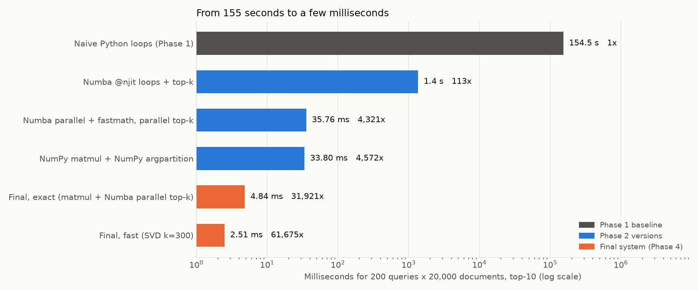
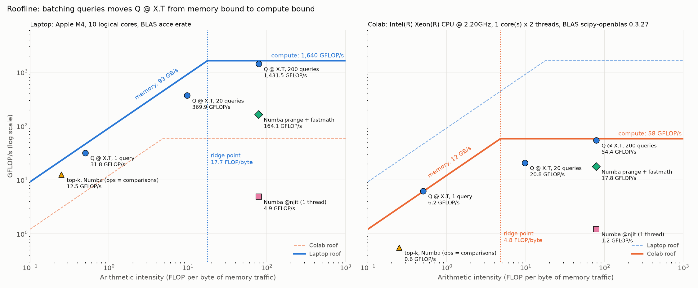

# High-Performance Similarity Search Engine

YZM 513 – Project 1. Top-10 semantic search over **20,000 arXiv abstracts (cs.AI / cs.CL / cs.LG, 2025–2026)** with 200 queries, taken from a naive pure-Python baseline to a system that is **~32,000× faster with identical results**.

| Version (200 queries × 20,000 docs, top-10) | Time | Speedup |
|---|---:|---:|
| Naive Python loops (Phase 1 baseline) | 155 s | 1× |
| Numba `@njit` loops | 1.37 s | 113× |
| Numba parallel + fastmath | 35.8 ms | 4,300× |
| NumPy matmul + NumPy argpartition | 33.8 ms | 4,600× |
| **Final, exact** (NumPy matmul + Numba parallel top-k) | **4.84 ms** | **31,900×** |
| Final, fast (our SVD, k = 300, recall@10 = 0.95) | 2.51 ms | 61,700× |

All rows were measured in the same run (`results/phase4_overview.csv`); the naive time is 5 queries timed and scaled to 200. Across runs the exact mode takes 4.5–5.0 ms. The exact mode returns the same top-10 lists as the baseline for all 200 queries (max score difference 8.4e-7, tolerance 1e-5). One query takes 0.87 ms to search (benchmarked); the live demo also spends ~15–19 ms embedding the query sentence.



## Hardware and software
Apple M4 (4 performance + 6 efficiency cores), 16 GB RAM, macOS; Python 3.13.7, NumPy 2.5.4 with Apple Accelerate (BLAS), Numba 0.68.1. Details: `results/environment.json`.

The matrix multiply `Q @ X.T` reaches 1,265 GFLOP/s with a single BLAS thread, and 2–10 threads add at most 6% (`results/extra_blas_threads.csv`). That is about 9× a rough single-core SIMD peak, which is consistent with Accelerate running it on Apple's on-chip matrix unit (AMX/SME). It explains two findings: NumPy beats every hand-written loop, and extra CPU threads barely speed up the matrix multiply (see Phase 3).

## Bonus: laptop vs Google Colab, and a roofline model

The same code, data and benchmark rules (`src/machine_bench.py`) were run on the laptop and on a free Colab CPU runtime (Intel Xeon @ 2.20 GHz, **1 physical core × 2 hyperthreads**, AVX2, OpenBLAS). Write-up: [docs/08](docs/08_bonus_colab_roofline.md) (Turkish).

| 200 queries × 20,000 docs | Laptop | Colab | Colab slower by |
|---|---:|---:|---:|
| Naive Python loops | 151.8 s | 649.9 s | 4.3× |
| Numba `@njit` loops | 1.36 s | 5.15 s | 3.8× |
| NumPy matmul + argpartition | 34.3 ms | 153.4 ms | 4.5× |
| **Final, exact** | **4.99 ms** | **120.0 ms** | 24× |
| Final, fast (SVD k = 300) | 2.68 ms | 55.6 ms | 20.8× |

- **How much slower Colab is depends on which part of the machine the code uses:**
  - single-core scalar code: ~4×;
  - memory bandwidth (92.5 vs 12.2 GB/s): 7.6×;
  - matrix multiply (1,640 vs 58 GFLOP/s), which on the laptop runs on the matrix unit: 21–28×.
- **The optimisation ranking is the same on both machines**, and the exact mode returns the identical top-10 lists for all 200 queries on both (ARM + Accelerate vs x86 + OpenBLAS).
- **The bottleneck moves.**
  - On the laptop, top-k takes 87% of the NumPy version, so our Numba top-k gives 6.9×.
  - On Colab the matrix multiply dominates (72%), and the same change gives only 1.28× (Amdahl).
- **Colab's 2 vCPUs are one core:**
  - BLAS threads give 1.05×;
  - a process pool gives 1.04× on pure Python (laptop: 4.76×).
- **Roofline (Figure 9):**
  - One query (0.5 FLOP/byte) sits on the memory roof of both machines.
  - 200 queries (78.7 FLOP/byte) reach 87% (laptop) and 93% (Colab) of peak compute.
  - The ridge point is 17.7 FLOP/byte on the laptop and 4.8 on Colab, so a batch needs about 38 queries on the laptop, but only about 10 on Colab, to become compute bound.



## Quick start

```bash
python3 -m venv .venv
.venv/bin/pip install -r requirements.txt

# 1. dataset: arXiv API, ~10 min (rate-limited), see data/dataset_card.md
.venv/bin/python src/data_prep.py

# 2. vectors: TF-IDF + mpnet (768-d) + MiniLM (384-d); ~20 min on Apple GPU (mps), longer on CPU
.venv/bin/python src/embed.py

# 3. live demo
.venv/bin/python demo.py               # exact mode
.venv/bin/python demo.py --fast        # SVD k=300 mode
```

## Reproducing every result

All benchmarks use warmup runs and ≥ 5 timed runs (median), enforced by `src/benchmark_utils.py`. Raw timings go to `results/`, figures to `figures/`.

| Phase | Command | Time | Output |
|---|---|---:|---|
| 1 Baseline + profiling | `.venv/bin/python src/phase1_naive_search.py bench` | ~3 min | `results/phase1_baseline.csv` |
| | `.venv/bin/python src/phase1_profiling.py` | ~2 min | Figure 1, cProfile / line_profiler output |
| | `.venv/bin/python src/phase1_naive_search.py reference` | ~3 min | top-10 reference for the correctness checks |
| 2A Sparse vs dense | `.venv/bin/python src/phase2a_sparse_dense.py` | ~4 min | Figure 2 (needs ~2 GB RAM) |
| 2B Dimensionality reduction | `.venv/bin/python src/phase2b_svd.py` | ~11 min | Figure 3 |
| 2C Loops vs NumPy vs Numba | `.venv/bin/python src/phase2c_vectorise.py` | ~3 min | Figure 4 |
| 3 Parallelism | `.venv/bin/python src/phase3_parallel.py --all` | ~15 min | Figure 5 (87 configurations) |
| 4 Final system | `.venv/bin/python src/phase4_final.py` | ~4 min | Figures 6 and 7 |
| Supporting numbers | `.venv/bin/python src/extra_measurements.py` | ~2 min | model overlap, query-encode latency (CPU vs MPS), BLAS thread scaling |
| Bonus: laptop run | `.venv/bin/python src/machine_bench.py --name laptop` | ~1 min | `results/machine_laptop.json` |
| Bonus: Colab run | `.venv/bin/python src/machine_bench.py --pack`, upload `colab_pack.zip` to Drive, run `notebooks/colab_machine_bench.ipynb` | ~5 min on Colab | `results/machine_colab.json` |
| Bonus: comparison | `.venv/bin/python src/machine_compare.py` | seconds | Figures 8 and 9, `results/machine_comparison.csv` |

Every script that draws a figure also accepts `--plot-only` to redraw it from the saved results.

## Figures

| # | File | Conclusion |
|---|---|---|
| 1 | `fig1_profile.png`, `fig1b_cprofile.png` | 99.5% of the naive time is the element-wise cosine loop; 58% is recomputing norms of unit vectors; the full sort is only 0.3%. |
| 2 | `fig2_sparse_dense.png` | TF-IDF takes 15 MB as CSR vs 2,075 MB dense; an inverted index searches it 730× faster than our dense mpnet loop. |
| 3 | `fig3_svd.png` | At k = 100 our block power iteration is 5.0× and TruncatedSVD 3.2× faster than a float32 full SVD; uncentred SVD and PCA with its mean added back both reach recall@10 = 0.95 at k = 300, while cosine in centred PCA coordinates stalls at 0.74. |
| 4 | `fig4_vectorise.png` | NumPy is 3,700× faster than Python loops and beats Numba on matrix multiply; Numba wins 22–98× on top-k, which has no BLAS equivalent. |
| 5 | `fig5_parallel.png` | CPU-bound search scales 4.5× on 10 asymmetric cores; threads give 1.0× on pure Python (GIL); no explicit parallelism beats a single BLAS call on the matrix unit. |
| 6 | `fig6_scaling.png` | Batch search scales linearly (~250 µs per 1,000 docs) up to 200K docs; a single query slows down 3.7× from 5K to 10K docs, where the corpus outgrows the 16 MB L2 cache. |
| 7 | `fig7_overview.png` | Every step of the story on one task: 113× → 4,300× → 4,600× → 31,900× (exact) → 61,700× (fast). |
| 8 | `fig8_machines.png` | Laptop vs Colab: Colab is 4× slower on scalar code, 7.6× on memory bandwidth, 21–28× on matrix multiply; its 2 vCPUs give no parallel speedup. |
| 9 | `fig9_roofline.png` | Roofline of both machines: batching moves `Q @ X.T` from the memory roof (1 query) to 87–93% of peak compute (200 queries). |

## Repository layout

```
├── demo.py                      live demo
├── requirements.txt
├── src/
│   ├── data_prep.py             download + clean the arXiv dataset
│   ├── embed.py                 TF-IDF, mpnet, MiniLM vectors (offline)
│   ├── benchmark_utils.py       warmup + >= 5 runs + median, CSV rows, environment info
│   ├── data_utils.py            shared paths and loaders
│   ├── kernels.py               our similarity / top-k kernels (Python, Numba)
│   ├── svd_power.py             our power-iteration and block power-iteration SVD
│   ├── phase1_naive_search.py   naive baseline + reference results
│   ├── phase1_profiling.py      cProfile, line_profiler, time breakdown
│   ├── phase2a_sparse_dense.py  sparse vs dense
│   ├── phase2b_svd.py           SVD / TruncatedSVD / PCA comparison
│   ├── phase2c_vectorise.py     Python vs NumPy vs Numba (+ top-k)
│   ├── phase3_parallel.py       7 parallel strategies x 3 workloads
│   ├── phase3_plot.py           Amdahl fit + Figure 5
│   ├── search_engine.py         the final system
│   ├── phase4_final.py          correctness, scaling, overview
│   ├── extra_measurements.py    model overlap, encode latency, BLAS threads
│   ├── machine_bench.py         bonus: portable benchmark suite for laptop and Colab
│   └── machine_compare.py       bonus: laptop vs Colab table, Figures 8 and 9
├── notebooks/
│   └── colab_machine_bench.ipynb  runs machine_bench.py on Google Colab
├── data/                        dataset card + stats, embeddings/meta.json, embeddings/corpus_ids.txt (large files rebuilt by the scripts)
├── results/                     raw benchmark data (CSV / JSON)
├── figures/                     all figures, generated by code
└── docs/                        step-by-step explanations (Turkish)
```

## Detailed write-ups (Turkish)
1. [Vectorisation](docs/01_vektorlestirme.md): dataset, TF-IDF, CSR, mpnet
2. [Phase 1](docs/02_phase1_baseline.md): baseline and profiling
3. [Phase 2A](docs/03_phase2a_sparse_dense.md): sparse vs dense
4. [Phase 2B](docs/04_phase2b_svd.md): dimensionality reduction
5. [Phase 2C](docs/05_phase2c_vectorise.md): loops vs NumPy vs Numba
6. [Phase 3](docs/06_phase3_parallel.md): parallelism and concurrency
7. [Phase 4](docs/07_phase4_final.md): final system and scaling
8. [Bonus](docs/08_bonus_colab_roofline.md): laptop vs Colab, roofline model

## Notes
- **Dataset:** `src/data_prep.py` queries the arXiv API (3 categories × 22 months × 3 windows). Raw responses are cached in `data/raw/`, so reruns do not hit the API again. Preprocessing and statistics: `data/dataset_card.md`.
- **SSL on python.org builds of Python (macOS):** `data_prep.py` uses `certifi` certificates automatically; verification stays on.
- **Embedding time** is excluded from all benchmarks (project FAQ). The demo prints it separately.
- **Synthetic data** (50K–200K documents) is used only in Phase 4, only to time the 10× scale-up question. All quality and correctness numbers come from the real corpus.
