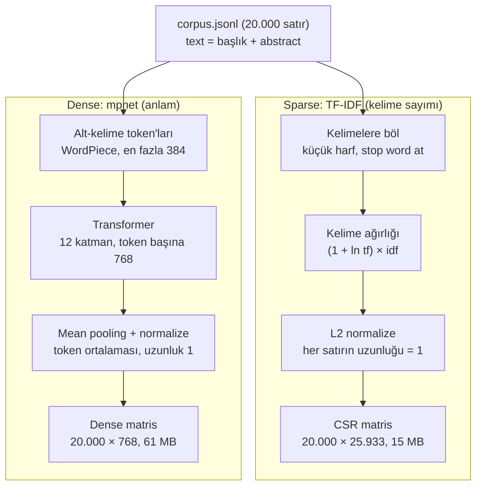

# Vektörleştirme: Metinden Vektöre

Bu doküman, 20.000 arXiv abstract'ını ve 200 query'yi nasıl vektörlere çevirdiğimizi kod parçalarıyla ve kendi verimizden çıkan gerçek sayılarla açıklar.

İlgili dosyalar: [`src/data_prep.py`](../src/data_prep.py), [`src/embed.py`](../src/embed.py). Çıktılar `data/embeddings/` klasöründe.

Kısaca: aynı metni **iki farklı yolla** sayıya çevirdik.

- **TF-IDF (sparse):** Metinde hangi kelimelerin geçtiğine bakar.
- **mpnet (dense):** Metnin ne anlattığına bakar.



---

## 0. Neden vektör?

Bilgisayar iki metnin "benzer" olup olmadığını doğrudan anlayamaz. Bu yüzden her metni sabit uzunlukta bir sayı dizisine (vektöre) çeviriyoruz. Benzerliği de iki vektör arasındaki açıyla ölçüyoruz; buna **cosine similarity** denir:

$$\cos(q, d) = \frac{q \cdot d}{\|q\| \, \|d\|}$$

Değer 1'e ne kadar yakınsa iki metin o kadar benzer. Projenin tamamı bu formülü 200 query × 20.000 doküman için olabildiğince hızlı hesaplamak üzerine kurulu.

---

## 1. Hangi metni vektöre çeviriyoruz? (`data_prep.py`)

```python
def clean(s):
    return re.sub(r"\s+", " ", s or "").strip()
```

arXiv'den gelen abstract'larda satır sonları ve fazla boşluklar var.

- `\s+` art arda gelen tüm boşluk karakterlerini (boşluk, `\n`, tab) yakalar ve hepsini tek bir boşluğa indirir.
- `s or ""` metin boş (`None`) gelirse hata çıkmasını engeller.
- `.strip()` baştaki ve sondaki boşlukları siler.

```python
p["text"] = f"{p['title']}. {p['abstract']}"                     # doküman
...
{"query_id": i, "query": p["title"], **p}                        # query
```

- **Doküman = başlık + abstract.** Başlık konuyu en yoğun anlatan cümle, abstract da detayı veriyor. İkisi birlikte en zengin temsili sağlıyor.
- **Query = sadece başlık** (ortalama ~10 kelime). Gerçek aramaya benziyor: kullanıcı kısa bir ifade yazar, sistem uzun dokümanlar arasında arar.
- Query'si alınan makaleler corpus'ta **yok**. Yani query kendi makalesini bulup kolayca 1.0 skor alamaz.

---

## 2. Verinin yüklenmesi (`embed.py`, `main`)

```python
corpus = load_jsonl(DATA / "corpus.jsonl")
docs = [d["text"] for d in corpus]
queries = [q["query"] for q in qrows]
(OUT / "corpus_ids.txt").write_text("\n".join(d["id"] for d in corpus) + "\n")
```

Buradaki önemli kural **satır hizası**: tüm matrislerde i. satır, `corpus.jsonl`'daki i. satıra karşılık gelir. Arama "en benzer doküman 4970. satır" dediğinde başlığını `corpus[4970]`'den okuruz. `corpus_ids.txt` bu hizanın yedeğidir.

---

## 3. TF-IDF (sparse yol)

### 3.1 Fikir

Bir kelime bir dokümanı iki koşulda iyi temsil eder:

- O dokümanda geçiyorsa (**TF**, term frequency)
- Diğer dokümanlarda nadir geçiyorsa (**IDF**, inverse document frequency)

"language" gibi her yerde geçen bir kelime ayırt edici değildir. "quantum" ise nadirdir, bu yüzden güçlü bir sinyaldir.

### 3.2 Kod

```python
vec = TfidfVectorizer(
    stop_words="english",
    sublinear_tf=True,
    min_df=2,
    max_df=0.5,
    dtype=np.float32,
)
X = vec.fit_transform(docs).tocsr()
Q = vec.transform(queries).tocsr()
```

| Parametre | Ne yapıyor | Neden |
|---|---|---|
| (varsayılan) `lowercase=True` | "LLM" → "llm" | Aynı kelime büyük/küçük harf yüzünden iki ayrı kelime sayılmasın |
| (varsayılan) regex `\b\w\w+\b` | En az 2 harfli kelimeleri alır, noktalamayı atar | "Gromov-Wasserstein" → "gromov" ve "wasserstein" |
| `stop_words="english"` | ~318 yaygın kelimeyi atar (the, of, via, …) | Anlam taşımıyorlar. Örneğin query 0'daki "via" atıldı |
| `sublinear_tf=True` | tf yerine 1 + ln(tf) kullanır | 10 kez geçen kelime 10 kat değil, ~3,3 kat önemli sayılır |
| `min_df=2` | Sadece 1 dokümanda geçen kelimeleri atar | 31.336 kelime gitti, çoğu "000213" gibi sayı ya da yazım hatası. Kelime sayısı 57.271 → 25.933 oldu |
| `max_df=0.5` | Dokümanların yarısından fazlasında geçen kelimeleri atar | Sadece "models" (%62) ve "model" (%53) atıldı; neredeyse her abstract'ta geçiyorlar |
| `dtype=np.float32` | 8 yerine 4 byte'lık sayı | Bellek yarıya iniyor, dense embedding'lerle de aynı tip oluyor. 2A karşılaştırması adil olsun |

### 3.3 Gerçek örnek: query 0

Query: *"Latent Bayesian Optimization via Autoregressive Normalizing Flows"*

| Kelime | IDF | Son ağırlık |
|---|---|---|
| normalizing | 6.97 | 0.560 |
| flows | 5.77 | 0.464 |
| bayesian | 4.92 | 0.396 |
| autoregressive | 4.89 | 0.393 |
| latent | 3.91 | 0.314 |
| optimization | 3.08 | 0.247 |

Ağırlık hesabı adım adım:

1. **TF:** Her kelime query'de 1 kez geçiyor, 1 + ln(1) = 1.
2. **IDF:** sklearn şu formülü kullanır:

   $$\text{idf}(t) = \ln\frac{1+N}{1+\text{df}(t)} + 1$$

   - "language" 8.949 dokümanda geçiyor → idf 1.80 (yaygın, düşük)
   - "llm" 4.259 dokümanda → idf 2.55
   - "transformer" 1.241 dokümanda → idf 3.78
   - "quantum" 219 dokümanda geçiyor → idf 5.51 (nadir, yüksek)
3. **TF × IDF:** TF = 1 olduğu için ağırlık doğrudan IDF'e eşit.
4. **L2 normalize:** Vektör kendi uzunluğuna bölünür. √(6.97² + 5.77² + … + 3.08²) = 12.44, yani "normalizing" için 6.97 / 12.44 = **0.560**. Satırın uzunluğu artık tam 1.0.

Normalizasyonun anlamı: tüm vektörlerin uzunluğu 1 olunca cosine formülündeki payda 1 × 1 = 1 olur. **Cosine similarity düz bir dot product'a dönüşür.**

### 3.4 `fit_transform` ve `transform` farkı

- **`fit_transform(docs)`** iki iş yapar. Önce corpus'tan sözlüğü (25.933 kelime) ve IDF değerlerini *öğrenir*, sonra dokümanları çevirir.
- **`transform(queries)`** hiçbir şey öğrenmez. Query'leri aynı sözlük ve aynı IDF'lerle çevirir.

Neden böyle?

- Query vektörü dokümanlarla **aynı 25.933 sütunda** olmalı; yoksa dot product alınamaz.
- Gerçek bir sistemde query'ler sonradan gelir; her query'de sözlüğü baştan kurmak mümkün değil.
- Sözlükte olmayan kelimeler sessizce atlanır. Bir query'nin hiçbir kelimesi sözlükte yoksa vektörü tamamen sıfır olur ve cosine hesabında sıfıra bölme hatası çıkar. Bu yüzden `queries_with_zero_terms` değerini kontrol ettik: **0**. Query başına ortalama 7,7 kelime eşleşti.

### 3.5 CSR formatı: matris bellekte nasıl tutuluyor?

20.000 × 25.933 matrisin %99,6'sı sıfır, çünkü bir doküman 25.933 kelimenin ortalama sadece 96'sını içeriyor. Bütün sıfırları saklamak yerine **CSR** (Compressed Sparse Row) formatı yalnızca sıfır olmayan değerleri üç dizide tutar:

| Dizi | İçerik | Bizdeki boyut |
|---|---|---|
| `data` | Sıfır olmayan değerler (float32) | 1.919.982 eleman |
| `indices` | Her değerin sütunu, yani kelime id'si (int32) | 1.919.982 eleman |
| `indptr` | Her satırın `data` içinde nerede başladığı (int32) | 20.001 eleman (N+1) |

Gerçek değerler: `indptr[:4] = [0, 85, 227, 338]`

- 0. dokümanın değerleri `data[0:85]` aralığında, yani 85 farklı kelime içeriyor.
- 1. dokümanın değerleri `data[85:227]` aralığında, yani 142 kelime.
- 0. dokümanın ilk girdileri: `(10812, 'gromov', 0.233)`, `(25381, 'wasserstein', 0.267)`, `(18855, 'quantization', 0.268)` …

Bellek hesabı:

```
data     1.919.982 × 4 byte = 7,68 MB
indices  1.919.982 × 4 byte = 7,68 MB
indptr      20.001 × 4 byte = 0,08 MB
                      toplam = 15,4 MB
dense:  20.000 × 25.933 × 4 = 2.070 MB  → ~134 kat fark
```

`.tocsr()` ile CSR'yi seçtik, çünkü aramada her doküman bir **satır** ve satırları tek tek geziyoruz. Phase 2A'da kendi sparse dot product'ımızı yazarken tam olarak bu üç diziyi kullanacağız: `data[j] * query[indices[j]]` toplamı.

### 3.6 Kaydetme

```python
sp.save_npz(OUT / "tfidf_corpus.npz", X)          # CSR'nin 3 dizisini sıkıştırıp kaydeder
pickle.dump(vec, f)                               # sözlük + IDF'ler
```

Vectorizer'ı canlı demo için kaydettik. Kullanıcı yeni bir cümle yazdığında `vec.transform([cümle])` aynı sözlükle çevrilecek.

---

## 4. Dense embedding (mpnet)

### 4.1 Fikir

`all-mpnet-base-v2`, 110 milyon parametreli bir transformer modelidir. 1 milyardan fazla "anlamca eşleşen cümle çifti" ile eğitilmiştir. Eğitimin mantığı: eşleşen çiftlerin vektörlerini birbirine yaklaştırmak, eşleşmeyenleri uzaklaştırmak (contrastive learning). Sonuçta **aynı kelimeler geçmese bile** benzer anlamdaki metinler yakın vektörler alır. TF-IDF bunu yapamaz.

### 4.2 Model yükleme

```python
device = "mps" if torch.backends.mps.is_available() else "cuda" if torch.cuda.is_available() else "cpu"
model = SentenceTransformer(MODELS[key], device=device)
```

- Model ilk çalışmada HuggingFace'ten indirildi (~420 MB) ve `~/.cache/huggingface` klasörüne kaydedildi.
- **MPS** Apple M4'ün kendi GPU'su. Kod sırayla MPS, CUDA ve en son CPU'yu dener.
- Bu, ödevin "ücretli GPU yok" kuralını ihlal etmez. Laptop'un kendi GPU'su ve yalnızca bu tek seferlik hazırlıkta kullanıldı. FAQ'ya göre embedding süresi benchmark'a dahil değil; Phase 1–4 ölçümlerinin hepsi CPU'da yapılacak.

### 4.3 Tokenizasyon: metin parçalara nasıl bölünüyor?

Model kelimeleri değil **alt-kelimeleri** (WordPiece) görür. Sözlükte 30.527 parça var. Query 0 şöyle bölündü:

```
['late', '##nt', 'bay', '##esian', 'optimization', 'via',
 'auto', '##re', '##gre', '##ssi', '##ve', 'normal', '##izing', 'flows']
```

- `##` "önceki parçanın devamı" demek.
- Sözlükte olmayan "autoregressive" bilinen parçalara bölündü; model hiçbir kelimeyi "bilmiyorum" diye atmaz.
- TF-IDF'ten bir fark: orada "via" stop word olduğu için atılmıştı, burada duruyor.

```python
lengths = [len(ids) for ids in tok(docs, add_special_tokens=True)["input_ids"]]
```

Bu satır sadece rapor için token sayar. Sonuçlar:

- Doküman başına ortalama **282 token**, kelime sayısı ise 190. Bilimsel kelimeler çok parçaya bölündüğü için kelime başına ~1,5 token düşüyor.
- mpnet en fazla **384 token** okuyor. **1.449 doküman (%7)** bu sınırda kesildi ve abstract'larının son kısmı kayboldu.
- Çalışırken görülen "503 > 384" uyarısı bu sayma adımından geliyor ve zararsız. Asıl `encode()` adımı kesmeyi kendisi yapıyor.

### 4.4 `encode` içinde neler oluyor?

```python
X = model.encode(docs, batch_size=64, show_progress_bar=True, convert_to_numpy=True)
```

1. **Batch:** 64 metin aynı anda GPU'ya gönderilir; GPU bu metinleri paralel işler. Bir batch'teki metinler en uzununa göre doldurulur (padding). Kütüphane metinleri uzunluğa göre sıralayıp batch'ler ve gereksiz dolguyu azaltır, sonra sonuçları orijinal sıraya geri koyar.
2. **Transformer (12 katman):** Her token önce 768 sayılık bir vektöre çevrilir. Her katmanda **self-attention** ile metindeki diğer tüm token'lara bakıp vektörünü günceller. Böylece "normalizing"in yanındaki "flows" ile "traffic flows" içindeki "flows" farklı vektörler alır; bağlam anlamı belirler.
3. **Mean pooling:** Metindeki tüm token vektörlerinin ortalaması alınır. Padding token'ları hesaba katılmaz. Sonuç: doküman başına tek bir 768 boyutlu vektör.
4. **Normalize:** Vektör kendi uzunluğuna bölünür, uzunluğu 1 olur.

Sonuç matrisi (20.000 × 768). Query'ler de aynı modelden geçti (200 × 768); aynı model olduğu için aynı uzaydalar ve karşılaştırılabilirler.

### 4.5 Bellek düzeni

```python
X = np.ascontiguousarray(X, dtype=np.float32)
```

- **float32:** 20.000 × 768 × 4 byte = **61,4 MB**. float64 olsaydı 123 MB olurdu. Dosya boyutu 61.440.128 byte; bunun 128 byte'ı `.npy` başlığı.
- **C-contiguous:** Her satırın 768 sayısı RAM'de yan yana durur (row-major). Bir dokümanı okurken CPU tek seferde ardışık bellek okur ve cache verimli kullanılır. BLAS (NumPy'nin `@` işlemi) ve Numba bu düzeni bekler. Phase 2'deki memory layout tartışmasının temeli bu.

### 4.6 Norm kontrolü

```python
norms = np.linalg.norm(X, axis=1)
"unit_norm": bool(np.allclose(norms, 1.0, atol=1e-3))   # sonuç: True
```

Tüm vektörlerin uzunluğu 1 çıktı. Yani mpnet için de **cosine = dot product**.

- Final sistemde norm hesabı tamamen atlanabilir.
- Naive baseline'da norm'ları yine her seferinde hesaplayacağız. Bu hem dürüst bir "yavaş" başlangıç, hem de profiling'de görülecek bottleneck'lerden biri.

### 4.7 MiniLM'i neden de ürettik?

`all-MiniLM-L6-v2`: 6 katman, 384 boyut, 22 milyon parametre, en fazla 256 token.

- **Süre:** mpnet 1.035 sn, MiniLM 88 sn sürdü (~12 kat fark). Sebebi kabaca:
  - Token başına hesap yükü ≈ katman sayısı × boyut². (12 × 768²) / (6 × 384²) = **8 kat**.
  - Kalan fark: mpnet daha uzun metin okuyor (384'e karşı 256 token) ve attention maliyeti metin uzunluğunun karesiyle artıyor.
  - Raporda HPC bağlantısı olarak kullanılabilir.
- **Kayıp:** MiniLM **12.621 dokümanı (%63)** 256 token'da kesti; çoğu abstract'ın sonu kayboldu. mpnet'i ana model seçmemizin sebebi bu.
- İki modelin ilk 10 sonucu sadece %36 örtüşüyor. Yani "tek doğru sonuç" yok. Ödevdeki doğruluk kontrolü bu yüzden **optimize edilmiş kodu, aynı vektörler üzerinde çalışan naive kodla** karşılaştırmak demek.

---

## 5. Çıkan dosyalar (`data/embeddings/`)

| Dosya | Şekil | Ne için |
|---|---|---|
| `tfidf_corpus.npz` / `tfidf_queries.npz` | 20.000 × 25.933 / 200 × 25.933 | 2A sparse deneyleri |
| `tfidf_vectorizer.pkl` | — | Demo'da yeni query'yi çevirmek |
| `mpnet_corpus.npy` / `mpnet_queries.npy` | 20.000 × 768 / 200 × 768 | Ana dense temsil (Phase 1–4) |
| `minilm_corpus.npy` / `minilm_queries.npy` | 20.000 × 384 / 200 × 384 | Karşılaştırma |
| `corpus_ids.txt`, `meta.json` | — | Satır hizası + rapor istatistikleri |

Yeniden üretmek için:

```bash
python3 src/data_prep.py            # arXiv'den indir + temizle
.venv/bin/python src/embed.py       # TF-IDF + mpnet + MiniLM
```

---

## 6. Kontrol: iki yöntem farklı şeyler buluyor

Her query için ilk 10 sonuca bakınca mpnet ve TF-IDF ortalamada sadece **%16** örtüşüyor.

- *"Correct, Concise and Complete: … Adaptive Reasoning"* query'sinde TF-IDF içinde "concise" ve "adaptive" kelimeleri geçen makaleleri buldu. mpnet ise bu kelimeler geçmese bile "reasoning distillation" ve "curriculum" gibi aynı konudaki makaleleri buldu.
- Query 0'da TF-IDF "flows" kelimesine takıldı ve normalizing flow makalelerini getirdi. mpnet ise Bayesian optimization makalelerini getirdi.

---

## 7. Sunumda gelebilecek sorular

- **TF-IDF'i neden sadece corpus'a fit ettiniz?** Query'lerin aynı sütun uzayında olması için. Ayrıca gerçek sistemde query'ler sonradan gelir.
- **Neden float32?** Bellek yarıya iniyor. Arama skorlarında float64'ün ek hassasiyetine ihtiyaç yok.
- **Neden CSR, CSC değil?** Arama satır satır (doküman doküman) ilerliyor. CSR satıra erişimde hızlı, CSC sütuna erişimde.
- **IDF'i en yüksek kelime hangisi olur?** Sadece birkaç dokümanda geçen kelime. Örneğin "quantum" (219 doküman) 5.51 alıyor, "language" (8.949 doküman) 1.80.
- **Vektörler normalize ise naive kodda norm hesaplamak gereksiz değil mi?** Evet, gereksiz. Bu yüzden profiling'de bottleneck olarak çıkacak ve optimizasyonla kaldıracağız.
- **Embedding'de GPU kullanmak kurala aykırı mı?** Hayır. Laptop'un kendi GPU'su, sadece hazırlık için kullanıldı ve FAQ embedding süresini benchmark dışında tutuyor.
- **Neden mpnet, MiniLM değil?** MiniLM dokümanların %63'ünü kesiyor. Ayrıca 768 boyut, ödevin boyut indirgeme (2B) senaryosuna birebir uyuyor.
