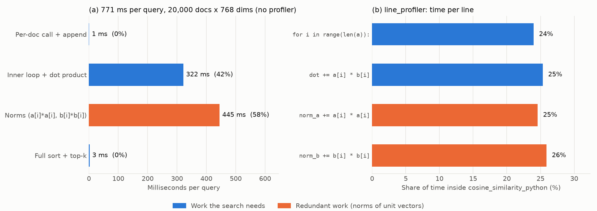

# Phase 1: Baseline ve Profiling

Bu dokümanda kasıtlı olarak yavaş yazılmış naive aramayı, nasıl ölçtüğümüzü ve zamanın nereye gittiğini açıklıyoruz.

İlgili dosyalar:
[`src/benchmark_utils.py`](../src/benchmark_utils.py),
[`src/data_utils.py`](../src/data_utils.py),
[`src/phase1_naive_search.py`](../src/phase1_naive_search.py),
[`src/phase1_profiling.py`](../src/phase1_profiling.py).
Ham sonuçlar `results/`, figürler `figures/` klasöründe.

## Özet

| Soru | Cevap |
|---|---|
| Baseline süresi (20.000 doküman, 768 boyut) | **791 ms / query** (20 query, 2 warmup + 5 run, median) |
| 200 query'nin tamamı | ~158 sn (tahmini); tek seferlik referans çalıştırması **185 sn** sürdü (warmup'sız, tek ölçüm; benchmark değil) |
| Süre nasıl büyüyor? | Doküman sayısıyla **doğrusal**: her boyutta doküman başına ~39 µs |
| Zaman nereye gidiyor? | %99,5'i element-element cosine döngüsünde, **%58'i norm hesabında** |
| Sort bottleneck mi? | **Hayır**: sadece %0,3 (query başına 2,5 ms) |
| Veri düzeninin bedeli | Python listeleri NumPy dizisinden **8 kat** fazla bellek tutuyor (493 MB'a karşı 61 MB) |

---

## 1. Ödevde ne istendi?

1. Veriyi vektöre çevir. (Önceki adımda yapıldı: [01_vektorlestirme.md](01_vektorlestirme.md).)
2. Saf Python ile (nested loop, element-element cosine) naive bir arama yaz.
3. `cProfile` ve `line_profiler` ile profille ve en büyük 3 bottleneck'i bul.
4. Baseline süresini kaydet.

Teslim edilecekler: baseline süresi, profiling ekran görüntüsü ve bottleneck listesi.

---

## 2. Ortak ölçüm aracı: `benchmark_utils.py`

Ödevin kuralı: her benchmark'ta **warmup** ve **en az 5 ölçüm** olmalı; olmazsa -10 puan. Bu kuralı tek bir fonksiyona koyduk ve tüm fazlar bunu kullanacak.

```python
MIN_RUNS = 5

def benchmark(func, *args, warmup=3, runs=5, **kwargs):
    if runs < MIN_RUNS or warmup < 1:
        raise ValueError(f"project rule: warmup >= 1 and runs >= {MIN_RUNS}")

    for _ in range(warmup):
        result = func(*args, **kwargs)

    times = []
    for _ in range(runs):
        t0 = time.perf_counter()
        result = func(*args, **kwargs)
        times.append(time.perf_counter() - t0)

    return {
        "median_s": statistics.median(times),
        "mean_s": statistics.mean(times),
        "std_s": statistics.stdev(times),
        ...
        "times": times,
        "result": result,
    }
```

Satır satır:

- **`if runs < MIN_RUNS or warmup < 1: raise`**: Kuralı kodun kendisi zorunlu kılıyor. Yanlışlıkla `runs=1` ile ölçüm yapılırsa program hata verir; cezalı bir benchmark rapora giremez.
- **Warmup döngüsü**: Sonuçlar atılır. İlk çalıştırmalarda CPU cache'leri soğuk, bellek ayırıcı ısınmamış olur; Numba'da da ilk çağrı derleme süresini içerir (Phase 2'de kritik).
- **`time.perf_counter()`**: Python'daki en hassas saat. Duvar saatinden (`time.time()`) farklı olarak geri gitmez ve nanosaniye çözünürlüğüne yakındır.
- **Median**: Tek bir yavaş ölçüm (işletim sistemi başka bir işi araya soktuğunda) ortalamayı kaydırır ama median'ı neredeyse etkilemez. Ortalama ve standart sapmayı da kaydediyoruz ki rapor dağılımı gösterebilsin.
- **`"times": times`**: Her ham ölçüm CSV'ye yazılıyor. Ödev "raw benchmark data" istiyor.
- **`"result": result`**: Son çalıştırmanın sonucu döndürülüyor; doğruluk kontrolü için gerekiyor.

Aynı dosyada iki yardımcı daha var:

- **`save_row(path, row)`**: Her ölçümü CSV'ye bir satır olarak ekler. Dosya ilk kez oluşturuluyorsa başlık satırını da yazar.
- **`environment_info()`**: İşlemci, çekirdek sayısı, RAM, Python/NumPy sürümü ve BLAS kütüphanesini toplar. Raporun Introduction bölümü bunu istiyor. Bizim makine: Apple M4 (4 performans + 6 verimlilik çekirdeği), 16 GB RAM, Python 3.13.7, NumPy 2.5.4, BLAS = Apple Accelerate. Kayıt: `results/environment.json`.

`data_utils.py` ise tüm fazların veriyi aynı şekilde yüklemesi için yol tanımları ve `load_dense(model, n_docs, n_queries)` fonksiyonunu içerir. Corpus sırası zaten rastgele olduğu için `X[:n]` rastgele bir alt küme verir; 1K/5K/10K/20K deneyleri bunu kullanıyor.

---

## 3. Naive arama: `phase1_naive_search.py`

Hocanın starter code'undaki yapıyı (`cosine_similarity_python` + `search_naive`) birebir koruduk ve TODO kısımlarını doldurduk.

### 3.1 Cosine similarity

```python
def cosine_similarity_python(a, b):
    dot = 0.0
    norm_a = 0.0
    norm_b = 0.0
    for i in range(len(a)):
        dot += a[i] * b[i]
        norm_a += a[i] * a[i]
        norm_b += b[i] * b[i]
    if norm_a == 0.0 or norm_b == 0.0:
        return 0.0
    return dot / (math.sqrt(norm_a) * math.sqrt(norm_b))
```

- Üç toplayıcı tek döngüde dolduruluyor: `dot` (iki vektörün çarpımı), `norm_a` ve `norm_b` (her vektörün kendi kare toplamı).
- Döngü 768 kez dönüyor; her turda 3 çarpma + 3 toplama yapılıyor.
- **`if norm_a == 0.0 ...`**: Sıfır vektör gelirse sıfıra bölmeyi engeller. Bizim verimizde böyle vektör yok, ama fonksiyon her girdide güvenli olmalı.
- **`math.sqrt`**: NumPy yok; starter code "bu fonksiyonun içinde NumPy kullanma" diyor.

Fonksiyonu bilerek "kötü" yazdık ama **hileli** değil: cosine formülünün en doğrudan Python karşılığı bu. Profiling hikayesinin dürüst olması için önemli.

### 3.2 Arama

```python
def search_naive(queries, corpus, k=10):
    results = []
    for query in queries:
        scores = []
        for d_idx, doc in enumerate(corpus):
            sim = cosine_similarity_python(query, doc)
            scores.append((d_idx, sim))
        scores.sort(key=lambda x: x[1], reverse=True)
        results.append(scores[:k])
    return results
```

- **Dış döngü**: Her query için ayrı bir skor listesi.
- **İç döngü**: 20.000 dokümanın hepsine cosine hesaplanıyor; `(doküman_no, skor)` çiftleri listeye ekleniyor.
- **`scores.sort(key=lambda x: x[1], reverse=True)`**: 20.000 skorun **tamamı** büyükten küçüğe sıralanıyor. `lambda x: x[1]` "çiftin ikinci elemanına (skora) göre sırala" demek.
- **`scores[:k]`**: Sadece ilk k=10 tanesi tutuluyor. Yani 20.000 elemanı sıralayıp 10'unu kullanıyoruz; bu israf ileride (Phase 4) önemli olacak.

### 3.3 Neden `.tolist()`?

```python
corpus = X.tolist()   # (N, 768) NumPy dizisi -> N tane 768 elemanlı Python listesi
```

Saf Python döngüsü, Python listeleri üzerinde NumPy dizisinden daha hızlı çalışıyor (bkz. Bölüm 6.4). Bu dönüşüm ölçülen sürenin **dışında** yapılıyor; çünkü arama sisteminin işi aramak, veri hazırlamak değil.

### 3.4 Doğruluk kontrolü

```python
def check_against_numpy(results, Q, X, k):
    Q64, X64 = Q.astype(np.float64), X.astype(np.float64)
    S = (Q64 @ X64.T) / np.outer(np.linalg.norm(Q64, axis=1), np.linalg.norm(X64, axis=1))
    ref = -np.sort(-S, axis=1)[:, :k]
    got = np.array([[s for _, s in r] for r in results])
    return float(np.max(np.abs(got - ref)))
```

- Aynı cosine'i NumPy ile float64 hassasiyetinde hesaplayıp naive sonuçla karşılaştırıyoruz.
- `-np.sort(-S)`: NumPy küçükten büyüğe sıralar; eksi ile çevirip büyükten küçüğe elde ediyoruz.
- **İndeksleri değil skorları** karşılaştırıyoruz. Eşit skorlu iki dokümanın sırası değişebilir; bu hata değil.
- Sonuç: tüm boyutlarda en büyük fark **~1,7 × 10⁻¹⁵**. Ödevin toleransı 1 × 10⁻⁵; naive kodumuz doğru.

### 3.5 Referans sonuçlar

`reference` modu 200 query'nin tamamını 20.000 dokümanda naive yöntemle bir kez çalıştırıp top-10 indeks ve skorları `results/phase1_reference_top10_mpnet.npz` dosyasına kaydediyor. Phase 2–4'teki her hızlandırılmış versiyon bu dosyaya karşı doğrulanacak (Phase 4'ün "correctness check" maddesi).

Bu çalıştırma 185 sn sürdü ve NumPy ile farkı 2,0 × 10⁻¹⁵ çıktı. 185 sn'lik süre benchmark değil: warmup yok, tek ölçüm var ve bir kısmı figür çizimiyle aynı anda çalıştı. Raporda baseline olarak Bölüm 4'teki median değerler kullanılmalı.

---

## 4. Baseline ölçümü

Ayar: 20 query, top-10, 2 warmup + 5 ölçüm, median. Saf Python çok yavaş olduğu için 200 yerine 20 query ile ölçüp **query başına süreyi** raporluyoruz.

| Doküman | 20 query (median) | Std | ms / query | µs / doküman | 200 query (tahmini) |
|---:|---:|---:|---:|---:|---:|
| 1.000 | 0,774 s | 0,009 s | 38,7 | 38,7 | 7,7 s |
| 5.000 | 3,794 s | 0,025 s | 189,7 | 37,9 | 37,9 s |
| 10.000 | 8,429 s | 0,513 s | 421,4 | 42,1 | 84,3 s |
| 20.000 | 15,830 s | 0,591 s | **791,5** | 39,6 | 158,3 s |

Okuma:

- **Doğrusal büyüme.** Doküman başına süre her boyutta ~39 µs. Doküman sayısı 20 katına çıkınca süre de ~20 katına çıkıyor. Beklenen: her doküman için aynı miktarda iş (768 × 3 çarpma-toplama) yapılıyor. Sort O(N log N) olsa da payı o kadar küçük ki eğriyi bozmuyor.
- **Eleman başına maliyet:** 39,6 µs / 768 ≈ **52 ns**. Bu sürede modern bir işlemci yüzlerce aritmetik işlem yapabilir; biz 6 yapıyoruz. Aradaki fark Python yorumlayıcısının maliyeti.
- **10K'daki yüksek std (0,51 s):** Kesin sebebini ölçmedik; olası bir açıklama, M4'te işletim sisteminin işlemi performans ve verimlilik çekirdekleri arasında taşıyabilmesi. Median kullanmamızın sebebi bu tür dalgalanmalar.
- **Etkileşimli değil:** 791 ms, bir kullanıcının "anında" diye algılayacağı ~100 ms sınırının çok üstünde. 200 query'nin tamamı ~2,6 dakika sürüyor.

Ham veri: `results/phase1_baseline.csv` (her satırda 5 ham ölçüm de var).

### Veri düzeninin bedeli

| Temsil | Bellek (20.000 × 768) |
|---|---:|
| NumPy float32 dizisi | 61,4 MB |
| Python listesi (`X.tolist()`) | **492,8 MB** (8 kat) |

Neden 8 kat? NumPy her sayıyı yan yana 4 byte olarak saklar. Python listesinde ise her sayı ayrı bir nesne (24 byte) ve liste her nesneye bir işaretçi (8 byte) tutar: 24 + 8 = 32 byte, yani 4 byte'ın 8 katı. Bu sayılar bellekte dağınık durur; CPU her `a[i]` için işaretçiyi takip edip nesneye gitmek zorunda kalır ve SIMD (tek komutla birden fazla sayıyı işleme) kullanamaz. Kayıt: `results/phase1_memory_layout.json`.

---

## 5. Profiling: zaman nereye gidiyor?

Dört farklı yöntem kullandık; her biri farklı bir soruyu cevaplıyor.

### 5.1 Manuel zaman ayrıştırması (profiler'sız)

Profiler'lar ölçtükleri kodu yavaşlatır ve bu yavaşlama her yere eşit dağılmaz. Bu yüzden önce **profiler kullanmadan** zamanı parçalara ayırdık. Fikir: aynı aramayı üç farklı benzerlik fonksiyonuyla çalıştırıp farkları almak.

```python
def no_op(a, b):
    return 0.0                      # hiç matematik yok: sadece çağrı + append maliyeti kalır

def dot_only_python(a, b):
    dot = 0.0
    for i in range(len(a)):
        dot += a[i] * b[i]          # norm toplayıcıları çıkarılmış hali
    return dot
```

```python
def timed_search(queries, corpus, sim):
    t_score = t_sort = 0.0
    for query in queries:
        t0 = time.perf_counter()
        scores = []
        for d_idx, doc in enumerate(corpus):
            scores.append((d_idx, sim(query, doc)))
        t1 = time.perf_counter()
        scores.sort(key=lambda x: x[1], reverse=True)
        scores[:K]
        t2 = time.perf_counter()
        t_score += t1 - t0
        t_sort += t2 - t1
    return t_score, t_sort
```

`timed_search`, `search_naive`'in aynısı; sadece iki kronometre eklendi: biri skorlama döngüsü, biri sort için. Kronometreler query başına sadece 3 kez okunuyor, ölçüme etkileri yok denecek kadar az.

Parçalar şöyle hesaplanıyor:

| Parça | Hesap |
|---|---|
| Doküman başına çağrı + append | `no_op` ile skorlama süresi |
| İç döngü + dot product | `dot_only` süresi − `no_op` süresi |
| Norm hesabı | tam cosine süresi − `dot_only` süresi |
| Sort + top-k | tam aramadaki sort süresi |

Sonuç (20.000 doküman, 5 query, her varyant 1 warmup + 5 ölçüm, median):

| Parça | ms / query | Pay | Tamamen kaldırılırsa en fazla hızlanma |
|---|---:|---:|---:|
| Norm hesabı | 445,2 | **%57,8** | 2,37× |
| İç döngü + dot product | 322,0 | %41,8 | 1,72× |
| Sort + top-k | 2,5 | %0,3 | 1,003× |
| Doküman başına çağrı + append | 1,1 | %0,1 | 1,001× |
| **Toplam** | **770,8** | | |

Son sütun **Amdahl Yasası**: bir parça toplam sürenin p kadarını alıyorsa, o parçayı tamamen yok etsek bile hızlanma en fazla 1 / (1 − p) olur. Sort'u sonsuz hızlı yapsak bile arama sadece %0,3 hızlanır.

### 5.2 cProfile: hangi fonksiyon?

```python
pr = cProfile.Profile()
pr.enable()
search_naive(queries, corpus, k=K)
pr.disable()
stats = pstats.Stats(pr).strip_dirs()
stats.sort_stats("tottime").print_stats(12)
```

cProfile her fonksiyon çağrısını sayar ve süresini toplar. `tottime` fonksiyonun kendi içinde geçen süre, `cumtime` çağırdığı fonksiyonlar dahil süre. 2 query × 20.000 doküman sonucu:

| Fonksiyon | Çağrı sayısı | tottime |
|---|---:|---:|
| `cosine_similarity_python` | 40.000 | **1,582 s** (%98,4) |
| `search_naive` | 1 | 0,011 s |
| `list.sort` | 2 | 0,006 s |
| `math.sqrt` | 80.000 | 0,003 s |
| `list.append` | 40.002 | 0,002 s |
| `len` | 40.000 | 0,002 s |
| `<lambda>` (sort anahtarı) | 40.000 | 0,002 s |

Ekran görüntüsü: `figures/fig1b_cprofile.png`. Tam çıktı: `results/phase1_cprofile.txt`.

cProfile'ın sınırı: sadece **fonksiyon** seviyesinde görüyor. "Zaman `cosine_similarity_python` içinde" diyor ama fonksiyonun içinde hangi satır olduğunu söyleyemiyor. Bunun için line_profiler gerekiyor. Profiler yükü burada küçük: 2 query profiler'sız ~1,54 s, profiler'la 1,61 s.

### 5.3 line_profiler: hangi satır?

```python
lp = LineProfiler(cosine_similarity_python, search_naive)
lp.runcall(search_naive, queries, corpus, K)
lp.print_stats(stream=text, output_unit=1e-3, stripzeros=True)
```

`LineProfiler`'a izlenecek fonksiyonları veriyoruz, `runcall` ile aramayı çalıştırıyoruz. `kernprof -l` komutuyla aynı işi yapar, ama script içinden çalıştığı için tek komutla tekrarlanabilir. 5 query × 1.000 doküman sonucu (`cosine_similarity_python` içi):

| Satır | Çalışma sayısı | Pay |
|---|---:|---:|
| `for i in range(len(a)):` | 3.845.000 | %24,0 |
| `dot += a[i] * b[i]` | 3.840.000 | %25,3 |
| `norm_a += a[i] * a[i]` | 3.840.000 | %24,6 |
| `norm_b += b[i] * b[i]` | 3.840.000 | %25,9 |
| `return dot / (sqrt * sqrt)` | 5.000 | %0,1 |

`search_naive` içinde ise `sim = cosine_similarity_python(...)` satırı %99,9, `scores.sort(...)` satırı %0,1.

Dikkat: line_profiler her satıra büyük bir yük ekliyor. Profiler'lı süre 1,78 s, profiler'sız aynı iş ~0,19 s (9 kat). Bu yüzden line_profiler'ın **mutlak sürelerine değil paylarına** bakıyoruz. Paylar manuel ayrıştırmayla tutarlı: iki norm satırı %50,5 (manuelde %58), döngü + dot %49 (manuelde %42).

Tam çıktı: `results/phase1_line_profiler.txt`.

### 5.4 Veri düzeni deneyi: liste mi NumPy mı?

```python
def loop(q, docs):
    return [cosine_similarity_python(q, d) for d in docs]

t_list = benchmark(loop, q_list, docs_list, warmup=1, runs=5)["median_s"]
t_np   = benchmark(loop, q_np,   docs_np,   warmup=1, runs=5)["median_s"]
```

Aynı saf Python döngüsünü, değişen tek şey veri kabı olacak şekilde iki kez çalıştırdık (1 query × 1.000 doküman):

| Veri kabı | Süre |
|---|---:|
| Python listesi | 40,1 ms |
| NumPy satırı | 221,2 ms (**5,5 kat yavaş**) |

Neden? NumPy dizisinde `a[i]` her seferinde yeni bir "NumPy skaler" nesnesi oluşturur ve bu skalerlerle yapılan aritmetik, düz Python float'ından daha pahalıdır. Ders: **NumPy, Python döngüsü içinde eleman eleman kullanılınca hızlı değildir.** Hızı ancak tüm işlem tek bir çağrıyla (`Q @ X.T`) NumPy'ye verildiğinde gelir. Phase 2'nin konusu tam olarak bu.

---

## 6. En büyük 3 bottleneck



> **Figure 1:** Naive arama query başına 771 ms'nin %99,5'ini element-element cosine döngüsünde harcıyor. Bunun %58'i zaten birim uzunlukta olan vektörlerin norm'larını yeniden hesaplamak. Sort ise sadece %0,3; onu hızlandırmak Amdahl Yasası gereği aramayı en fazla 1,003 kat hızlandırır.

1. **Gereksiz norm hesabı (%58).** `norm_a` ve `norm_b` satırları zamanın yarısından fazlasını alıyor. Üç ayrı açıdan israf:
   - Vektörler zaten birim uzunlukta; her norm 1 çıkıyor.
   - Bir dokümanın norm'u 200 query'nin her biri için baştan hesaplanıyor (200 kez).
   - Bir query'nin norm'u 20.000 dokümanın her biri için baştan hesaplanıyor (20.000 kez).

   Çözüm (Phase 2): norm'ları bir kez hesapla ya da vektörleri önceden normalize et; cosine düz bir dot product'a iner. Bu tek başına en fazla **2,37 kat** kazandırır.
2. **Yorumlayıcıda eleman eleman çarpma-toplama (`dot += a[i] * b[i]`, %25).** Bu iş gerekli, kaldırılamaz. Ama her çarpma-toplamada Python iki listeden işaretçi takip ediyor, iki float nesnesini açıyor, sonucu yeni bir float nesnesine koyuyor. Çözüm (Phase 2): işi yorumlayıcıdan çıkarmak, yani NumPy/BLAS (`Q @ X.T`) veya Numba ile derlenmiş döngü.
3. **Döngü kontrolü ve indeksleme (`for i in range(len(a))`, %24).** Bu satır hiç matematik yapmıyor; sadece sayaç ilerletiyor. Yine de zamanın dörtte birini alıyor. Bu, saf Python'da her elemanın ~52 ns tutmasının sebebi. Çözüm 2 ile aynı: döngüyü yorumlayıcıdan çıkarmak.

**Bottleneck olmayanlar:**

- **Sort (%0,3):** Starter code ve ilk planımız full sort'u muhtemel bir bottleneck olarak görüyordu. Ölçüm bunun yanlış olduğunu gösterdi. Dersi: tahmin etme, ölç.
- **Fonksiyon çağrısı + append (%0,1):** 20.000 çağrının maliyeti, her çağrının içindeki 768 turluk döngünün yanında önemsiz.

**İleriye dönük not (Amdahl'ın ters yüzü):** Bugün %0,3 olan sort, skorlama hızlandıkça önem kazanacak. Phase 2'de skorlamayı örneğin 1 ms'ye indirirsek, 2,5 ms'lik sort toplam sürenin büyük kısmını oluşturacak. O noktada full sort yerine `np.argpartition` (sadece en iyi k'yı bulan O(N) seçim) kullanmak anlamlı hale gelecek. Bir bottleneck'i çözmek bir sonrakini ortaya çıkarır.

Ödevin anahtar sorusuna cevap: *"Zaman benzerlik hesabında mı, sıralamada mı, veri erişim düzeninde mi?"* Zamanın neredeyse tamamı **benzerlik hesabında**. Sıralama önemsiz. Veri erişim düzeni ise benzerlik hesabının neden bu kadar yavaş olduğunun sebebi: kutulu Python float'ları, dağınık bellek ve SIMD'nin kullanılamaması.

---

## 7. Çıkan dosyalar

| Dosya | İçerik |
|---|---|
| `results/environment.json` | Donanım ve yazılım bilgisi |
| `results/phase1_baseline.csv` | 1K/5K/10K/20K baseline ölçümleri (ham süreler dahil) |
| `results/phase1_memory_layout.json` | Liste ve NumPy bellek karşılaştırması |
| `results/phase1_breakdown.json` | Manuel ayrıştırma, cProfile özeti, line_profiler satırları, veri düzeni deneyi |
| `results/phase1_cprofile.txt` | cProfile tam çıktısı |
| `results/phase1_line_profiler.txt` | line_profiler tam çıktısı |
| `results/phase1_reference_top10_mpnet.npz` | 200 query için naive top-10 (doğruluk referansı) |
| `figures/fig1_profile.png` | Figure 1 |
| `figures/fig1b_cprofile.png` | cProfile ekran görüntüsü |

Yeniden üretmek için:

```bash
.venv/bin/python src/phase1_naive_search.py bench        # ~3 dk
.venv/bin/python src/phase1_profiling.py                 # ~2 dk
.venv/bin/python src/phase1_naive_search.py reference    # ~3 dk, bir kez
```

---

## 8. Sunumda gelebilecek sorular

- **Neden sadece 20 query ile ölçtünüz?** Saf Python ile 200 query × 7 çalıştırma ~18 dakika sürer. Süre query sayısıyla doğrusal olduğu için query başına süreyi raporlamak yeterli; 200 query için tahmini toplamı da veriyoruz.
- **Warmup saf Python'da neden gerekli?** JIT derlemesi yok ama ilk çalıştırmada cache'ler ve bellek ayırıcı soğuk. Ayrıca kural tüm benchmark'lar için geçerli; tek bir araç kullanınca hiçbir yerde unutulmuyor.
- **Neden ortalama değil median?** Tek bir yavaş çalıştırma ortalamayı kaydırır, median'ı neredeyse etkilemez. 10K ölçümündeki 0,5 s'lik std bunun örneği.
- **cProfile ile line_profiler farkı ne?** cProfile fonksiyon seviyesinde, düşük yüklü. line_profiler satır seviyesinde, ama ~9 kat yük ekliyor. Bu yüzden ondan sadece payları kullanıyoruz.
- **Manuel ayrıştırmaya neden ihtiyaç duydunuz?** Profiler yükü satırlara eşit dağılmıyor. Amdahl hesabı için profiler'sız, dürüst paylar gerekiyordu.
- **Sort neden bu kadar ucuz?** 20.000 sayıyı sıralamak C'de yazılmış Timsort ile ~2,5 ms. Skorlama ise doküman başına 768 turluk Python döngüsü, yani 15 milyon yorumlanan adım. Bu oran skorlama hızlandıkça tersine dönecek.
- **NumPy kullanmak neden döngüyü yavaşlattı?** Python döngüsü içinde `a[i]` her seferinde yeni bir NumPy skaler nesnesi oluşturuyor. NumPy'nin hızı tek bir çağrıyla tüm diziyi işlediğinde gelir.
- **Naive kodunuz doğru mu?** Her boyutta NumPy float64 sonucuyla farkı ~10⁻¹⁵; ödevin toleransı 10⁻⁵.
