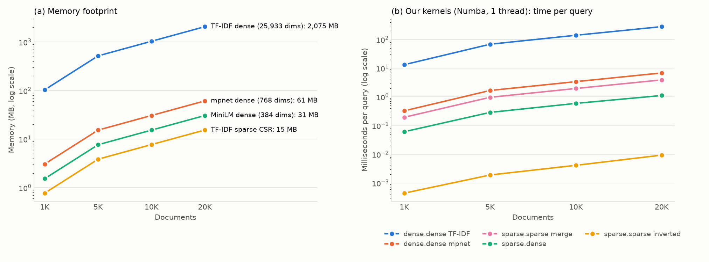

# Phase 2A: Sparse vs Dense — Temsil Fark Eder mi?

Aynı 20.000 abstract'ı farklı temsillerde tutup bellek ve hız açısından karşılaştırıyoruz. Dot product'ların hepsini kendimiz yazdık (ödev "sklearn çağırmak yetmez, kodu göster" diyor).

İlgili dosyalar: [`src/kernels.py`](../src/kernels.py) (kernel'ler), [`src/phase2a_sparse_dense.py`](../src/phase2a_sparse_dense.py) (deney). Ham veri: `results/phase2a_memory.csv`, `results/phase2a_sparse_dense.csv`.

## Özet

| Soru | Cevap (20.000 doküman) |
|---|---|
| En az bellek | TF-IDF CSR: **15 MB**. mpnet 61 MB, dense TF-IDF **2.075 MB** (134 kat) |
| En hızlı arama (bizim kodumuz) | Inverted index ile sparse·sparse: **0,009 ms/query** |
| En yavaş | Dense TF-IDF: 281 ms/query (zamanın %99,6'sı sıfırla çarpma) |
| Büyüme | Hepsi doküman sayısıyla doğrusal |
| Seçimimiz | Anlamsal arama için **dense mpnet + BLAS** (0,022 ms/query). Kelime araması gerekirse sparse + inverted index |

---

## 1. Karşılaştırılan temsiller

| Temsil | Boyut | Doküman başına saklanan |
|---|---|---|
| TF-IDF **CSR** (sparse) | 25.933 sütun | ~96 değer + 96 indeks |
| TF-IDF **dense** | 25.933 sütun | 25.933 sayı (%99,6'sı sıfır) |
| **mpnet** (dense embedding) | 768 | 768 sayı |
| **MiniLM** (dense embedding) | 384 | 384 sayı (sadece bellek için) |

TF-IDF'in sparse ve dense hali **aynı matris**; fark sadece sıfırları saklayıp saklamamak. Böylece "aynı veri, farklı format" sorusu ile "farklı temsil" sorusunu ayrı ayrı görebiliyoruz.

---

## 2. Bellek

```python
def csr_bytes(M):
    return M.data.nbytes + M.indices.nbytes + M.indptr.nbytes
```
CSR'ın belleği üç dizisinin toplamı (bkz. [01_vektorlestirme.md](01_vektorlestirme.md) Bölüm 3.5). Dense matrisler için `satır × sütun × 4 byte`.

| Doküman | TF-IDF CSR | mpnet (768) | MiniLM (384) | TF-IDF dense |
|---:|---:|---:|---:|---:|
| 1.000 | 0,8 MB | 3,1 MB | 1,5 MB | 103,7 MB |
| 5.000 | 3,9 MB | 15,4 MB | 7,7 MB | 518,7 MB |
| 10.000 | 7,7 MB | 30,7 MB | 15,4 MB | 1.037,3 MB |
| 20.000 | **15,4 MB** | 61,4 MB | 30,7 MB | **2.074,6 MB** |

- Hepsi doküman sayısıyla doğrusal büyüyor.
- Alt kümelerde de tam sözlük (25.933 kelime) kullanıldı; bu yüzden dense TF-IDF'in genişliği her boyutta aynı.
- Dense TF-IDF 200.000 dokümanda ~20 GB olurdu; laptop'a sığmaz. CSR ise ~150 MB.
- CSR, MiniLM'den bile küçük: doküman başına 96 × (4 + 4) byte = 768 byte, MiniLM'de 384 × 4 = 1.536 byte.

---

## 3. Kendi kernel'lerimiz

Hepsi Numba `@njit` ile derlenmiş, **tek thread**. Tümü aynı çıktıyı üretiyor: `S[i, j]` = query i ile doküman j'nin dot product'ı. Vektörlerin hepsi birim uzunlukta olduğu için bu doğrudan cosine similarity.

### 3.1 Sparse · sparse: merge

```python
@njit
def csr_csr_merge(q_ptr, q_idx, q_val, d_ptr, d_idx, d_val):
    nq = q_ptr.shape[0] - 1
    n = d_ptr.shape[0] - 1
    S = np.zeros((nq, n), dtype=np.float32)
    for i in range(nq):
        a0, a1 = q_ptr[i], q_ptr[i + 1]
        for j in range(n):
            p, r = a0, d_ptr[j]
            r1 = d_ptr[j + 1]
            acc = 0.0
            while p < a1 and r < r1:
                ia, ib = q_idx[p], d_idx[r]
                if ia == ib:
                    acc += q_val[p] * d_val[r]
                    p += 1
                    r += 1
                elif ia < ib:
                    p += 1
                else:
                    r += 1
            S[i, j] = acc
    return S
```

- `q_ptr[i]` ile `q_ptr[i+1]` arası, query i'nin sıfır olmayan elemanları (CSR'ın `indptr` dizisi).
- İki işaretçi var: `p` query'nin kelime listesinde, `r` dokümanın kelime listesinde ilerliyor.
- Kelime id'leri eşitse (`ia == ib`) iki ağırlığı çarpıp topluyoruz. Değilse küçük olan tarafı bir adım ilerletiyoruz.
- Bu, iki sıralı listeyi birleştiren klasik **merge** adımı. İki listede ortak olmayan kelimeler için çarpma yapılmıyor.
- **Önemli şart:** indekslerin her satırda sıralı olması. sklearn'ün ürettiği corpus CSR'ında indeksler sıralı değildi; `csr_arrays()` fonksiyonu bunları `sort_indices()` ile sıralıyor. Sıralanmasaydı sonuç sessizce yanlış çıkardı.
- Maliyet: her (query, doküman) çifti için ~(7,7 + 96) adım. 20.000 dokümanda query başına ~2,1 milyon adım.

### 3.2 Sparse · sparse: inverted index

```python
@njit
def csr_csr_inverted(q_ptr, q_idx, q_val, t_ptr, t_doc, t_val, n_docs):
    nq = q_ptr.shape[0] - 1
    S = np.zeros((nq, n_docs), dtype=np.float32)
    for i in range(nq):
        for p in range(q_ptr[i], q_ptr[i + 1]):
            word, w = q_idx[p], q_val[p]
            for r in range(t_ptr[word], t_ptr[word + 1]):
                S[i, t_doc[r]] += w * t_val[r]
    return S
```

- `t_*` corpus'un **CSC** hali (`Xs.tocsc()`): her kelime için "bu kelime hangi dokümanlarda, hangi ağırlıkla geçiyor" listesi. Arama motorlarının kullandığı **inverted index** bu.
- Query'nin her kelimesi için sadece o kelimeyi içeren dokümanları geziyoruz ve skorlarına katkıyı ekliyoruz.
- Hiç ortak kelimesi olmayan dokümanlara **hiç dokunulmuyor**. Merge ise 20.000 dokümanın hepsini tek tek kontrol ediyordu.
- Maliyet: query'deki kelimelerin doküman frekanslarının toplamı. Ölçtük: 20K'da query başına ortalama **12.446** posting. Merge'ün 2,1 milyon adımının ~170'te biri.
- Index'i kurmak tek seferlik bir maliyet: 20K'da 3,8 ms. Sonraki her query bundan faydalanıyor.

### 3.3 Sparse · dense

```python
@njit
def csr_dense(d_ptr, d_idx, d_val, Qd):
    nq = Qd.shape[0]
    n = d_ptr.shape[0] - 1
    S = np.empty((nq, n), dtype=np.float32)
    for i in range(nq):
        for j in range(n):
            acc = 0.0
            for r in range(d_ptr[j], d_ptr[j + 1]):
                acc += d_val[r] * Qd[i, d_idx[r]]
            S[i, j] = acc
    return S
```

- Doküman sparse (CSR), query ise 25.933 elemanlı düz bir dizi (`Qd`).
- Her doküman için sadece sıfır olmayan ~96 elemanı geziyoruz: `data[r] * query[indices[r]]`. Ödevin "sparse-dense" tanımı tam bu.
- Döngü sırası bilerek seçildi: query dış döngüde. Bir query satırı ~100 KB ve M4'ün 128 KB'lık L1 önbelleğine sığıyor. 20.000 dokümanı gezerken `Qd[i, d_idx[r]]` okumaları hep önbellekten geliyor.
- Merge'den farkı: eşleşme aramak yok. Query'de her kelimenin bir yeri olduğu için doğrudan indeksle okunuyor. Bu yüzden merge'den ~3,5 kat hızlı.

### 3.4 Dense · dense

```python
@njit
def dense_numba(Q, X):
    nq, d = Q.shape
    n = X.shape[0]
    S = np.empty((nq, n), dtype=np.float32)
    for j in range(n):
        for i in range(nq):
            acc = 0.0
            for t in range(d):
                acc += Q[i, t] * X[j, t]
            S[i, j] = acc
    return S
```

- Düz üçlü döngü. Aynı fonksiyonu hem dense TF-IDF (d = 25.933) hem mpnet (d = 768) için kullandık. Yani ikisi arasındaki tek fark boyut.
- Doküman dış döngüde: bir doküman satırı bir kez okunup tüm query'ler için önbellekte kullanılıyor.
- Dense TF-IDF 34 kat daha geniş olduğu için ondan sadece 20 query ölçtük. Karşılaştırmayı **query başına süre** üzerinden yapıyoruz.

### 3.5 Doğruluk

Her kernel'in sonucu kütüphane sonucuyla karşılaştırıldı (TF-IDF için scipy, mpnet için float64 NumPy). En büyük fark **6 × 10⁻⁸**; tolerans 10⁻⁵. Fark toleransı aşarsa script hata verip duruyor.

---

## 4. Hız sonuçları

Kendi kernel'lerimiz (tek thread), ms / query:

| Doküman | sparse·sparse inverted | sparse·dense | sparse·sparse merge | dense·dense mpnet | dense·dense TF-IDF |
|---:|---:|---:|---:|---:|---:|
| 1.000 | 0,0004 | 0,061 | 0,196 | 0,327 | 13,3 |
| 5.000 | 0,0019 | 0,289 | 0,970 | 1,678 | 68,5 |
| 10.000 | 0,0041 | 0,596 | 1,968 | 3,408 | 140,8 |
| 20.000 | **0,0094** | 1,122 | 3,918 | 6,855 | **281,1** |

Kütüphane versiyonları (referans), 20.000 doküman:

| İşlem | Kütüphane | ms / query | Bizim en iyimiz |
|---|---|---:|---:|
| sparse·sparse | scipy (`Q @ X.T`) | 0,094 | 0,009 (inverted, **10 kat hızlı**) |
| sparse·dense | scipy (`X @ q`) | 0,226 | 1,122 |
| dense·dense TF-IDF | NumPy (BLAS) | 3,174 | 281,1 |
| dense·dense mpnet | NumPy (BLAS) | **0,022** | 6,855 |



> **Figure 2:** Aynı TF-IDF matrisi CSR olarak 15 MB, dense olarak 2.075 MB yer tutuyor. Inverted index ile sparse arama, sadece query kelimelerini içeren dokümanlara dokunduğu için dense TF-IDF'ten 30.000 kat, mpnet ile dense aramadan 730 kat hızlı (tek thread, kendi kodumuz).

### Okuma

**1. Eleman başına maliyet hemen hemen aynı, fark eleman sayısında.** Skaler derlenmiş kodda bir çarpma-toplamanın maliyeti:

| Kernel | Hesap | Eleman başına |
|---|---|---:|
| sparse·dense | 1,122 ms / (20.000 × 96) | 0,58 ns |
| dense mpnet | 6,855 ms / (20.000 × 768) | 0,45 ns |
| dense TF-IDF | 281,1 ms / (20.000 × 25.933) | 0,54 ns |

Yani süre neredeyse tamamen "kaç eleman işlendi" sorusuna bağlı. Sparse'ın dolaylı erişimi (`q[indices[r]]`) eleman başına biraz daha pahalı, ama 8 kat daha az eleman işlediği için yine de kazanıyor.

**2. Algoritma, formattan daha önemli.** Merge ve inverted index aynı CSR verisini kullanıyor; inverted 418 kat hızlı. Merge her dokümanı kontrol ediyor, inverted ise ortak kelimesi olmayan dokümanları hiç görmüyor. Ölçülen fark (418 kat), adım sayısı farkından (~170 kat) bile büyük; çünkü merge'ün `if/elif/else` dallanmaları işlemcinin tahmin mekanizmasını sık sık yanıltıyor.

**3. Bizim inverted index scipy'yi 10 kat geçiyor.** scipy `Q @ X.T` işlemini genel bir sparse matris çarpımı olarak yapıyor: sonucu önce sparse bir matris olarak kuruyor (indeks dizileri, iki geçiş), sonra biz onu `.toarray()` ile dense'e çeviriyoruz. Bizim kernel sonucu doğrudan dense diziye yazıyor. Kendi problemimize özel kod, genel amaçlı kütüphaneyi yenebiliyor.

**4. BLAS dense'i bambaşka bir seviyeye taşıyor.** NumPy ile mpnet araması 0,022 ms; bizim skaler kodumuzdan 300 kat hızlı. Bunun sebeplerini (SIMD, cache blocking, çok çekirdek, Apple'ın matris hızlandırıcısı AMX) Phase 2C'de inceliyoruz. Sparse işlemler bu hızlandırmalardan yararlanamıyor, çünkü erişim düzensiz.

**5. Dense TF-IDF hiçbir durumda doğru seçim değil.** 2 GB bellek, ve BLAS ile bile 3,2 ms/query (2 GB'ı bellekten okumak zaman alıyor). Çarpmaların %99,6'sı sıfırla.

---

## 5. Hangi temsil ne zaman doğru?

| Temsil | Ne zaman doğru | Ne zaman yanlış |
|---|---|---|
| **Sparse CSR + inverted index** | Kelime eşleşmesi yeterliyse (anahtar kelime araması). Sözlük büyük, dokümanlar kısa, query'ler birkaç kelimeyse. Bellek kısıtlıysa. | Anlamsal benzerlik gerekiyorsa: eş anlamlıları ve farklı ifade edilmiş aynı fikri kaçırır. [01_vektorlestirme.md](01_vektorlestirme.md) Bölüm 6'da mpnet ile TF-IDF'in ilk 10 sonucu sadece %16 örtüşüyordu. |
| **Sparse CSR + merge** | Neredeyse hiçbir zaman; inverted index aynı işi çok daha hızlı yapıyor. Sadece tek bir çift için dot product gerektiğinde. | Çok sayıda doküman taranacaksa. |
| **Dense TF-IDF** | Hiçbir zaman (yoğunluk ~%10'un üstüne çıkmadıkça). | Her durumda: belleği ve süreyi sıfırlara harcıyor. |
| **Dense embedding (mpnet)** | Anlamsal arama gerekiyorsa. Sabit ve tahmin edilebilir maliyet (N × d). BLAS/SIMD ile çok hızlı. Boyut indirgeme (2B) ile daha da küçültülebiliyor. | Bellek çok kısıtlıysa veya kelime araması yeterliyse. |

**Kaba kural:** Sparse format, yoğunluk × (sparse eleman maliyeti / dense eleman maliyeti) < 1 olduğunda kazanır.
- Skaler kodda iki maliyet benzer (~0,5 ns), dolayısıyla sparse neredeyse her zaman kazanır.
- BLAS ile dense eleman 100-300 kat ucuzlar. Bu durumda sparse ancak yoğunluk ~%0,3-1'in altındaysa ya da algoritma dokümanları tamamen atlayabiliyorsa (inverted index) kazanır.

**Bizim seçimimiz:** Projenin amacı anlamsal benzerlik olduğu için ana temsil **dense mpnet**. NumPy/BLAS ile zaten 0,022 ms/query. Inverted index'i rapordaki "alternatifler" ve "hibrit arama" tartışmasında kullanacağız.

---

## 6. Yeniden üretmek için

```bash
.venv/bin/python src/phase2a_sparse_dense.py              # ~4 dk (dense TF-IDF için 2 GB RAM)
.venv/bin/python src/phase2a_sparse_dense.py --plot-only  # sadece figür
```

Not: İlk çalıştırmada CSV yazıcısı, sadece inverted satırlarında bulunan iki sütunu (`index_build_s`, `postings_per_query`) başlığa eklemedi. Değerler doğru ölçülmüştü; dosyadaki yerleri sonradan düzeltildi. `save_row` artık böyle bir uyuşmazlıkta hata veriyor.

---

## 7. Sunumda gelebilecek sorular

- **Dot product'ları neden Numba ile yazdınız, saf Python ile değil?** Saf Python ile 200 query × 20.000 dokümanlık merge dakikalar sürerdi. Ödev "kendin yaz" diyor, "yavaş yaz" demiyor. Numba kodu Python sözdizimiyle yazılıyor; satır satır açıklanabilir.
- **Merge neden sıralı indeks istiyor?** İki işaretçi küçük olanı ilerleterek ilerliyor. Listeler sıralı değilse ortak bir kelimeyi atlayıp yanlış sonuç verir. sklearn'ün corpus CSR'ı sıralı değildi; biz sıraladık.
- **Inverted index neden bu kadar hızlı?** Query'nin ~8 kelimesini içermeyen dokümanlara hiç bakmıyor. Query başına 2,1 milyon adım yerine ~12.000 adım.
- **scipy'yi nasıl geçtiniz?** scipy genel amaçlı bir sparse matris çarpımı yapıyor: sonucu sparse kurup sonra dense'e çeviriyor. Bizim kodumuz sonucu doğrudan dense diziye yazıyor.
- **O zaman neden sparse'ı seçmediniz?** Hız değil, kalite sebebiyle: TF-IDF sadece ortak kelimeleri yakalıyor. Anlamsal arama için dense embedding gerekiyor, ve BLAS ile o da yeterince hızlı.
- **sparse·dense'te döngü sırası neden query dışta?** Query satırı (~100 KB) L1 önbelleğe sığıyor. Ters sırada her doküman için 200 farklı query satırına dağınık erişim olurdu.
- **Dense TF-IDF için neden sadece 20 query?** Query başına 281 ms; 200 query × 7 çalıştırma ~7 dakika sürerdi. Query başına süre raporlandığı için karşılaştırma adil.
