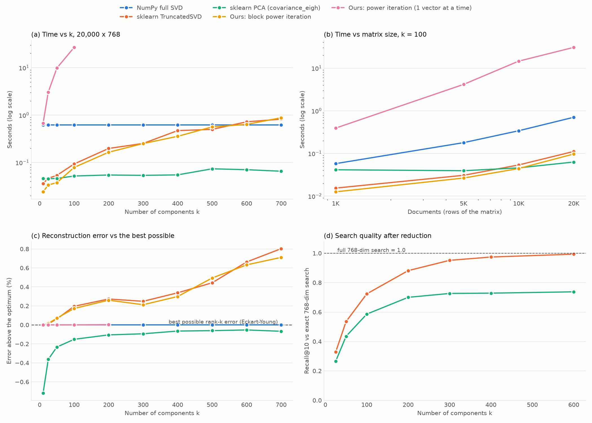

# Phase 2B: Boyut İndirgeme — Seç ve Gerekçelendir

mpnet embedding matrisimiz (20.000 × 768) aramayı hızlandırmak için daha az boyuta indirgenebilir mi? Kendi power-iteration SVD'mizi yazıp kütüphane yöntemleriyle karşılaştırıyoruz ve final sistem için bir yöntem seçiyoruz.

İlgili dosyalar: [`src/svd_power.py`](../src/svd_power.py) (kendi SVD'miz), [`src/phase2b_svd.py`](../src/phase2b_svd.py) (deneyler). Ham veri: `results/phase2b_*.csv`, `results/phase2b_summary.json`.

## Özet

| Soru | Cevap |
|---|---|
| En hızlı (k=100) | PCA kovaryans çözücüsü **0,052 s**; bizim blok power iteration 0,079 s; TruncatedSVD 0,093 s; tam SVD 0,622 s |
| En yavaş | Bizim tek-vektör power iteration: k=100'de 26,8 s (ama hatası optimuma eşit) |
| Doğruluk | Yöntemlerin hepsi optimumun **%1 yakınında** |
| TruncatedSVD tam SVD'yi ne zamana kadar yener? | **k ≈ 550'ye kadar** (768 boyutun ~%70'i) |
| PCA neden farklı? | Veri merkezli değil: ortalama vektörün uzunluğu 0,51. PCA ortalamayı çıkarınca cosine geometrisi değişiyor ve arama kalitesi **%74'te takılıyor** |
| Seçimimiz | **Merkezlenmemiş truncated SVD**, k=300 (recall@10 = 0,95). Bizim blok power iteration ile hesaplanıyor, TruncatedSVD ile çapraz kontrol ediliyor |

---

## 1. Fikir: SVD ve boyut indirgeme

Her matris üç parçaya ayrılabilir: **A = U · diag(σ) · Vᵀ**.
- **V'nin satırları** (sağ tekil vektörler): verideki "ana yönler", en önemliden en önemsize.
- **σ** (tekil değerler): her yönün ne kadar enerji taşıdığı.
- **U · diag(σ)**: her dokümanın bu yönlerdeki koordinatları.

Sadece ilk k yönü tutarsak her doküman 768 yerine k sayıyla temsil edilir. **Eckart–Young teoremi**: aynı rank'taki tüm matrisler arasında A'ya en yakın olanı, ilk k tekil vektörle kurulandır. Bu yüzden "en iyi mümkün hata" tam SVD'nin σ değerlerinden doğrudan hesaplanabiliyor:

$$\frac{\|A - A_k\|_F}{\|A\|_F} = \sqrt{\frac{\sum_{i>k} \sigma_i^2}{\sum_i \sigma_i^2}}$$

Karşılaştırdığımız beş yöntem:

| Yöntem | Ne yapıyor |
|---|---|
| **Bizim: power iteration** | Tekil vektörleri teker teker buluyor (ödevin "algoritmayı öğren" kısmı) |
| **Bizim: blok power iteration** | k vektörü birlikte iterate ediyor |
| **NumPy `np.linalg.svd`** | 768 bileşenin hepsini hesaplıyor; doğruluk referansı |
| **sklearn `TruncatedSVD`** | Rastgele izdüşüm (randomized) ile sadece ilk k bileşen |
| **sklearn `PCA`** | Veriyi merkezliyor (ortalamayı çıkarıyor), sonra 768 × 768 kovaryans matrisinin özvektörlerini buluyor (`svd_solver="covariance_eigh"`) |

---

## 2. Kendi SVD'miz: `svd_power.py`

### 2.1 Power iteration (tek vektör)

**Temel fikir:** Rastgele bir vektörü AᵀA ile tekrar tekrar çarparsan, en büyük tekil değere ait yön her adımda diğerlerinden daha hızlı büyür. Sonunda vektör o yöne döner. Bir yön bulununca onu çıkarıp (deflation) aynı işi sıradaki yön için tekrarlıyoruz.

```python
def power_iteration_svd(A, k, max_iter=300, tol=1e-6, seed=0):
    rng = np.random.default_rng(seed)
    n, d = A.shape
    V = np.zeros((d, k), dtype=A.dtype)
    S = np.zeros(k, dtype=A.dtype)
    U = np.zeros((n, k), dtype=A.dtype)
    iters = []
    for j in range(k):
        v = rng.standard_normal(d).astype(A.dtype)
        v /= np.linalg.norm(v)
        Vj = V[:, :j]
        for it in range(1, max_iter + 1):
            w = A.T @ (A @ v)
            w -= Vj @ (Vj.T @ w)
            w -= Vj @ (Vj.T @ w)
            w /= np.linalg.norm(w)
            converged = 1.0 - abs(float(w @ v)) < tol
            v = w
            if converged:
                break
        iters.append(it)
        Av = A @ v
        S[j] = np.linalg.norm(Av)
        U[:, j] = Av / S[j]
        V[:, j] = v
    return U, S, V.T, iters
```

Satır satır:
- **`v = rng.standard_normal(d)`**: Rastgele bir başlangıç vektörü. `seed=0` ile sonuç her çalıştırmada aynı.
- **`w = A.T @ (A @ v)`**: AᵀA ile çarpma. AᵀA matrisini (768 × 768) **hiç oluşturmuyoruz**; önce `A @ v` (20.000 sayı), sonra `A.T @ (...)` (768 sayı). İki matris-vektör çarpımı.
- **`w -= Vj @ (Vj.T @ w)`**: **Deflation.** Daha önce bulunan j vektörün yönlerini w'dan çıkarıyoruz (Gram–Schmidt ortogonalleştirme). Yoksa her vektör yine en büyük yöne, yani ilk vektöre yakınsardı.
- **İki kez yapılması**: float32'de tek seferlik çıkarma küçük artıklar bırakıyor. İkinci geçiş bunları temizliyor ("re-orthogonalisation").
- **`w /= np.linalg.norm(w)`**: Uzunluğu 1'e çekiyoruz; yoksa her adımda σ² ile büyüyüp taşardı.
- **`1 - |w · v| < tol`**: İki ardışık vektör aynı yönü gösteriyorsa (aralarındaki açı ~0) yakınsamış demektir.
- **`S[j] = ||A v||`, `U[:, j] = A v / σ`**: Bulunan sağ tekil vektörden tekil değeri ve sol tekil vektörü hesaplıyoruz.

**Yakınsama hızı:** Her iterasyonda istenmeyen yönlerin payı (σⱼ₊₁/σⱼ)² oranında küçülüyor.
- İlk bileşen: σ₁ = 74,7, σ₂ = 31,7, oran² = 0,18. Sadece **5 iterasyonda** yakınsadı.
- 100. bileşen civarı: σ₉₉ = 5,521, σ₁₀₀ = 5,439, oran² = 0,97. 10⁻⁶ hassasiyet için ~450 iterasyon gerekir. Üst sınırımız 300.

k=200'de ortalama **178 iterasyon** gerekti ve **33 bileşen** 300'e takıldı (tekil değer hatası en fazla %0,95). Yine de yeniden oluşturma hatası optimumla neredeyse aynı (0,28638'e karşı 0,28637). Sebebi: tekil değerleri birbirine çok yakın olan yönler tam ayrışmasa da, yakınsamamış vektörler bu yönlerin bir karışımı ve hepsi aynı ilk-k alt uzayının içinde kalıyor. Bu yöntem matris-vektör çarpımı (BLAS-2) yaptığı için yavaş: k=100'de 26,8 s.

### 2.2 Blok power iteration

```python
def block_power_svd(A, k, n_iter=10, oversample=10, seed=0):
    rng = np.random.default_rng(seed)
    n, d = A.shape
    l = min(k + oversample, d)
    V, _ = np.linalg.qr(rng.standard_normal((d, l)).astype(A.dtype))
    for _ in range(n_iter):
        V, _ = np.linalg.qr(A.T @ (A @ V))
    B = A @ V
    Ub, s, Wt = np.linalg.svd(B, full_matrices=False)
    U = Ub[:, :k]
    S = s[:k]
    Vt = (V @ Wt.T)[:, :k].T
    return U, S, Vt
```

- **`l = k + oversample`**: k yerine k+10 vektörle çalışıyoruz. Fazladan vektörler, k. ve k+1. yön arasındaki küçük farkın yakınsamayı yavaşlatmasını engelliyor.
- **`np.linalg.qr(...)`**: QR ayrıştırması, bloğun sütunlarını birbirine dik ve birim uzunlukta tutuyor. Tek-vektör yöntemindeki deflation'ın blok karşılığı: vektörlerin hepsinin aynı en büyük yöne çökmesini engelliyor.
- **`A.T @ (A @ V)`**: 768 × 110'luk bir blokla çarpım. Artık **matris-matris** (BLAS-3) işlem; Phase 2C'de gördüğümüz gibi çok daha verimli.
- **Rayleigh–Ritz adımı** (`B = A @ V`, küçük SVD): Döngü bize "ilk k yönü içeren alt uzayı" veriyor ama yönleri tek tek ayırmıyor. 20.000 × 110'luk küçük B matrisinin SVD'si bu alt uzayı tekil vektörlere ayırıyor.
- Bu algoritma, TruncatedSVD'nin kullandığı **randomized SVD** ile aynı fikir.

**Kaç iterasyon?** (k = 100, optimum hata = 0,42557):

| n_iter | Süre | Hata | En kötü σ hatası |
|---:|---:|---:|---:|
| 0 | 0,037 s | 0,92478 | %63 |
| 1 | 0,043 s | 0,46854 | %20 |
| 2 | 0,049 s | 0,43644 | %9,7 |
| 4 | 0,062 s | 0,42771 | %4,3 |
| **6** | **0,076 s** | **0,42630** | %2,5 |
| 8 | 0,090 s | 0,42587 | %1,5 |
| 12 | 0,117 s | 0,42564 | %0,5 |
| 16 | 0,148 s | 0,42559 | %0,15 |

n_iter = 0 rastgele bir alt uzay demek (hata 0,92). 6 iterasyonda hata optimumun sadece %0,17 üstünde. Varsayılan olarak 6'yı seçtik; sklearn'ün TruncatedSVD varsayılanına (5 iterasyon) yakın, böylece karşılaştırma adil.

---

## 3. Sonuçlar

### 3.1 Zaman vs k (20.000 × 768, saniye, 1 warmup + 5 ölçüm, median)

| k | Tam SVD | TruncatedSVD | PCA | Bizim blok | Bizim tek-vektör |
|---:|---:|---:|---:|---:|---:|
| 10 | 0,622 | 0,036 | 0,046 | **0,024** | 0,671 |
| 25 | 0,622 | 0,046 | 0,046 | **0,034** | 3,06 |
| 50 | 0,622 | 0,054 | 0,046 | **0,038** | 9,84 |
| 100 | 0,622 | 0,093 | **0,052** | 0,079 | 26,8 |
| 200 | 0,622 | 0,198 | **0,055** | 0,165 | (74,4, tek ölçüm) |
| 300 | 0,622 | 0,252 | **0,054** | 0,251 | — |
| 400 | 0,622 | 0,471 | **0,055** | 0,357 | — |
| 500 | 0,622 | 0,500 | **0,074** | 0,564 | — |
| 600 | 0,622 | 0,722 | **0,071** | 0,637 | — |
| 700 | 0,622 | 0,822 | **0,066** | 0,879 | — |

- Tam SVD k'dan bağımsız; her zaman 768 bileşenin hepsini hesaplıyor (bir kez ölçüldü).
- TruncatedSVD ve bizim blok yöntemi k ile kabaca doğrusal büyüyor ve k ≈ 550 civarında tam SVD'yi geçiyor.
- PCA'nın kovaryans çözücüsü k'dan neredeyse bağımsız (Bölüm 4.3).
- Tek-vektör power iteration k=200 için 5 ölçüm ~7,5 dakika sürerdi. Bu yüzden k=200'de sadece tek bir çalıştırmayla hata ve iterasyon sayısı kaydedildi; zaman ölçümü k ≤ 100 ile sınırlı.

### 3.2 Zaman vs matris boyutu (k = 100, saniye)

| Doküman | Tam SVD | TruncatedSVD | PCA | Bizim blok | Bizim tek-vektör |
|---:|---:|---:|---:|---:|---:|
| 1.000 | 0,058 | 0,015 | 0,041 | **0,013** | 0,393 |
| 5.000 | 0,179 | 0,031 | 0,039 | **0,027** | 4,15 |
| 10.000 | 0,340 | 0,054 | 0,046 | **0,044** | 14,6 |
| 20.000 | 0,705 | 0,111 | **0,063** | 0,097 | 30,6 |

- Tam SVD, TruncatedSVD ve blok yöntemi satır sayısıyla kabaca doğrusal büyüyor.
- PCA küçük matrislerde sabit ~0,04 s: bu süreye 768 × 768'lik özdeğer problemi hakim ve satır sayısına bağlı değil.
- Tek-vektör yöntemi doğrusaldan hızlı büyüyor. Matris büyüdükçe tekil değerler birbirine yaklaşıyor ve gereken iterasyon sayısı artıyor.

### 3.3 Yeniden oluşturma hatası (‖A − A_k‖_F / ‖A‖_F)

| k | Optimum (Eckart–Young) | Tam SVD | TruncatedSVD | PCA | Bizim blok | Bizim tek-vektör |
|---:|---:|---:|---:|---:|---:|---:|
| 50 | 0,53447 | 0,53447 | 0,53481 | 0,53323 | 0,53485 | 0,53447 |
| 100 | 0,42557 | 0,42557 | 0,42640 | 0,42492 | 0,42630 | 0,42557 |
| 200 | 0,28637 | 0,28637 | 0,28715 | 0,28607 | 0,28711 | 0,28638 |

Yorum:
- k=100'de hata 0,4256, yani enerjinin 1 − 0,4256² = **%81,9**'u korunuyor. k=50'de %71,4, k=200'de %91,8.
- Tam SVD ve tek-vektör yöntemi optimuma eşit. TruncatedSVD ve blok yöntemi optimumun %0,2–0,3 üstünde; birkaç iterasyonla durdukları için kabul edilebilir bir yaklaşıklık.
- **PCA optimumun altında görünüyor.** Bu bir çelişki değil: PCA k bileşene ek olarak ortalama vektörünü de saklıyor, yani aslında rank k+1 bir yaklaşım yapıyor.

### 3.4 Bellek (tracemalloc ile tepe bellek, k = 100)

| Yöntem | Tepe bellek | Neden |
|---|---:|---|
| Tam SVD | **520 MB** | 768 bileşenin hepsi (U: 20.000 × 768), A'nın kopyası (LAPACK girdiyi bozar) ve LAPACK çalışma alanı |
| Bizim blok | 80 MB | 20.000 × 110'luk ara matrisler, küçük SVD |
| TruncatedSVD | 79 MB | Benzer yapı |
| PCA (kovaryans) | 26 MB | Sadece 768 × 768 kovaryans + çıktı. Veriyi kopyalayarak merkezlemiyor |
| Bizim tek-vektör | **8,5 MB** | Sadece U (20.000 × 100) ve birkaç vektör |

Veri matrisinin kendisi 61 MB. Tam SVD bunun 8,5 katı bellek istiyor; 200.000 dokümanda ~5 GB olurdu.

### 3.5 Arama kalitesi: boyut indirgeme aramayı ne kadar bozuyor?

Phase 1'deki 768 boyutlu naive aramanın top-10 sonuçlarını referans aldık. İndirgenmiş uzayda yapılan aramanın bu 10 sonuçtan kaçını bulduğunu (**recall@10**) ölçtük:

```python
Z  = normalise((A  - m) @ Vt.T)     # m = 0 for SVD, data mean for PCA
Qz = normalise((Qm - m) @ Vt.T)
idx, _ = topk_rows_parallel(Qz @ Z.T, 10)
```

Vektörleri k boyuta izdüşürüp yeniden birim uzunluğa getiriyoruz ve cosine'i bu uzayda hesaplıyoruz.

| k | TruncatedSVD recall@10 | PCA recall@10 | Matris çarpımı (200 query) | İndirgenmiş corpus |
|---:|---:|---:|---:|---:|
| 25 | 0,329 | 0,266 | 1,07 ms | 2 MB |
| 50 | 0,535 | 0,435 | 0,80 ms | 4 MB |
| 100 | 0,724 | 0,586 | 1,12 ms | 8 MB |
| 200 | 0,882 | 0,700 | 1,76 ms | 16 MB |
| **300** | **0,952** | 0,727 | **2,40 ms** | **24 MB** |
| 400 | 0,974 | 0,728 | 3,03 ms | 32 MB |
| 600 | 0,994 | 0,738 | 4,46 ms | 48 MB |
| 768 (tam) | 1,000 | — | 7,36 ms | 61 MB |

- SVD ile recall k arttıkça 1'e yaklaşıyor. PCA ise **~0,74'te takılıyor**; neden olduğu Bölüm 4.2'de.
- k = 300'de recall 0,95, matris çarpımı 3 kat hızlı, bellek 2,5 kat az.
- Not: 768 boyutlu çarpım bu ölçümde 7,36 ms çıktı; Phase 2C'de aynı işlem 4,34 ms'ydi. 12 dakikalık kesintisiz yükün sonunda işlemci frekansı düşmüş olabilir. Tablodaki satırlar aynı koşullarda ölçüldüğü için kendi aralarında karşılaştırılabilir.



> **Figure 3:** (a) İlk 100 bileşeni bizim blok power iteration (7,9 kat) ve TruncatedSVD (6,7 kat) tam SVD'den hızlı buluyor; bu avantaj k ≈ 550'de kayboluyor. PCA'nın kovaryans çözücüsü bu "uzun ve dar" matriste her k'da en hızlısı. (c) Hızlı yöntemlerin hepsi optimum hatanın %1 yakınında. (d) Ama PCA veriyi merkezlediği için cosine geometrisi değişiyor ve arama recall'ı 0,74'te takılıyor. Merkezlenmemiş SVD ise k=300'de 0,95'e ulaşıyor.

---

## 4. Ödevin soruları

### 4.1 TruncatedSVD neden tam SVD'den hızlı?
- **Tam SVD** her zaman 768 bileşenin hepsini hesaplıyor: maliyeti O(N·d²). LAPACK'in kullandığı ilk adım (bidiagonalizasyon) kısmen matris-vektör işlemlerinden oluşuyor ve bellek hızıyla sınırlı.
- **TruncatedSVD** sadece k+10 boyutlu bir alt uzay arıyor. Rastgele bir izdüşüm yapıyor, birkaç power iterasyonu ve küçük bir SVD ekliyor. Bunların hepsi matris-matris çarpımı (BLAS-3) ve maliyet O(N·d·k).
- k = 100'de bu fark **6,7 kat** hız demek (0,093 s'ye karşı 0,622 s).

### 4.2 PCA SVD'den ne zaman farklıdır?
PCA, **merkezlenmiş** verinin SVD'si: önce her sütundan ortalamayı çıkarıyor. Verinin ortalaması sıfırsa ikisi aynı sonucu verir. Bizim verimizde değil:
- Ortalama vektörün uzunluğu **0,51**. Satırlar birim uzunlukta olduğu için bu çok büyük: tüm embedding'ler ortak bir yöne doğru yığılmış. Sentence embedding'lerin bilinen bir özelliği (anizotropi).
- SVD'nin ilk bileşeni bu ortalama yönüyle **neredeyse aynı** (cosine = 0,998) ve tüm enerjinin **%28'ini** taşıyor. İkinci bileşen sadece %5.
- PCA bu yönü çıkarıp k bileşenini ortalama etrafındaki farklara harcıyor. Yeniden oluşturmada biraz daha iyi (ortalamayı bedava saklıyor), ama:
- **Cosine benzerliği değişiyor.** PCA uzayında iki vektörün açısı, ortalamadan sapmalarının açısı. Bu, orijinal cosine ile aynı sıralamayı vermiyor. Bu yüzden k = 600'de bile recall 0,74; k = 768'de bile 1 olmaz.
- Sparse TF-IDF için ek bir sorun: merkezleme sparsity'yi yok eder (her sıfır −ortalama olur). 2 GB'lık dense bir matris oluşur. Bu yüzden sparse veride TruncatedSVD (LSA) kullanılır.

### 4.3 TruncatedSVD'nin hâlâ kazandığı pratik maksimum k nedir?
- **Tam SVD'ye karşı:** k ≈ 550'ye kadar. k = 500'de 0,50 s'ye karşı 0,62 s ile kazanıyor; k = 600'de 0,72 s'ye karşı 0,62 s ile kaybediyor. Yani d = 768'in yaklaşık **%70'i**. Bu noktadan sonra "sadece k bileşeni hesapla" avantajı, randomized yöntemin ek iterasyonlarına yeniliyor.
- **Kovaryans/Gram yaklaşımına karşı** (PCA'nın kullandığı yöntem): bu matriste **hiçbir k'da kazanamıyor**. AᵀA'yı (768 × 768) bir kez hesaplamak tek bir büyük matris çarpımı ve AMX ile çok hızlı. 768 × 768'lik özdeğer problemi de küçük. Bu hile sadece **d küçükken** işe yarıyor. TF-IDF'te d = 25.933 olurdu: 2,7 GB'lık bir Gram matrisi ve O(d³) özdeğer problemi. Orada tek pratik seçenek TruncatedSVD.

### 4.4 Final sistem için hangi yöntem ve neden?

**Seçim: merkezlenmemiş truncated SVD, k = 300.** Basis'i bizim blok power iteration ile hesaplıyoruz (n_iter = 6); sklearn TruncatedSVD ile çapraz kontrol ediyoruz.

Gerekçeler:
1. **Merkezlenmemiş olmalı (PCA değil):** Arama orijinal embedding'ler üzerindeki cosine ile tanımlı. PCA bu geometriyi değiştiriyor ve recall'ı 0,74'te tavanlıyor. SVD orijinal geometriyi koruyor.
2. **k = 300:** recall@10 = 0,95 (aranan 10 dokümanın ortalama 9,5'i bulunuyor), matris çarpımı 3 kat hızlı, corpus belleği 61 MB'dan 24 MB'a iniyor. k = 200 (0,88) fazla kayıplı; k = 400 (0,97) ek %2 recall için %26 daha uzun matris çarpımı demek.
3. **Basis'i hangi yöntemle hesapladığımız ikincil:** Basis bir kez, offline hesaplanıyor (k = 300'de ~0,25 s; embedding üretmek 17 dakikaydı). TruncatedSVD ile bizim blok yöntemimiz aynı hızda ve aynı doğrulukta (k = 300'de optimumun %0,25 ve %0,21 üstünde). Kendi kodumuzu kullanmak sunumda her satırı açıklayabilmemizi sağlıyor.
4. **Tam SVD gereksiz:** 768 bileşenin hepsini hesaplıyor ve 520 MB bellek istiyor. Biz sadece 300'ünü kullanacağız.
5. **Kovaryans/Gram yöntemi en hızlısı olurdu**, ama merkezlemeden yapılması gerekir (`eigh(AᵀA)`). Bunu bir alternatif olarak not ediyoruz. Fit süresi zaten önemsiz olduğu için tercihimizi değiştirmiyor.

**Dürüst bir uyarı:** 20.000 dokümanda 768 boyutlu arama zaten hızlı (200 query için 4–7 ms). Boyut indirgemenin bu ölçekteki kazancı mütevazı ve bir doğruluk bedeli var: tam 768 boyutlu arama baseline'la 10⁻⁵ toleransta eşleşir, indirgenmiş arama eşleşmez. Bu yüzden final sistem iki mod sunacak: **tam mod** (768 boyut, baseline ile birebir) ve **hızlı mod** (k = 300, recall 0,95). İndirgeme asıl değerini 10 kat büyük bir corpus'ta gösterir: 200.000 dokümanda 614 MB yerine 240 MB ve bellek bant genişliğinin yarısından fazlası tasarruf.

---

## 5. Yeniden üretmek için

```bash
.venv/bin/python src/phase2b_svd.py              # ~12 dk (tek-vektör power iteration'ın payı büyük)
.venv/bin/python src/phase2b_svd.py --plot-only  # sadece figür
```

---

## 6. Sunumda gelebilecek sorular

- **Power iteration neden çalışıyor?** AᵀA ile her çarpımda her yön σ² ile büyüyor. En büyük σ'ya ait yön diğerlerini geride bırakıyor ve vektör o yöne dönüyor.
- **AᵀA'yı neden hiç oluşturmadınız?** `A.T @ (A @ v)` iki matris-vektör çarpımıyla aynı sonucu veriyor ve 768 × 768'lik ara matrise gerek kalmıyor. Büyük d'de (TF-IDF: 25.933) bu matris 2,7 GB olurdu.
- **Deflation ne işe yarıyor?** Bulunan yönleri sonraki vektörden çıkarıyor. Yoksa her vektör yine ilk (en büyük) yöne yakınsardı.
- **Neden bazı bileşenler 300 iterasyonda yakınsamadı?** Yakınsama hızı (σⱼ₊₁/σⱼ)². 100. bileşen civarında bu oran 0,97; her iterasyonda istenmeyen yönün sadece %3'ü kayboluyor.
- **Yakınsamadıysa hata neden optimum?** Tekil değerleri çok yakın yönler aynı alt uzayın içinde. Vektör hangi karışımda kalırsa kalsın, k-boyutlu uzay neredeyse aynı.
- **Blok yöntemi neden 300 kat hızlı?** Tüm vektörleri birlikte işliyor: matris-vektör yerine matris-matris çarpımı (BLAS-3). Ayrıca tek tek yönleri değil alt uzayı arıyor; yakın tekil değerler onu yavaşlatmıyor.
- **PCA neden hatada daha iyi ama aramada daha kötü?** Ortalamayı ayrıca sakladığı için yeniden oluşturmada bir bileşen önde. Ama ortalamayı çıkarmak açıları, dolayısıyla cosine sıralamasını değiştiriyor.
- **Neden k = 300?** Recall 0,95 ile hız (3 kat) ve bellek (2,5 kat) arasında en iyi denge. Daha düşük k'larda recall hızla düşüyor, daha yüksek k'larda kazanç azalıyor.
- **TruncatedSVD neden k = 600'de tam SVD'den yavaş?** Maliyeti k ile doğrusal büyüyor; tam SVD'nin maliyeti sabit. k, d'ye yaklaşınca "sadece bir kısmını hesapla" avantajı kalmıyor.
