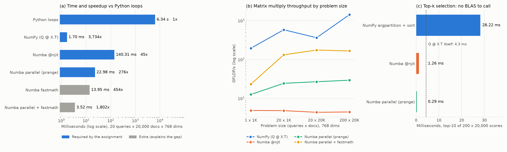

# Phase 2C: Döngü vs Vektörleştirme vs JIT

Aynı işlemi, yani similarity matrisi **S = Q·Xᵀ**'yi, dört zorunlu ve iki ek yolla hesaplıyoruz. Amaç, ödevin anahtar sorusunu veriyle cevaplamak: *"Numba NumPy'yi ne zaman yener, ne zaman kaybeder? Neden?"*

İlgili dosyalar: [`src/kernels.py`](../src/kernels.py), [`src/phase2c_vectorise.py`](../src/phase2c_vectorise.py). Ham veri: `results/phase2c_vectorise.csv`, `results/phase2c_topk.csv`.

## Özet

| | 20 query × 20.000 doküman × 768 boyut | Python'a göre hızlanma |
|---|---:|---:|
| Python döngüleri | 6,34 s | 1× |
| Numba `@njit` | 140 ms | 45× |
| Numba `parallel=True` + `prange` | 23,0 ms | 276× |
| **NumPy (`Q @ X.T`)** | **1,70 ms** | **3.734×** |
| *(ek)* Numba fastmath | 14,0 ms | 454× |
| *(ek)* Numba parallel + fastmath | 3,52 ms | 1.802× |

- **Matris çarpımında NumPy her boyutta kazanıyor**, en küçük problemde bile. 200 × 20K'da 1.415 GFLOP/s'ye çıkıyor; bizim en iyi Numba kodumuzun 8,5 katı.
- **BLAS karşılığı olmayan bir işlemde (top-10 seçimi) Numba kazanıyor:** NumPy 28,2 ms, Numba 1,26 ms (22 kat), paralel Numba 0,29 ms (98 kat).

---

## 1. Dört (+2) implementasyon

Hepsi aynı işi yapıyor: `S[i, j] = Σₜ Q[i, t] · X[j, t]`. Vektörler birim uzunlukta olduğu için bu cosine similarity.

### 1.1 Python döngüleri

```python
def dense_python(Q, X):
    nq, n, d = len(Q), len(X), len(Q[0])
    S = [[0.0] * n for _ in range(nq)]
    for j in range(n):
        x = X[j]
        for i in range(nq):
            q = Q[i]
            acc = 0.0
            for t in range(d):
                acc += q[t] * x[t]
            S[i][j] = acc
    return S
```
Python listeleri üzerinde üçlü döngü. Her `acc += q[t] * x[t]` adımı yorumlayıcıda ~20 ns tutuyor (Phase 1'deki analiz).

### 1.2 NumPy

```python
S = Q @ X.T
```
Tek satır. NumPy işi doğrudan **BLAS** kütüphanesine (bu Mac'te Apple Accelerate) devrediyor. Python yorumlayıcısı sadece bir kez çağrı yapıyor; asıl döngüler derlenmiş, optimize edilmiş C/assembly kodunda dönüyor.

### 1.3 Numba `@njit`

```python
@njit
def dense_numba(Q, X):
    nq, d = Q.shape
    n = X.shape[0]
    S = np.empty((nq, n), dtype=np.float32)
    for j in range(n):
        for i in range(nq):
            acc = 0.0
            for t in range(d):
                acc += Q[i, t] * X[j, t]
            S[i, j] = acc
    return S
```
Python döngüsünün birebir aynısı, tek fark `@njit` dekoratörü. Numba fonksiyon ilk çağrıldığında argüman tiplerine bakıp LLVM ile makine koduna derliyor ("just-in-time"). Böylece yorumlayıcı maliyeti, kutulu float nesneleri ve tip kontrolü ortadan kalkıyor.

- `acc = 0.0` float64. Bu, Python ile aynı aritmetiği garanti ediyor ama Bölüm 3'te göreceğimiz gibi hızı sınırlıyor.
- Döngü sırası: doküman dışta. Bir doküman satırı (768 sayı = 3 KB) bir kez okunup tüm query'ler için önbellekte kullanılıyor.

### 1.4 Numba `parallel=True` + `prange`

```python
@njit(parallel=True)
def dense_numba_parallel(Q, X):
    ...
    for j in prange(n):          # tek fark: range -> prange
        for i in range(nq):
            acc = 0.0
            for t in range(d):
                acc += Q[i, t] * X[j, t]
            S[i, j] = acc
    return S
```
`prange`, Numba'ya "bu döngünün turları birbirinden bağımsız, çekirdeklere dağıt" diyor. Dokümanlar 10 çekirdeğe bloklar halinde bölünüyor. Her `S[i, j]` hücresini tam olarak bir thread yazıyor, dolayısıyla yarış durumu (race condition) yok ve kilit gerekmiyor.

### 1.5 (Ek) Numba fastmath

```python
@njit(fastmath=True)
def dense_numba_fastmath(Q, X):
    ...
            acc = np.float32(0.0)
            for t in range(d):
                acc += Q[i, t] * X[j, t]
```
İki değişiklik var:
- `fastmath=True`: derleyiciye "toplama sırasını değiştirebilirsin" izni. Kayan noktalı toplama birleşmeli değildir, yani (a+b)+c ile a+(b+c) son bitlerde farklı çıkabilir. Bu yüzden derleyici bu izin olmadan toplamı yeniden sıralayamaz.
- `float32` toplayıcı: girdilerle aynı tip, dönüşüm yok.

Bu izinle LLVM toplamı **SIMD** şeritlerine bölüyor: tek komutla 4 float32 birden çarpılıp toplanıyor ve birden çok ara toplam paralel ilerliyor. Bu varyantı, NumPy ile Numba arasındaki farkın sebebini göstermek için ekledik.

### 1.6 (Ek) Numba parallel + fastmath
1.4 ve 1.5'in birleşimi: çok çekirdek + SIMD.

### 1.7 Doğruluk
Her sonuç float64 NumPy referansıyla karşılaştırıldı. En büyük fark **8,9 × 10⁻⁷** (NumPy float32 BLAS; toplama sırası farklı). Numba'da 3 × 10⁻⁸ (float64 toplayıcı) ile 1,1 × 10⁻⁷ (float32 + fastmath) arasında. Hepsi 10⁻⁵ toleransın çok altında.

---

## 2. Ölçüm düzeni

- 4 problem boyutu, küçükten büyüğe: (query × doküman) = **1 × 1K, 20 × 1K, 20 × 20K, 200 × 20K**, hepsi 768 boyut.
- Numba için 2 warmup + 5 ölçüm. İlk çağrı derleme içerdiği için derleme süresini ayrıca ölçtük: `@njit` 0,33 s, `parallel` 0,19 s, `fastmath` 0,06 s, `parallel + fastmath` 0,20 s. Warmup olmasaydı ilk ölçüm 100 kat yavaş görünürdü.
- Python: 1 warmup + 5 ölçüm. 200 × 20K'da bir çalıştırma ~63 s süreceği için atlandı; süresi 20 × 20K'dan doğrusal olarak tahmin edildi (maliyet query × doküman × boyut ile orantılı).
- Numba paralel varsayılan 10 thread kullanıyor (M4: 4 performans + 6 verimlilik çekirdeği).

---

## 3. Sonuçlar

### 3.1 Tüm boyutlar (median, ms)

| Varyant | 1 × 1K | 20 × 1K | 20 × 20K | 200 × 20K |
|---|---:|---:|---:|---:|
| Python döngüleri | 15,5 | 299 | 6.335 | ~63.400 (tahmin) |
| NumPy | **0,008** | **0,053** | **1,70** | **4,34** |
| Numba `@njit` | 0,314 | 6,36 | 140 | 1.375 |
| Numba parallel | 0,122 | 1,26 | 23,0 | 210 |
| Numba fastmath | 0,041 | 0,695 | 14,0 | 162 |
| Numba parallel + fastmath | 0,066 | 0,233 | 3,52 | 37,1 |

Aynı veri GFLOP/s olarak (saniyede milyar kayan noktalı işlem; 1 çarpma-toplama = 2 işlem):

| Varyant | 1 × 1K | 20 × 1K | 20 × 20K | 200 × 20K |
|---|---:|---:|---:|---:|
| Python döngüleri | 0,10 | 0,10 | 0,10 | — |
| NumPy | 195 | 581 | 362 | **1.415** |
| Numba `@njit` | 4,9 | 4,8 | 4,4 | 4,5 |
| Numba parallel | 12,6 | 24,4 | 26,7 | 29,3 |
| Numba fastmath | 37,8 | 44,2 | 44,0 | 37,9 |
| Numba parallel + fastmath | 23,4 | 132 | 175 | 166 |

### 3.2 Top-k seçimi: BLAS'ın olmadığı bir işlem

200 × 20.000'lik skor matrisinden her query için en iyi 10 dokümanı seçmek:

```python
def topk_numpy(S, k):
    part = np.argpartition(-S, k, axis=1)[:, :k]          # en iyi k'yı bul (sırasız)
    vals = np.take_along_axis(S, part, axis=1)
    order = np.argsort(-vals, axis=1)                     # sadece o k'yı sırala
    return np.take_along_axis(part, order, axis=1), np.take_along_axis(vals, order, axis=1)
```

```python
@njit
def _topk_row(row, k, out_idx, out_val):
    for p in range(k):
        out_val[p] = -np.inf
        out_idx[p] = -1
    for j in range(row.shape[0]):
        s = row[j]
        if s > out_val[k - 1]:              # skorların çoğu burada elenir: tek karşılaştırma
            p = k - 1
            while p > 0 and out_val[p - 1] < s:
                out_val[p] = out_val[p - 1]
                out_idx[p] = out_idx[p - 1]
                p -= 1
            out_val[p] = s
            out_idx[p] = j
```

Numba versiyonu satırı **tek geçişte** okuyor ve en iyi k'yı küçük, sıralı bir tamponda tutuyor. Yeni bir skor tampondaki en kötüden büyük değilse tek bir karşılaştırmayla eleniyor; 20.000 skorun büyük çoğunluğu böyle eleniyor. Paralel versiyonda (`topk_rows_parallel`) satırlar `prange` ile çekirdeklere dağıtılıyor.

| Varyant | Süre | NumPy'ye göre |
|---|---:|---:|
| NumPy argpartition + sort | 28,2 ms | 1× |
| Numba `@njit` | 1,26 ms | **22×** |
| Numba parallel | 0,29 ms | **98×** |
| *(karşılaştırma: matris çarpımının kendisi)* | 4,32 ms | |



> **Figure 4:** (a) Aynı matris çarpımı Python döngüsünden NumPy'ye geçince 3.734 kat hızlanıyor; Numba derlemesi 45 kat, çok çekirdek ve SIMD ile 1.802 kata kadar hızlanma sağlıyor ama NumPy'ye yetişemiyor. (b) NumPy/BLAS her problem boyutunda en yüksek throughput'u veriyor. (c) BLAS karşılığı olmayan top-k seçiminde ise tablo tersine dönüyor: tek geçişli Numba döngüsü NumPy'den 22 kat, paralel hali 98 kat hızlı.

---

## 4. Neden? Sonuçların açıklaması

### 4.1 Python → Numba `@njit` (45 kat)
Derleme, yorumlayıcı maliyetini kaldırıyor. Python her `acc += q[t] * x[t]` için iki liste elemanını işaretçiyle bulup kutulu float nesnelerini açıyor, sonucu yeni bir nesneye koyuyor ve tip kontrolü yapıyor. Numba'da aynı satır birkaç makine komutuna iniyor ve sayılar register'larda duruyor.

### 4.2 Neden `@njit` sadece 4,5 GFLOP/s? (bağımlılık zinciri)
`acc += ...` satırında her toplama bir öncekinin sonucunu bekliyor. Kayan noktalı toplamanın gecikmesi birkaç saat çevrimi; işlemci her çevrimde birden fazla toplama yapabilecekken tek bir zincirde sırasını bekliyor. Ayrıca float64 toplayıcı, her float32 çarpımın float64'e dönüştürülmesini gerektiriyor. Derleyici `fastmath` izni olmadan toplamı yeniden sıralayamadığı için bu zinciri kıramıyor.

### 4.3 fastmath (10 kat): SIMD
Toplama sırası serbest kalınca LLVM toplamı birden çok SIMD şeridine bölüyor. Tek komut 4 float32'yi aynı anda işliyor ve birden çok bağımsız ara toplam aynı anda ilerliyor. Sonuç 4,4'ten 44 GFLOP/s'ye çıkış. Bedeli: sonuç son bitlerde farklı olabiliyor (1,1 × 10⁻⁷).

### 4.4 parallel (6,1 kat, 10 çekirdekte)
`@njit`'ten paralel versiyona hızlanma 140 → 23 ms, yani 6,1 kat; 10 kat değil:
- M4'ün 10 çekirdeğinin 6'sı verimlilik çekirdeği ve performans çekirdeklerinden yavaş. Kabaca 4 + 6 × 0,5 ≈ 7 "performans çekirdeği eşdeğeri" var.
- Thread başlatma ve iş dağıtma sabit bir maliyet. En küçük problemde (1 × 1K) bu maliyet işin kendisinden büyük: parallel + fastmath (0,066 ms), tek thread'li fastmath'ten (0,041 ms) **yavaş**.
- Bu, Phase 3'te ölçeceğimiz Amdahl Yasası ve paralel ek yükünün ilk işareti.

### 4.5 NumPy neden her boyutta kazanıyor?
Matris çarpımı, sayısal hesaplamanın en çok optimize edilmiş işlemi. BLAS (burada Apple Accelerate) bizim döngümüzün yapmadığı şeyleri yapıyor:
- **Cache blocking ve register tiling:** Matrisleri önbelleğe sığan bloklara bölüyor. Önbelleğe veya register'a alınan her sayıyı birçok çarpmada yeniden kullanıyor. Bizim döngümüz her query için doküman satırını L1'den baştan okuyor.
- **SIMD ve çok çekirdek**, elle ayarlanmış kodla.
- **AMX:** Apple Silicon'da Accelerate, CPU'ya bağlı ayrı bir matris çarpım biriminden (AMX) yararlanıyor. Genel amaçlı derleyicinin (LLVM) ürettiği kod bu birimi kullanamıyor.

Sonuç: 200 × 20K'da NumPy 1.415 GFLOP/s, bizim en iyimiz 166 GFLOP/s.

**Beklentimiz yanlış çıktı:** Çok küçük problemlerde NumPy'nin çağrı ek yükü yüzünden Numba'nın kazanacağını düşünüyorduk. Ama 1 × 1K'da bile NumPy 8 µs, en hızlı Numba 41 µs. Accelerate'in çağrı maliyeti birkaç mikrosaniye ile sınırlı.

### 4.6 NumPy'nin 20 × 20K'daki düşüşü (362 GFLOP/s): bellek sınırı
20 × 1K'da 581 GFLOP/s olan NumPy, 20 × 20K'da 362'ye düşüyor, 200 × 20K'da 1.415'e çıkıyor. Sebep **aritmetik yoğunluk**, yani bellekten okunan her byte başına yapılan işlem sayısı:
- 20 query'de, bellekten okunan her doküman sayısı (4 byte) sadece 20 çarpma-toplamada kullanılıyor: ~10 FLOP/byte. 61 MB'lık X matrisi önbelleğe sığmıyor ve işlemci bellek okumasını bekliyor.
- 200 query'de her sayı 200 kez kullanılıyor: ~100 FLOP/byte. Artık sınır bellek değil, hesap gücü.
- 20 × 1K'da X sadece 3 MB ve L2 önbelleğe (16 MB) sığıyor.

Bu, roofline modelinin (bonus) tam konusu. Ayrıca sistem tasarımı için önemli bir ders: **query'leri gruplayıp tek seferde işlemek (batching), tek tek işlemekten çok daha verimli.**

### 4.7 Top-k'da Numba neden kazanıyor?
- `np.argpartition(-S, ...)`: önce `-S` için 16 MB'lık yeni bir dizi oluşturuyor, sonra her satır için 32 MB'lık bir int64 indeks dizisi üretip veriyi defalarca karıştırıyor (introselect). Bellek üzerinden birden fazla geçiş yapıyor ve tek thread çalışıyor.
- Numba döngüsü: tek geçiş, eleman başına çoğunlukla tek karşılaştırma, ara dizi yok, en iyi 10'luk tampon L1'de. Satırlar bağımsız olduğu için `prange` ile kolayca paralel.

**Phase 1'deki öngörü doğrulandı.** Phase 1'de sort zamanın sadece %0,3'üydü ve "skorlama hızlanınca önemli hale gelecek" demiştik. Şimdi NumPy ile skorlama 4,3 ms, NumPy top-k ise 28,2 ms; yani top-k artık toplam sürenin %87'si. Amdahl Yasası'nın klasik görünümü: bir darboğazı çözünce bir sonraki ortaya çıkıyor. Final sistemde (Phase 4) top-k için Numba kullanacağız.

---

## 5. Anahtar sorunun cevabı: Numba ne zaman kazanır, ne zaman kaybeder?

**Numba kaybeder:** İşlem, ayarlanmış bir kütüphane rutinine (BLAS GEMM gibi) karşılık geliyorsa. BLAS'ın blocking, SIMD, çok çekirdek ve özel donanım (AMX) avantajlarına derlenmiş basit bir döngüyle yetişmek mümkün değil. Bizde fastmath + parallel ile bile matris çarpımında NumPy 2–8,5 kat önde.

**Numba kazanır:**
1. İşlemin tek bir vektörleştirilmiş NumPy karşılığı yoksa: top-k seçimi (22–98 kat), sparse merge ve inverted index (Phase 2A).
2. NumPy aynı işi birden fazla geçiş ve geçici dizilerle yapıyorsa: argpartition `-S` kopyası + indeks dizisi oluşturuyor, Numba tek geçişte bitiriyor.
3. Döngü kolayca paralelleşebiliyorsa: NumPy BLAS dışındaki işlemleri tek thread yapıyor, Numba `prange` ile tüm çekirdekleri kullanıyor.

**Pratik kural:** Önce NumPy/BLAS'a ifade edilebilecek her şeyi ona ver. Geriye kalan özel döngüleri Numba ile yaz. Final sistem tam olarak böyle olacak: `Q @ X.T` için NumPy, top-k için Numba.

---

## 6. Yeniden üretmek için

```bash
.venv/bin/python src/phase2c_vectorise.py              # ~3 dk, iki deney + figür
.venv/bin/python src/phase2c_vectorise.py --topk-only  # sadece top-k deneyi
.venv/bin/python src/phase2c_vectorise.py --plot-only  # sadece figür
```

---

## 7. Sunumda gelebilecek sorular

- **Warmup Numba'da neden kritik?** İlk çağrı derleme yapıyor (0,06–0,33 s). Warmup olmadan 140 ms'lik bir ölçüm 470 ms görünürdü.
- **`prange` ile neden kilit (lock) gerekmiyor?** Her thread farklı dokümanları, yani `S`'nin farklı sütunlarını yazıyor. Aynı hücreye iki thread yazmıyor.
- **10 çekirdekte neden 10 kat değil de 6 kat?** 6 çekirdek verimlilik çekirdeği (daha yavaş), üstüne thread yönetimi maliyeti var. Küçük problemlerde bu maliyet kazancı bile geçiyor.
- **fastmath ne yapıyor, riski ne?** Toplama sırasını serbest bırakıyor ve derleyici SIMD kullanabiliyor. Sonuç son bitlerde değişebiliyor; bizde fark 1,1 × 10⁻⁷, tolerans 10⁻⁵.
- **NumPy neden bu kadar hızlı?** Cache blocking, SIMD, çok çekirdek ve Apple'ın AMX matris birimi. Basit bir döngü bunların hiçbirini yapmıyor.
- **20 × 20K'da NumPy neden yavaşladı?** Az query = düşük aritmetik yoğunluk; her bellek okuması az işte kullanılıyor ve işlem bellek hızıyla sınırlanıyor. 200 query'de tekrar hızlanıyor. Sonuç: query'leri gruplamak verimli.
- **Top-k'da Numba neden NumPy'yi geçti?** argpartition birden fazla geçiş ve geçici diziler kullanıyor, tek thread çalışıyor. Numba tek geçişte, ara dizi olmadan ve paralel çalışıyor.
