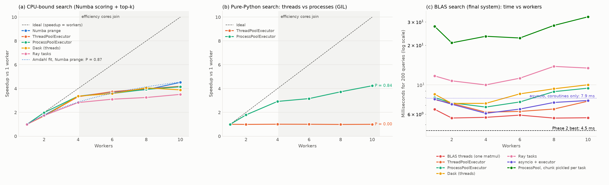

# Phase 3: Paralellik ve Eşzamanlılık

Ödevin tablosundaki **7 stratejinin hepsini** uyguladık ve iki varyant ekledik: BLAS thread'leri, Numba `prange`, ThreadPoolExecutor, ProcessPoolExecutor (iki şekilde), asyncio (iki şekilde), Dask ve Ray. Bu, iki bonus maddesini karşılıyor: 3'ten fazla strateji, ve Dask ile Ray'in birlikte karşılaştırılması.

İlgili dosyalar: [`src/phase3_parallel.py`](../src/phase3_parallel.py) (stratejiler + ölçüm düzeni), [`src/phase3_plot.py`](../src/phase3_plot.py) (Amdahl fit + figür), [`src/kernels.py`](../src/kernels.py) (GIL'siz kernel'ler). Ham veri: `results/phase3_parallel.csv`, `results/phase3_amdahl.csv`, `results/phase3_summary.csv`.

## Özet

| Soru | Cevap |
|---|---|
| Final sistem (BLAS) için en iyi strateji | **Hiçbiri.** Phase 2'nin en iyisi (varsayılan BLAS + Numba paralel top-k, **4,5 ms**) tüm açık paralellik stratejilerinden hızlı (en iyileri 5,6–6,2 ms) |
| Neden? | Sadece matris çarpımını ölçtük: tek BLAS thread'i 1.265 GFLOP/s yapıyor, 2+ thread en fazla %6 ekliyor. Bu, çarpımın çekirdeklerin paylaştığı ayrı bir matris biriminde (AMX/SME) yapıldığı yorumuyla tutarlı. Amdahl fit: işin sadece ~%16'sı paralelleşebiliyor |
| CPU-bound iş yükünde | Ray dışındaki tüm stratejiler 4 worker'da ~3,3 kat (Ray 2,8), 10 worker'da 3,9–4,5 kat (Ray 3,5). En iyisi Numba `prange` (4,5 kat) |
| Saf Python'da | ThreadPool **1,0 kat** (GIL). ProcessPool **4,2 kat** |
| Kod karmaşıklığı başına en iyi hızlanma | Numba `prange`: `range` → `prange` değişikliği ile 4,5 kat |
| Naive baseline'a göre | 158 s (Phase 1 baseline'ı, 20 query ölçülüp 200'e ölçeklendi) → 4,5 ms: **35.100 kat**. Phase 4'te aynı çalıştırmada ölçülen değerlerle 154,5 s → 4,84 ms: ~32.000 kat; final sürenin farklı çalıştırmalardaki aralığı 4,5–5,0 ms |

---

## 1. Ölçüm düzeni

### 1.1 Ortak iş birimi
Her strateji aynı işi yapıyor: corpus'u parçalara (chunk) bölüyor, her parçada tüm query'lerin top-10'unu buluyor, sonra parçaların sonuçlarını birleştiriyor. Değişen tek şey, parçaların worker'lara nasıl dağıtıldığı.

```python
def chunk_search(a, b):
    Q, Xc = G["Q"], G["X"][a:b]
    S = Q @ Xc.T if G["workload"] == "blas" else K.dense_fastmath_nogil(Q, Xc)
    idx, val = K.topk_rows_nogil(S, K_TOP)
    return idx + a, val
```
- `G` modül seviyesindeki paylaşılan durum (corpus ve query'ler). Thread'ler aynı `G`'yi görüyor; her process kendi `G`'sini kuruyor.
- `idx + a`: parça içindeki indeksi corpus genelindeki doküman numarasına çeviriyor.
- Birleştirme (`merge_topk`): her parçanın 200 × 10'luk sonuçları yan yana konuyor ve her satırdan en iyi 10 seçiliyor. Parça sayısı az olduğu için ucuz.

**Parça sayısı = 4 × worker.** Worker sayısından fazla parça kullanmamızın sebebi M4'ün asimetrik çekirdekleri: hızlı performans çekirdekleri işini bitirince yeni parça alıyor, yavaş verimlilik çekirdekleri daha az parça işliyor. Worker başına tek parça olsaydı en yavaş çekirdek toplam süreyi belirlerdi.

**Corpus'u bölüyoruz, query'leri değil.** Query'leri bölseydik her worker 61 MB'lık corpus'un tamamını okumak zorunda kalırdı. Corpus'u bölünce her doküman satırı sadece bir kez okunuyor.

### 1.2 Üç iş yükü
| İş yükü | Parça içindeki iş | Neden |
|---|---|---|
| **blas** | `Q @ X_parça.T` (Apple Accelerate) + top-k | Final sistemin gerçek hali |
| **cpu** | Kendi Numba fastmath kernel'imiz + top-k | Aynı arama, ama sadece CPU çekirdeklerinde. Çekirdek ölçeklenmesini görmek için |
| **python** | Phase 1 naive araması, 20 query × 5.000 doküman, query'ye göre bölünmüş | GIL'i doğrudan göstermek için |

### 1.3 Adillik önlemleri
- **Her ölçüm ayrı bir alt süreçte.** Önceki stratejiden kalan thread havuzları, process'ler ya da Ray worker'ları bir sonraki ölçümü etkilemiyor. Ölçümler arasında 2 sn soğuma molası var.
- **BLAS thread'leri 1'e sabit** (`VECLIB_MAXIMUM_THREADS=1`), sadece `blas_threads` stratejisi hariç. Yoksa her worker kendi BLAS thread'lerini açar ve çekirdek sayısından fazla thread yarışır (oversubscription).
- **Kurulum zamanı ölçümün dışında.** Havuz oluşturma, Ray başlatma ve process başına Numba yükleme `setup_s` olarak ayrıca raporlanıyor. Ölçülen, havuz hazırken bir aramanın süresi.
- Her ölçümde 2 warmup + 5 ölçüm, median (python iş yükünde 1 warmup).
- **Doğruluk:** Her konfigürasyonun top-10 skorları Phase 1 referansıyla karşılaştırıldı. En büyük fark 8 × 10⁻⁷.

### 1.4 GIL'siz kernel'ler
Thread'lerin gerçekten paralel çalışabilmesi için derlenmiş kodun çalışırken GIL'i bırakması gerekiyor:

```python
@njit(nogil=True, cache=True)
def topk_rows_nogil(S, k):
    ...
```
- `nogil=True`: Numba fonksiyonu çalışırken GIL'i bırakıyor; diğer Python thread'leri aynı anda kendi işlerini yapabiliyor. NumPy'nin `@` işlemi de BLAS'a girerken GIL'i bırakıyor.
- `cache=True`: Derlenmiş makine kodu diske kaydediliyor. Yeni başlayan worker process'ler baştan derlemek yerine diskten yüklüyor.

---

## 2. Stratejiler: kod

### 2.1 BLAS thread'leri (örtük paralellik)
```python
# ortam değişkeni süreç başlarken: VECLIB_MAXIMUM_THREADS = W
search = lambda: K.topk_rows_nogil(G["Q"] @ G["X"].T, K_TOP)
```
Tek büyük matris çarpımı; paralelliği BLAS kendi içinde yapıyor. Accelerate'in thread sayısı bir ortam değişkeniyle sınırlanıyor, ve bu değişken süreç başlarken okunduğu için her W ayrı bir süreçte ölçüldü. Top-k bilerek tek thread bırakıldı ki sadece BLAS'ın ölçeklenmesi görülsün.

### 2.2 Numba `prange`
```python
numba.set_num_threads(W)
search = lambda: K.topk_rows_parallel(K.dense_numba_parallel_fastmath(G["Q"], G["X"]), K_TOP)
```
Phase 2C'deki kernel'ler: `@njit(parallel=True)` ve `for j in prange(n)`. Thread sayısı çalışma anında değiştirilebiliyor.

### 2.3 ThreadPoolExecutor
```python
ex = ThreadPoolExecutor(W)
search = lambda: merge(workload, list(ex.map(lambda t: fn(*t), T)))
```
`T` parça sınırlarının listesi. `ex.map` parçaları W thread'e dağıtıyor ve sonuçları sırayla döndürüyor. Thread'ler aynı belleği paylaştığı için veri kopyalanmıyor.

### 2.4 ProcessPoolExecutor
```python
def init_worker(workload):
    os.environ["VECLIB_MAXIMUM_THREADS"] = "1"
    load_globals(workload)          # corpus np.load(..., mmap_mode="r") ile

ex = ProcessPoolExecutor(W, initializer=init_worker, initargs=(workload,))
search = lambda: merge(workload, list(ex.map(run_task, T)))
```
- `initializer` her worker process'te **bir kez** çalışıyor, her görevde değil. Corpus burada yükleniyor.
- `mmap_mode="r"`: dosya belleğe kopyalanmıyor, işletim sisteminin sayfa önbelleği üzerinden "haritalanıyor". 10 process aynı fiziksel belleği paylaşıyor, yani 10 × 61 MB değil bir kez 61 MB.
- Görev olarak sadece iki tamsayı (`a, b`) gönderiliyor; geri dönen de sadece 200 × 10'luk sonuç.
- `run_task` modül seviyesinde tanımlı, çünkü process'lere gönderilen fonksiyon pickle ile **adıyla** seri hale getiriliyor (lambda olamaz).

### 2.5 ProcessPoolExecutor, veri her görevde gönderilirse (karşı örnek)
```python
payload = lambda: [(Q, X[a:b], a) for a, b in T]
search = lambda: merge(workload, list(ex.map(chunk_with_data, payload())))
```
Her görev kendi parçasını pickle'lanmış halde taşıyor. Her aramada toplam 61 MB seri hale getirilip process'ler arasında kopyalanıyor. Initializer + mmap yaklaşımının neden gerekli olduğunu göstermek için ekledik.

### 2.6 Dask
```python
search = lambda: merge(workload, dask.compute(*[delayed(fn)(a, b) for a, b in T],
                                              scheduler="threads", num_workers=W))
```
`delayed` her parça çağrısını bir görev grafiğinin düğümü yapıyor; `dask.compute` grafiği W thread ile çalıştırıyor. Görevlere bilerek dizi değil sadece indeks (`a, b`) verdik. Dask görevlere verilen dizilerin içeriğini hash'liyor, ve 61 MB'lık bir dilimi her seferinde hash'lemek pahalı olurdu.

### 2.7 Ray
```python
ray.init(num_cpus=W, runtime_env={"env_vars": {"VECLIB_MAXIMUM_THREADS": "1", "PYTHONPATH": str(SRC)}})
Q_ref, X_ref = ray.put(G["Q"]), ray.put(np.ascontiguousarray(G["X"]))
remote = ray.remote(ray_chunk)
search = lambda: merge(workload, ray.get([remote.remote(Q_ref, X_ref, a, b, workload) for a, b in T]))
```
- `ray.put`: corpus Ray'in paylaşımlı nesne deposuna **bir kez** kopyalanıyor. Worker'lar onu kopyalamadan, salt-okunur bir görünüm olarak alıyor.
- `remote.remote(...)`: görevi gönderip hemen bir "gelecek" (future) referansı döndürüyor. `ray.get` hepsini bekliyor.
- `runtime_env`: Ray worker'ları ayrı süreçler; BLAS ayarını ve `kernels` modülünün yolunu onlara bu şekilde iletiyoruz.

### 2.8 asyncio (iki şekilde)
```python
async def _coroutines(T, fn):
    async def one(a, b):
        return fn(a, b)                 # içinde await yok: baştan sona kesintisiz çalışır
    return await asyncio.gather(*[one(a, b) for a, b in T])

async def _executor(T, fn, ex):
    loop = asyncio.get_running_loop()
    return await asyncio.gather(*[loop.run_in_executor(ex, fn, a, b) for a, b in T])
```
- **Sadece coroutine'ler:** Tek bir event loop, tek bir thread. `gather` görevleri "eşzamanlı" başlatıyor, ama hiçbirinde bekleme (`await`) noktası olmadığı için sırayla çalışıyorlar. Eşzamanlılık (concurrency) paralellik değildir.
- **`run_in_executor`:** asyncio işi bir thread havuzuna devrediyor. Pratikte ThreadPoolExecutor'ın aynısı, üstüne biraz asyncio ek yükü.

---

## 3. Sonuçlar

### 3.1 CPU iş yükü (200 query × 20K doküman, Numba skorlama, ms)

| Strateji | 1 | 2 | 4 | 6 | 8 | 10 | En iyi hızlanma | Amdahl P |
|---|---:|---:|---:|---:|---:|---:|---:|---:|
| Numba prange | 161,0 | 92,0 | 48,0 | 43,4 | 41,3 | **35,6** | **4,52×** | 0,87 |
| ThreadPoolExecutor | 161,7 | 95,4 | 48,8 | 43,2 | 40,7 | 38,6 | 4,19× | 0,86 |
| ProcessPoolExecutor | 162,0 | 81,8 | 48,1 | 45,2 | 41,2 | 39,0 | 4,15× | 0,86 |
| Dask (threads) | 162,2 | 95,1 | 48,2 | 45,3 | 40,0 | 41,7 | 4,06× | 0,85 |
| Ray | 166,2 | 95,7 | 58,8 | 53,5 | 51,1 | 47,3 | 3,51× | 0,80 |

### 3.2 Saf Python iş yükü (20 query × 5K doküman, ms)

| Strateji | 1 | 2 | 4 | 6 | 8 | 10 | En iyi hızlanma | Amdahl P |
|---|---:|---:|---:|---:|---:|---:|---:|---:|
| ThreadPoolExecutor | 3.777 | 3.816 | 3.749 | 3.767 | 3.826 | 3.783 | **1,01×** | 0,00 |
| ProcessPoolExecutor | 3.796 | 2.124 | 1.300 | 1.202 | 1.018 | **896** | **4,23×** | 0,84 |

### 3.3 BLAS iş yükü — final sistem (200 query × 20K doküman, ms)

| Strateji | 1 | 2 | 4 | 6 | 8 | 10 | En iyi |
|---|---:|---:|---:|---:|---:|---:|---:|
| BLAS thread'leri | 6,53 | 5,61 | 5,68 | 5,90 | 5,60 | 5,64 | 5,60 |
| asyncio + executor | 7,79 | 7,14 | 6,09 | 6,56 | 7,36 | 7,62 | 6,09 |
| ThreadPoolExecutor | 7,72 | 7,26 | 6,21 | 6,30 | 6,56 | 7,53 | 6,21 |
| ProcessPoolExecutor | 8,01 | 7,32 | 6,79 | 7,43 | 8,89 | 9,45 | 6,79 |
| Dask (threads) | 8,50 | 7,24 | 7,25 | 8,55 | 9,35 | 10,02 | 7,24 |
| Ray | 11,69 | 10,74 | 10,00 | 11,24 | 13,82 | 13,42 | 10,00 |
| ProcessPool, veri her görevde | 27,79 | 20,84 | 23,38 | 22,68 | 28,24 | 32,82 | 20,84 |
| asyncio, sadece coroutine | 7,92 | — | — | — | — | 13,96 | 7,92 |
| **Phase 2 en iyi** (varsayılan BLAS + Numba paralel top-k) | | | | | | | **4,51** |

### 3.4 Kurulum maliyetleri (bir kerelik, saniye)

| Strateji | Kurulum |
|---|---:|
| ThreadPool, asyncio, BLAS, Numba | ~0 |
| Dask | 0,05–0,07 |
| ProcessPool (blas/cpu) | 0,30–0,60 |
| ProcessPool (python; her process 5K dokümanı listeye çeviriyor) | 1,4–4,0 |
| Ray (başlatma + corpus'u nesne deposuna koyma) | **4,8–6,3** |

### 3.5 Baseline ve Phase 2 ile karşılaştırma (en iyi konfigürasyonlar)

| Konfigürasyon | Süre (200 query) | Naive baseline'a göre | Phase 2 en iyiye göre |
|---|---:|---:|---:|
| Naive Python (Phase 1) | 158,3 s | 1× | — |
| **Phase 2 en iyi** | **4,51 ms** | **35.100×** | 1,00× |
| BLAS thread'leri (8) | 5,60 ms | 28.250× | 0,80× |
| ThreadPool, blas (4) | 6,21 ms | 25.490× | 0,73× |
| ProcessPool, blas (4) | 6,79 ms | 23.310× | 0,66× |
| Dask, blas (2) | 7,24 ms | 21.860× | 0,62× |
| Ray, blas (4) | 10,00 ms | 15.830× | 0,45× |
| Numba prange, cpu (10) | 35,6 ms | 4.440× | 0,13× |



> **Figure 5:** (a) CPU-bound aramada Ray dışındaki tüm stratejiler 4 performans çekirdeğine kadar neredeyse aynı ölçekleniyor (3,3 kat; Ray görev ek yükü yüzünden 2,8). Verimlilik çekirdekleri eklenince kazanç yavaşlıyor; en iyisi Numba `prange` ile 10 worker'da 4,5 kat (Amdahl fit P = 0,87). (b) Saf Python'da thread'ler GIL yüzünden hiç hızlanmıyor, process'ler 4,2 kat hızlanıyor. (c) Final sistemde (BLAS) hiçbir açık paralellik stratejisi Phase 2'nin 4,5 ms'lik sonucunu geçemiyor: matris çarpımı tek thread'in zaten en iyi throughput'un ~%95'ine ulaştığı paylaşılan bir matris biriminde çalışıyor ve worker eklemek sadece ek yük getiriyor.

---

## 4. Neden? Ders kavramlarıyla açıklama

### 4.1 GIL: saf Python'da thread'ler neden işe yaramıyor?
CPython'da bir anda sadece bir thread Python bytecode'u çalıştırabiliyor (Global Interpreter Lock). Naive arama baştan sona saf Python olduğu için 10 thread de sırayla çalışıyor: **1,01 kat**. Amdahl fit'i bunu P = 0,00 olarak görüyor, yani paralelleşebilen iş yok.

Process'lerin her birinin kendi yorumlayıcısı ve kendi GIL'i var, dolayısıyla gerçekten paralel çalışıyorlar: **4,2 kat**. Bedeli: her process'in kendi belleği (5K doküman listesi) ve 1,4–4 s'lik başlangıç maliyeti.

Aynı thread havuzu **cpu** iş yükünde 4,2 kat hızlanıyor. Fark kodda değil, çalışan kodun GIL'i bırakıp bırakmamasında: Numba `nogil=True` ve NumPy'nin BLAS çağrıları GIL'i bırakıyor. Kural: **thread'ler, ancak ağır iş GIL dışında yapılıyorsa paralellik getirir.**

### 4.2 Amdahl Yasası ve asimetrik çekirdekler
Amdahl: işin P kadarı paralelleşebiliyorsa W worker ile hızlanma en fazla 1 / ((1 − P) + P/W). CPU iş yükünde fit P ≈ 0,86 veriyor; teorik sınır 1 / (1 − 0,86) ≈ 7 kat.

Ama bu P'yi "kodun %14'ü seri" diye okumak yanlış olur. Amdahl tüm worker'ların eşit hızda olduğunu varsayıyor. M4'te değiller:
- 4 worker'a kadar (sadece performans çekirdekleri) hızlanma **3,35 kat**, yani %84 verim.
- 6 verimlilik çekirdeği eklenince hızlanma 3,35'ten 4,52'ye çıkıyor (×1,35). Basit bir model kurarsak (her çekirdek %84 verimle çalışıyor, bir verimlilik çekirdeği bir performans çekirdeğinin r katı iş yapıyor): 4,52 = 0,84 × (4 + 6r) → r ≈ 0,23. Yani bu SIMD-ağırlıklı kernel'de bir verimlilik çekirdeği, bir performans çekirdeğinin işinin **~%23'ünü** yapıyor gibi görünüyor. Bu bir **model tahmini**; çekirdek hızlarını ya da işletim sisteminin thread'leri hangi çekirdeğe koyduğunu doğrudan ölçmedik.

Yani eğrinin düzleşmesinin asıl sebebi seri kod değil, donanımın asimetrisi. Bu, Amdahl'ın varsayımlarının gerçek bir makinede nerede kırıldığına iyi bir örnek.

Ray'in daha düşük kalmasının sebebi (3,5 kat) görev başına ek yük: her görev için zamanlama, nesne deposu erişimi ve süreçler arası mesajlaşma. Parça sayısı arttıkça bu ek yük toplam süreye eklenen seri bir parça gibi davranıyor.

### 4.3 BLAS ve paylaşılan matris birimi: final sistemde paralellik neden işe yaramıyor?
Phase 3'ün en şaşırtıcı sonucu bu. BLAS iş yükünde hiçbir paralellik stratejisi tek bir büyük matris çarpımını geçemedi:
- BLAS'a 1'den 10'a kadar thread vermek arama süresini sadece **1,17 kat** kısaltıyor (6,53 → 5,60 ms). Bu sürelerin içinde tek thread'li ~1,3 ms'lik top-k da var.
- Thread havuzunda her thread kendi parçasını 1 BLAS thread'iyle çarpıyor. Sonuç yine en fazla **1,24 kat**, ve 4 worker'dan sonra süre **artıyor**.
- Amdahl fit P ≈ 0,16: işin ~%84'ü pratikte seri davranıyor.

**Sadece matris çarpımını ayrıca ölçtük** (`src/extra_measurements.py blas`, `results/extra_blas_threads.csv`). `Q @ X.T` (200 × 20K × 768), her thread ayarı ayrı bir süreçte:

| `VECLIB_MAXIMUM_THREADS` | Süre | GFLOP/s | 1 thread'e göre |
|---|---:|---:|---:|
| 1 | 4,86 ms | 1.265 | 1,00× |
| 2 | 4,59 ms | 1.338 | 1,06× |
| 4 | 4,58 ms | 1.340 | 1,06× |
| 10 | 4,61 ms | 1.333 | 1,05× |
| varsayılan | 4,62 ms | 1.329 | 1,05× |

Bu tablo iki şey söylüyor:
1. **Tek thread zaten neredeyse tavanda.** 2 thread %6 ekliyor, daha fazlası hiçbir şey eklemiyor. Thread eklemenin faydası yok, çünkü iş thread sayısıyla ölçeklenen bir kaynakta yapılmıyor.
2. **Tek thread 1.265 GFLOP/s yapıyor.** Bu, tek bir CPU çekirdeğinin SIMD birimleriyle kaba bir hesapla ulaşabileceği değerin (~0,14 TFLOP/s: 4 adet 128-bit FMA birimi × 4 float32 × 2 FLOP × ~4,4 GHz) yaklaşık 9 katı. Tek çekirdeğin bunu kendi başına yapması mümkün değil.

İkisi birlikte şu yorumla tutarlı: Accelerate, M4'te matris çarpımını CPU çekirdeklerinin içinde değil, çekirdeklerin paylaştığı ayrı bir **matris biriminde** (Apple'ın AMX/SME birimi) yapıyor. Tek thread bu birimi besleyebiliyor; daha fazla thread aynı birime sıra bekliyor. Birimi doğrudan gözlemlemedik (Apple bunun için bir araç sunmuyor); bu, ölçümlerden çıkan ve Apple'ın belgeleriyle uyumlu bir yorum. Amdahl fit'indeki "seri" kısım bu yüzden kod değil, paylaşılan donanım.

Bellek bant genişliği sınır değil: 61 MB'lık corpus ~5 ms'de okunuyor, yani ~12 GB/s. Phase 4'te aynı makinede tek query ile ~70 GB/s okuma hızına ulaştık.

Phase 2'nin en iyi versiyonu neden kazanıyor? Tek bir büyük matris çarpımı, matris birimini en verimli kullanıyor: parçalara bölme, birleştirme ya da görev yönetimi yok. Arkasından gelen top-k ise saf CPU işi ve Numba `prange` ile 10 çekirdeğe dağılıyor (1,26 → 0,29 ms). Kısacası doğru iş doğru donanımda.

### 4.4 Pickling ve süreçler arası iletişim (IPC)
Aynı ProcessPool, veriyi her görevde gönderince yaklaşık 3 kat yavaşlıyor: aynı worker sayısında 2,9–3,5 kat (en iyi konfigürasyonlar 6,8 ms'ye karşı 20,8 ms). Her aramada 61 MB'lık corpus pickle ile seri hale getiriliyor, process'ler arasında kopyalanıyor ve tekrar açılıyor. Worker sayısı arttıkça daha da kötüleşiyor, çünkü ana process tüm veriyi tek başına gönderiyor. Çözüm: veriyi bir kez paylaş (initializer + `mmap`, Ray'de `ray.put`) ve görevlere sadece indeks gönder.

### 4.5 asyncio: eşzamanlılık paralellik değildir
Sadece coroutine'lerle yazılmış versiyon 1 worker'da 7,9 ms, 10 "worker"da 14,0 ms. Hiç paralellik yok; tek thread görevleri sırayla çalıştırıyor. 10 worker'da daha yavaş, çünkü 40 küçük parça yönetiliyor. asyncio binlerce bekleyen I/O işlemi (ağ istekleri, dosya okuma) için tasarlandı: biri beklerken diğeri çalışır. Bizim iş yükümüzde hiç bekleme yok. `run_in_executor` ile işi thread'lere devredince ThreadPool ile aynı sonuç alınıyor.

### 4.6 Dask ve Ray: tek makinede ek yük
- **Dask** (thread scheduler) ThreadPool ile hemen hemen aynı ölçekleniyor, ama her aramada görev grafiği kurup çalıştırmanın ~1–2 ms'lik bir maliyeti var. BLAS iş yükünde bu maliyet işin kendisi kadar büyük.
- **Ray** tek makinede en ağır seçenek: 5–6 sn başlatma, görev başına ek yük ve en yavaş arama süreleri.
- İkisinin de asıl gücü bu iş yükünde ortaya çıkmıyor: Dask'ınki RAM'e sığmayan veride (out-of-core) parça parça işlemek, Ray'inki birden fazla makineye dağıtmak ve durumlu (stateful) worker'lar.

---

## 5. Tasarım kararı

### 5.1 Hangi stratejileri seçtik, hangilerini neden seçmezdik?
Bonus için hepsini uyguladık, ama gerçek bir sistem kurarken iş yükümüze göre tercihimiz:

| Strateji | Bizim iş yükümüze uygun mu? | Neden |
|---|---|---|
| **NumPy/BLAS** | **Evet, ana yöntem** | Skorlamanın tamamı tek bir matris çarpımı ve matris birimi en hızlısı |
| **Numba prange** | **Evet, top-k için** | BLAS karşılığı olmayan döngü. Tek kelimelik değişiklikle top-k'da 4,4 kat (CPU iş yükünün tamamında 4,5 kat) |
| **ThreadPoolExecutor** | Corpus büyürse | GIL'siz kernel'lerle işe yarıyor. Corpus'u parça parça işleyip bellek kullanımını sınırlamak için kullanışlı |
| ProcessPoolExecutor | Hayır | Sadece saf Python CPU işinde gerekli. Bizim ağır işimiz zaten GIL dışında; process'ler sadece başlangıç maliyeti ve bellek ekliyor |
| asyncio | Hayır | İş yükünde I/O yok. Embedding'i uzak bir API'den alsaydık, yüzlerce isteği eşzamanlı göndermek için doğru araç olurdu |
| Dask | Bu boyutta hayır | 61 MB RAM'e rahatça sığıyor. RAM'e sığmayan corpus için doğru araç |
| Ray | Bu boyutta hayır | Tek makinede en çok ek yük. Birden fazla makineye dağıtım için doğru araç |

### 5.2 Kod karmaşıklığı başına en iyi hızlanma
| Strateji | Gereken değişiklik | Kazanç |
|---|---|---|
| **Numba prange** | `@njit(parallel=True)` + `range` → `prange` | **4,5×** (CPU iş yükü) |
| BLAS thread'leri | Hiçbir şey (varsayılan) | 1,17× (bu donanımda) |
| ThreadPoolExecutor | ~3 satır + `nogil` kernel'ler + birleştirme | 4,2× |
| Dask | ~3 satır + birleştirme | 4,1× |
| ProcessPoolExecutor | ~5 satır + initializer + mmap + modül seviyesi fonksiyon | 4,2× |
| Ray | ~6 satır + `init` + `runtime_env` + nesne deposu | 3,5× |

En iyi oran açık ara **Numba `prange`**. Final sistemde zaten tek bir NumPy satırı + `prange`'li top-k kullanılıyor.

### 5.3 Corpus 10 kat büyük olsaydı (200.000 doküman) cevap değişir miydi?
- Corpus 614 MB olur (k = 300 SVD ile 240 MB). RAM'e hâlâ sığar.
- **Skor matrisi** 200 × 200.000 × 4 byte = 160 MB olur. Tek seferde oluşturmak yerine corpus'u parça parça işleyip her parçadan top-k almak (Bölüm 1.1'deki yapı) belleği sınırlar. Burada **ThreadPool (veya Dask)** hız için değil, **bellek** için değerli hale gelir.
- Matris birimi hâlâ tek bir kaynak, dolayısıyla skorlama yine 1 thread'le en verimli. Top-k ise 10 kat büyür ve `prange` daha önemli hale gelir (Amdahl: büyüyen paralel kısım).
- **100 kat** (2 milyon doküman, 6 GB) olsaydı: RAM sınırına yaklaşılır. **Dask** ile disk üzerindeki memmap'ten parça parça okumak, ya da **Ray** ile birden fazla makineye bölmek gerekir. O ölçekte tam arama yerine yaklaşık en yakın komşu (HNSW gibi) yöntemleri de devreye girer.

---

## 6. Yeniden üretmek için

```bash
.venv/bin/python src/phase3_parallel.py --all          # 87 konfigürasyon, ~15 dk
.venv/bin/python src/phase3_parallel.py --one cpu threadpool 4    # tek konfigürasyon
.venv/bin/python src/phase3_parallel.py --plot-only    # Amdahl fit + figür
```

---

## 7. Sunumda gelebilecek sorular

- **Saf Python'da thread'ler neden hızlanmadı?** GIL: aynı anda tek thread Python bytecode'u çalıştırabiliyor. Process'lerin her birinin kendi GIL'i var.
- **Aynı ThreadPool cpu iş yükünde neden 4 kat hızlandı?** Ağır iş Numba `nogil=True` kodunda yapılıyor; GIL bırakılıyor ve thread'ler gerçekten paralel çalışıyor.
- **10 çekirdekte neden 10 kat değil?** 6 çekirdek verimlilik çekirdeği. Model tahminimize göre bu kernel'de performans çekirdeğinin işinin ~%23'ünü yapıyorlar (doğrudan ölçmedik). 4 performans çekirdeğinde verim %84.
- **Amdahl P = 0,86 ne demek?** Eşit worker varsayımıyla işin %86'sı paralel görünüyor. Gerçekte düzleşmeye asıl sebep olan asimetrik çekirdekler.
- **BLAS iş yükünde paralellik neden işe yaramadı?** Sadece matris çarpımını ölçünce tek thread 1.265 GFLOP/s yapıyor ve 2+ thread en fazla %6 ekliyor. Bu, tek bir çekirdeğin SIMD kapasitesinin ~9 katı; çarpımın paylaşılan bir matris biriminde (AMX/SME) yapıldığı yorumuyla tutarlı. Daha fazla thread aynı kaynağa sıra bekliyor.
- **Process'lere veriyi nasıl kopyalamadan verdiniz?** Initializer'da `np.load(..., mmap_mode="r")`. İşletim sistemi dosyayı bir kez belleğe alıyor ve tüm process'ler aynı fiziksel sayfaları paylaşıyor. Görevlere sadece başlangıç ve bitiş indeksi gidiyor.
- **Veriyi her görevde gönderince ne oldu?** Yaklaşık 3 kat (aynı worker sayısında 2,9–3,5 kat) yavaşladı. Her aramada 61 MB pickle ile kopyalandı.
- **asyncio neden işe yaramadı?** Eşzamanlılık paralellik değil. Coroutine'ler tek thread'de sırayla çalışıyor; I/O beklemesi olmadığı için örtüşecek bir şey yok.
- **Ray neden en yavaş?** 5–6 sn başlatma ve görev başına zamanlama ve nesne deposu ek yükü. Gücü çok makineli dağıtımda.
- **Oversubscription nedir, nasıl önlediniz?** Her worker'ın kendi BLAS thread'lerini açması, yani çekirdek sayısından çok thread'in yarışması. Havuz kullanan her stratejide BLAS'ı 1 thread'e sabitledik.
