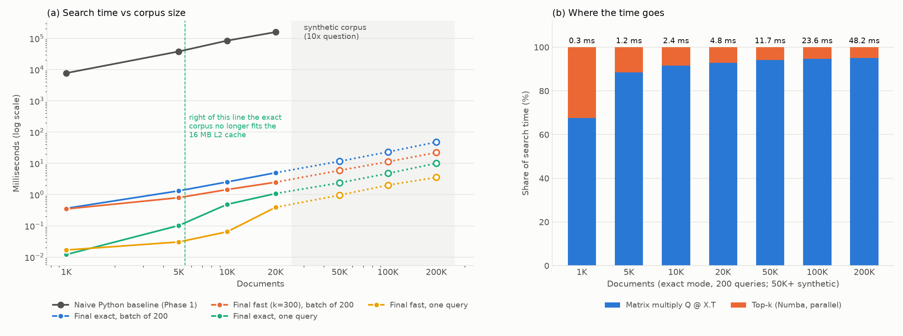
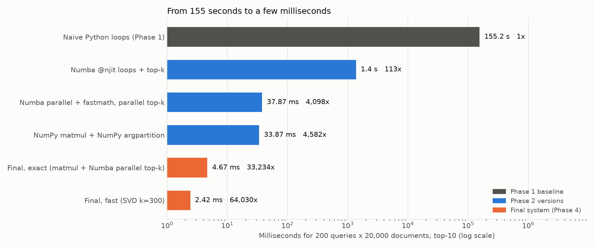

# Phase 4: Final Sistem ve Ölçeklenme

Önceki fazlardaki tüm kararları tek bir arama motorunda birleştirdik. Ardından doğruluğunu baseline'a karşı kontrol ettik, 1K'dan 20K'ya (ve sentetik olarak 200K'ya) kadar ölçeklenmesini ölçtük ve canlı bir demo hazırladık.

İlgili dosyalar: [`src/search_engine.py`](../src/search_engine.py) (final sistem), [`src/phase4_final.py`](../src/phase4_final.py) (deneyler), [`demo.py`](../demo.py) (canlı demo). Ham veri: `results/phase4_*.{csv,json}`.

## Özet

| Soru | Cevap |
|---|---|
| Final süre (200 query × 20K doküman) | **Tam mod 4,67 ms**, hızlı mod (SVD k=300) 2,42 ms |
| Naive baseline'a göre | Tam mod **33.200 kat**, hızlı mod 64.000 kat |
| Doğru mu? | **Evet.** 200 query'nin 200'ünde top-10 listesi baseline ile birebir aynı (sıra dahil). Skor farkı en fazla 8,4 × 10⁻⁷ (tolerans 10⁻⁵) |
| Doğrusal ölçekleniyor mu? | Toplu aramada **evet**: 5K'dan 200K'ya kadar 1.000 doküman başına ~250 µs |
| Nerede bozuluyor? | Tek query'de, corpus 16 MB'lık L2 önbelleğe sığmayınca (5K → 10K arası süre 4,8 kat artıyor). Bellekte de skor matrisi N ile büyüyor; parçalı arama bunu 10 kat azaltıyor |
| Canlı demo | Query başına ~18 ms vektöre çevirme + **0,9 ms arama** |

---

## 1. Final sistem: `search_engine.py`

```
veri → embedding (mpnet, offline) → [isteğe bağlı SVD] → skorlama (tek BLAS çarpımı) → paralel top-k
```

Her parçanın gerekçesi bir ölçüme dayanıyor:

| Karar | Kaynak |
|---|---|
| Dense mpnet vektörleri, kurulumda bir kez normalize: cosine = dot product, query başına norm hesabı yok | Phase 1: norm hesabı zamanın %58'iydi. Phase 2A: anlamsal kalite |
| Bir batch'teki tüm query'ler tek bir matris çarpımıyla (`Q @ X.T`) | Phase 2C: NumPy/BLAS en hızlısı. Phase 3: ek thread'ler matris birimini hızlandırmıyor |
| Top-k, kendi tek geçişli Numba kernel'imizle, query'ler üzerinde paralel | Phase 2C: NumPy argpartition'dan 98 kat hızlı |
| İsteğe bağlı hızlı mod: merkezlenmemiş SVD, 300 boyut, bizim blok power iteration ile | Phase 2B: recall@10 ≈ 0,95, PCA'dan iyi |
| İsteğe bağlı parçalı arama | Phase 3: 10 kat büyük corpus sorusu (bellek) |

```python
class SearchEngine:
    def __init__(self, corpus, mode="exact", dims=300, chunk_docs=None, svd_iters=6):
        ...
        X = normalise(corpus)
        self.P = None
        if mode == "fast":
            _, _, Vt = block_power_svd(X, dims, n_iter=svd_iters)
            self.P = np.ascontiguousarray(Vt.T)                 # 768 x dims, bir kez hesaplanır
            X = normalise(X @ self.P)
        self.X = np.ascontiguousarray(X, dtype=np.float32)

    def prepare(self, Q):
        Q = normalise(np.atleast_2d(Q))
        if self.P is not None:
            Q = normalise(Q @ self.P)
        return np.ascontiguousarray(Q)

    def search(self, Q, k=10):
        Q = self.prepare(Q)
        if self.chunk_docs is None:
            return topk(Q @ self.X.T, k)
        parts = []
        for a in range(0, self.X.shape[0], self.chunk_docs):
            idx, val = topk(Q @ self.X[a:a + self.chunk_docs].T, k)
            parts.append((idx + a, val))
        return K.merge_topk(parts, k)
```

Satır satır:
- **`normalise(corpus)`**: Her doküman vektörü bir kez, kurulumda birim uzunluğa getiriliyor. Böylece aramada cosine'in paydası her zaman 1 ve iş düz bir dot product'a iniyor. Phase 1'in en büyük bottleneck'i (%58) tamamen ortadan kalkıyor.
- **`block_power_svd(...)`** (hızlı mod): 300 boyutlu taban bir kez hesaplanıyor (20K'da 0,26 s). Corpus bu tabana izdüşürülüp tekrar normalize ediliyor.
- **`prepare(Q)`**: Query'ler de aynı uzaya getiriliyor. `np.atleast_2d` sayesinde tek bir query (768 sayılık vektör) de 200'lük bir batch de aynı koddan geçiyor.
- **`Q @ self.X.T`**: Tüm skorlar tek bir BLAS çağrısıyla. Query'leri batch halinde vermek önemli: Phase 2C'de 20 query 362 GFLOP/s, 200 query 1.415 GFLOP/s vermişti.
- **`topk(...)`**: 8 veya daha fazla query varsa paralel (`prange`), daha azsa tek thread'li kernel. Tek query'de thread başlatmanın maliyeti kazançtan büyük.
- **Parçalı arama**: corpus `chunk_docs`'luk dilimler halinde işleniyor ve her dilimden top-k alınıyor. Bellekte hiçbir zaman tüm skor matrisi tutulmuyor.

---

## 2. Doğruluk kontrolü

| Kontrol | Sonuç |
|---|---|
| Tam mod, 20K, **200 query**, Phase 1 naive referansına karşı | En büyük skor farkı **8,4 × 10⁻⁷**. Top-10 listeleri **%100 birebir aynı** (sıra dahil) |
| Tam mod, 1K / 5K / 10K / 20K, naive arama şimdi yeniden çalıştırılarak (20 query) | En büyük fark 7,3–8,0 × 10⁻⁷. Tüm boyutlarda listeler %100 aynı |
| Hızlı mod (k = 300), 20K | recall@10 = **0,954**. Tasarım gereği yaklaşık; 10⁻⁵ toleransı aranmıyor |
| Parçalı ve parçasız arama, 200K | Fark **0** (bit düzeyinde aynı) |

Kalan ~10⁻⁷'lik fark float32 aritmetiğinden geliyor: baseline Python'un float64 sayılarıyla, final sistem float32 ile hesaplıyor. Skorlar 10⁻⁵ toleransının 12 kat altında ve hiçbir sıralamayı değiştirmiyor.

Bu kontrolün düzeni Phase 2B'deki kararla örtüşüyor: **tam mod** baseline ile birebir eşleşen moddur. **Hızlı mod** ise bir hız-doğruluk takası; onun kalitesini 10⁻⁵ ile değil recall ile ölçüyoruz.

---

## 3. Ölçeklenme

### 3.1 Ölçüm düzeni
- **Gerçek corpus:** 1K, 5K, 10K, 20K doküman (karıştırılmış corpus'un ilk N satırı).
- **Sentetik uzantı:** 50K, 100K, 200K. Gerçek vektörlerden rastgele biri seçiliyor, %5 gürültü ekleniyor ve tekrar normalize ediliyor. **Sadece zaman ölçümü için**; doğruluk ve kalite sonuçları bu verilerden çıkarılmadı. Amaç "10 kat daha fazla veri olsaydı ne olurdu?" sorusunu tahminle değil ölçümle cevaplamak.
- İki kullanım şekli: **200 query'lik batch**, ve **tek query** (20 query'yi tek tek arayıp ortalaması).
- Her ölçüm 2 warmup + 5 ölçüm, median.

### 3.2 Sonuçlar (ms)

| Doküman | Naive (200 query) | Tam, batch 200 | Hızlı, batch 200 | Tam, tek query | Hızlı, tek query | Corpus (tam) |
|---:|---:|---:|---:|---:|---:|---:|
| 1.000 | 7.742 | 0,36 | 0,35 | 0,012 | 0,017 | 3 MB |
| 5.000 | 37.944 | 1,32 | 0,80 | 0,102 | 0,030 | 15 MB |
| 10.000 | 84.290 | 2,54 | 1,45 | **0,486** | 0,065 | 31 MB |
| 20.000 | 158.298 | **5,00** | **2,48** | 1,078 | 0,390 | 61 MB |
| 50.000 *(sentetik)* | — | 11,60 | 5,93 | 2,370 | 0,960 | 154 MB |
| 100.000 *(sentetik)* | — | 23,16 | 11,23 | 4,758 | 2,010 | 307 MB |
| 200.000 *(sentetik)* | — | 47,90 | 22,09 | 10,012 | 3,544 | 614 MB |

Zamanın dağılımı (tam mod, 200 query):

| Doküman | Matris çarpımı | Top-k | Top-k payı |
|---:|---:|---:|---:|
| 1.000 | 0,22 ms | 0,11 ms | %33 |
| 20.000 | 4,45 ms | 0,34 ms | %7 |
| 200.000 | 45,78 ms | 2,42 ms | %5 |



> **Figure 6:** (a) Final sistem toplu aramada doğrusal ölçekleniyor: 5K'dan 200K dokümana kadar 1.000 doküman başına ~250 µs (200 query), ve her boyutta naive baseline'dan 21.000–33.000 kat hızlı. Tek query de doğrusal ölçekleniyor; tek istisna, corpus'un 16 MB'lık L2 önbelleği aştığı 5K–10K arasındaki 4,8 katlık sıçrama. (b) Corpus büyüdükçe zamanın büyük kısmı matris çarpımına kayıyor (%67'den %95'e); top-k artık bir bottleneck değil.

### 3.3 Sistem doğrusal ölçekleniyor mu?

**Toplu aramada evet.** 1.000 doküman başına süre 5K'da 263 µs, 20K'da 250 µs, 200K'da 240 µs; neredeyse sabit. Sebebi, 200 query'lik matris çarpımının **hesap gücüyle sınırlı** olması: her doküman sayısı bellekten bir kez okunup 200 query için kullanılıyor. 200K'da matris çarpımı 1,34 TFLOP/s'de çalışıyor; Phase 2C'de ölçtüğümüz tepe değere (1,4 TFLOP/s) çok yakın. İş N ile doğrusal arttığı için süre de doğrusal artıyor.

1K'da doküman başına maliyet daha yüksek (363 µs). İş o kadar küçük ki top-k'nın thread başlatma maliyeti gibi sabit masraflar öne çıkıyor; top-k payının %33 olması da bunu gösteriyor.

**Tek query'de bir istisnayla evet.** Tek bir query için matris çarpımı bir matris-vektör çarpımına dönüşüyor. Corpus'taki her sayı bir kez okunup **tek bir** çarpmada kullanılıyor, dolayısıyla süreyi okuma hızı belirliyor:
- 5K'da corpus 15 MB ve L2 önbelleğe sığıyor: 15 MB / 0,10 ms ≈ **150 GB/s**.
- 10K'da corpus 31 MB ve ana bellekten okunmak zorunda: süre 2 katı değil **4,8 katı**.
- 20K'dan 200K'ya kadar yine doğrusal: 61 MB / 1,08 ms ≈ 57 GB/s, 614 MB / 10,0 ms ≈ 61 GB/s. Yani ana belleğin bant genişliği sınırında.

Hızlı mod (300 boyut) aynı sıçramayı daha geç yaşıyor: 10K'da corpus 12 MB ve hâlâ önbellekte (0,065 ms); 20K'da 24 MB ve önbellekten taşıyor (0,39 ms). Bu, boyut indirgemenin asıl değerini gösteriyor: **tek query'de 2,8 kat** (200K'da 10,0'a karşı 3,5 ms), çünkü bellekten okunacak veri 2,5 kat az.

### 3.4 Nerede bozuluyor?
1. **Önbellek sınırı (tek query):** Corpus L2'den taşınca tek query'nin doküman başına maliyeti ~5 katına çıkıyor (Bölüm 3.3).
2. **Skor matrisi belleği (batch):** 200 × N × 4 byte. 20K'da 16 MB, 200K'da 160 MB, 2 milyonda 1,6 GB. Parçalı arama bunu çözüyor:

   | 200K doküman, 200 query | Süre | Aramanın tepe belleği |
   |---|---:|---:|
   | Parçasız | 50,5 ms | 160,6 MB |
   | Parçalı (20K'lık dilimler) | 50,0 ms | **16,9 MB** |

   Aynı hız, aynı sonuç (fark 0), 10 kat az bellek.
3. **RAM (corpus):** 200K'da 614 MB (hızlı modda 240 MB), 2 milyonda 6,1 GB. 16 GB RAM'li bir laptop'ta işletim sistemi ve modelle birlikte sınıra yaklaşılır.

### 3.5 10 kat daha fazla veriyle ne yapardık?
**10 kat (200K): mevcut sistem yetiyor.** Sentetik ölçüm: tam modda 200 query 48 ms, tek query 10 ms; hızlı modda 22 ms ve 3,5 ms. Etkileşimli kullanım için hâlâ çok hızlı. Yapacağımız tek değişiklik, belleği sınırlamak için parçalı aramayı açmak.

**100 kat (2 milyon) ve ötesi:**
- **Hızlı mod (SVD)** varsayılan olur: 6,1 GB yerine 2,4 GB, ve tek query'de bant genişliği kazancı.
- Corpus RAM'e sığmazsa diskteki memmap'ten **parça parça okuma** (Dask ya da kendi parça döngümüz). Kodumuz bunu zaten parça bazında yapıyor.
- Tek makine yetmezse corpus'u makinelere bölüp her birinde top-k almak ve sonuçları birleştirmek (Ray). Bizim `merge_topk` adımımız tam olarak bu birleştirme.
- Tam aramanın maliyeti N ile doğrusal. Milyonlarca dokümanda doğrusalın altında ölçeklenen **yaklaşık en yakın komşu** yöntemleri (HNSW, IVF) gerekir. Bedeli biraz recall kaybı; bu ödevde bir bonus maddesi olarak listeleniyor.

---

## 4. Genel karşılaştırma: tüm versiyonlar

Aynı görev: 200 query × 20.000 doküman, top-10. Hepsi aynı çalıştırmada, aynı koşullarda ölçüldü.

| Versiyon | Faz | Süre | Naive'e göre | Baseline'dan sapma |
|---|:-:|---:|---:|---:|
| Naive Python döngüleri | 1 | 155,2 s* | 1× | 0 |
| Numba `@njit` döngüleri + top-k | 2 | 1,376 s | 113× | 1,1 × 10⁻⁷ |
| Numba parallel + fastmath, paralel top-k | 2 | 37,9 ms | 4.098× | 1,4 × 10⁻⁷ |
| NumPy matris çarpımı + NumPy argpartition | 2 | 33,9 ms | 4.582× | 8,0 × 10⁻⁷ |
| **Final, tam** (matris çarpımı + Numba paralel top-k) | 4 | **4,67 ms** | **33.234×** | 8,4 × 10⁻⁷ |
| Final, hızlı (SVD k = 300) | 4 | 2,42 ms | 64.030× | yaklaşık (recall 0,95) |

\* 5 query ölçüldü ve 40 ile çarpıldı (süre query sayısıyla doğrusal; Phase 1). Phase 1'deki 20 query'lik ölçüm 158,3 s vermişti.



> **Figure 7:** Aynı görevde performans hikayesinin her adımı: döngüleri derlemek 113 kat, SIMD ve 10 çekirdek 4.100 kat, BLAS 4.600 kat kazandırıyor. Ardından ortaya çıkan yeni bottleneck'i (top-k) kendi Numba kernel'imizle çözmek, baseline ile birebir aynı sonuçlarla 33.000 kata çıkarıyor. SVD'li hızlı mod, recall@10 = 0,95 karşılığında 64.000 kata ulaşıyor.

Hikaye Amdahl Yasası'nın iki kez işlediğini gösteriyor:
- Phase 1'de zamanın %99,6'sı skorlamadaydı; sort %0,3'tü. Skorlamayı BLAS ile çözünce (33,9 ms) zamanın %87'si top-k'ya kaydı.
- Top-k'yı Numba ile çözünce (4,67 ms) darboğaz tekrar matris çarpımına döndü: artık zamanın %93'ü orada. Matris çarpımı da donanımın tepe hızına yakın çalışıyor.

---

## 5. Canlı demo: `demo.py`

```bash
.venv/bin/python demo.py                      # interaktif, tam mod
.venv/bin/python demo.py --fast               # SVD k=300
.venv/bin/python demo.py --query "your text"  # tek query
```

Örnek çıktı:

```
Ready: 20,000 arXiv abstracts (2025-26), mode = exact, model on cpu, loaded in 3.0 s

"efficient attention for long context language models"
  encode 19.5 ms | search 0.92 ms over 20,000 documents
  1. [0.782] Cost-Optimal Grouped-Query Attention for Long-Context Modeling
       arXiv:2503.09579  cs.CL  2025-03-12
  2. [0.756] SEAL: Scaling to Emphasize Attention for Long-Context Retrieval
       arXiv:2501.15225  cs.CL  2025-01-25
  ...
```

Tasarım notları:
- **Her şey yerel:** Model HuggingFace'in yerel önbelleğinden, internete bağlanmadan yükleniyor (`HF_HUB_OFFLINE=1`). Sınıfta bağlantı sorunu demoyu etkilemez.
- **Warmup:** Açılışta iki deneme araması yapılıyor; model ve Numba kernel'leri ilk kullanıcı query'sinden önce hazır oluyor.
- **İki süre ayrı gösteriliyor:** cümleyi vektöre çevirme (~18 ms, embedding modeli) ve arama (~0,9 ms). FAQ'ya göre embedding süresi benchmark'a dahil değil, ama demoda dürüstçe ikisini de gösteriyoruz. Kullanıcının beklediği sürenin %95'i modelde.
- **Model CPU'da:** Apple GPU'sunda (MPS) her yeni cümle uzunluğu için yeniden derleme oluyor ve bir query 280–430 ms sürüyordu. CPU ise sabit 17–22 ms veriyor; canlı demoda öngörülebilirlik daha önemli.

---

## 6. Yeniden üretmek için

```bash
.venv/bin/python src/phase4_final.py              # ~4 dk: doğruluk + ölçeklenme + genel karşılaştırma
.venv/bin/python src/phase4_final.py --plot-only  # sadece Figure 6 ve 7
```

---

## 7. Sunumda gelebilecek sorular

- **Final sistem baseline ile nasıl aynı sonucu veriyor?** Aynı cosine'i hesaplıyor: normalize edilmiş vektörlerin dot product'ı. Farklar float32 yuvarlamasından (≤ 8,4 × 10⁻⁷) ve hiçbir sıralamayı değiştirmiyor; 200 query'nin hepsinde top-10 listesi birebir aynı.
- **Neden iki mod var?** Tam mod baseline ile birebir eşleşiyor (ödevin doğruluk şartı). Hızlı mod %5 recall karşılığında 2 kat hız ve 2,5 kat az bellek sunuyor.
- **Sistem doğrusal mı?** Toplu aramada evet (~250 µs / 1.000 doküman), çünkü matris çarpımı hesap gücüyle sınırlı. Tek query'de de, corpus'un L2 önbelleği aştığı nokta dışında.
- **5K'dan 10K'ya tek query neden 4,8 kat yavaşladı?** 5K'da corpus (15 MB) 16 MB'lık L2'ye sığıyor; 10K'da (31 MB) sığmıyor ve her query ana bellekten okunuyor.
- **Batch neden tek query'den bu kadar verimli?** Bellekten okunan her sayı 200 query için kullanılıyor (hesap sınırlı). Tek query'de her sayı bir kez kullanılıyor (bant genişliği sınırlı).
- **Sentetik veri neden kullanıldı?** Sadece 10 kat büyük bir corpus'ta zamanın nasıl davrandığını ölçmek için. Doğruluk ve kalite sonuçları yalnızca gerçek veriden.
- **Parçalı arama neden aynı hızda?** Matris çarpımının toplam işi aynı; sadece skorlar parça parça üretilip hemen top-k'ya indiriliyor. Kazanç bellekte: 160 MB yerine 17 MB.
- **10 kat veri gelse ne yapardınız?** Mevcut sistem 200K'da 48 ms (batch), 10 ms (tek query) veriyor; parçalı aramayı açmak yeterli. 100 katta hızlı mod, diskten parça parça okuma, makineler arası bölme ve yaklaşık en yakın komşu (HNSW).
- **Demoda zamanın çoğu nereye gidiyor?** Cümleyi vektöre çevirmeye (~18 ms). Arama ~0,9 ms.
