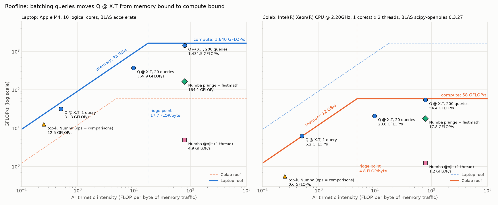
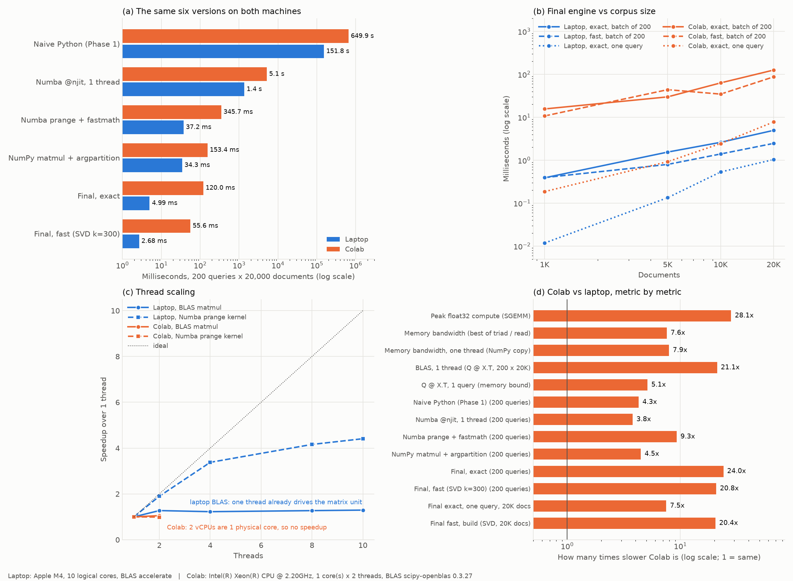

# Bonus: Laptop ile Colab Karşılaştırması ve Roofline Modeli

Ödevin bonus listesindeki iki madde bu belgede:

1. **Laptop + Colab karşılaştırması:** aynı kod, aynı veri ve aynı ölçüm kurallarıyla iki farklı makinede.
2. **Roofline modeli:** her makinenin hesap ve bellek tavanları ile çekirdeklerimizin bu tavanlara göre yeri.

Listedeki diğer iki bonus maddesi zaten projede vardı: 3'ten fazla paralellik stratejisi (Phase 3'te 7 strateji) ve Dask ile Ray karşılaştırması (Phase 3).

İlgili dosyalar:
- [`src/machine_bench.py`](../src/machine_bench.py): ölçüm script'i, iki makinede aynı.
- [`src/machine_compare.py`](../src/machine_compare.py): tablo ve grafikleri üretir.
- [`notebooks/colab_machine_bench.ipynb`](../notebooks/colab_machine_bench.ipynb): Colab'da çalıştırılan notebook.

Ham veri `results/machine_laptop.json`, `results/machine_colab.json` ve `results/machine_comparison.csv` dosyalarında; grafikler `figures/fig8_machines.png` ve `figures/fig9_roofline.png`.

## Özet

| Soru | Cevap |
|---|---|
| Colab ne kadar yavaş? | Ne ölçtüğüne göre **3,8 ile 28 kat arası**. Tek çekirdekte skaler kod ~4 kat, bellek hızı ~7,6 kat, matris çarpımı 21–28 kat yavaş |
| Final sistem Colab'da | Tam mod 200 query'de **120 ms** (laptop 4,99 ms, **24 kat**). Tek query 7,8 ms, yani hâlâ etkileşimli |
| Optimizasyon sırası değişiyor mu? | **Hayır.** Altı sürüm iki makinede de aynı sırada hızlanıyor. Colab'da naive'e göre tam mod 5.400 kat, hızlı mod 11.700 kat |
| Darboğaz değişiyor mu? | **Evet.** Laptop'ta matris çarpımı çok hızlı olduğu için top-k darboğaz (NumPy sürümünde zamanın %87'si). Colab'da matris çarpımı darboğaz (%72); bizim top-k kernel'imiz orada sadece 1,28 kat kazandırıyor |
| Colab'ın "2 çekirdeği" | **1 fiziksel çekirdek, 2 hyperthread.** BLAS 1,05 kat, process pool 1,04 kat hızlanıyor; paralellik neredeyse hiçbir şey kazandırmıyor |
| Roofline ne gösteriyor? | Tek query bellek sınırında, 200 query hesap sınırında: laptop'ta tepe hızın %87'si, Colab'da %93'ü. Ridge noktası laptop'ta 17,7, Colab'da 4,8 FLOP/byte |
| Batch eşiği | Hesap sınırına geçmek için laptop'ta **~38**, Colab'da **~10** query'lik batch gerekiyor |
| Sonuçlar taşınabilir mi? | **Evet.** İki makinede de 200 query'nin 200'ünde top-10 listesi Phase 1 ile birebir aynı; hızlı modun recall@10 değeri ikisinde de 0,9535 |

---

## 1. Yöntem: aynı kod, aynı veri, aynı kurallar

Karşılaştırmanın adil olması için iki makinede **tamamen aynı** şey çalışıyor:

- **Aynı kod:** `src/` klasörünün tamamı. Projedeki kernel'ler (`kernels.py`), final motor (`search_engine.py`) ve ölçüm kuralları (`benchmark_utils.py`: warmup + en az 5 tekrar + medyan).
- **Aynı veri:** laptop'ta üretilmiş mpnet embedding'leri (20.000 × 768 corpus, 200 × 768 query) ve Phase 1'in top-10 referans sonuçları.
- **Aynı script:** `machine_bench.py`. Laptop'ta yaklaşık 1 dakika, Colab'da yaklaşık 5 dakika sürdü.

Embedding'ler laptop'ta bir kez üretildiği için Colab'da modeli yeniden çalıştırmak gerekmiyor. Böylece iki makinenin vektörleri bit düzeyinde aynı olur. Kod ve veri `colab_pack.zip` dosyasında (55 MB; `--pack` ile üretilir, git'e girmez) Google Drive üzerinden Colab'a taşınıyor.

`machine_bench.py` altı şey ölçüyor:

| # | Bölüm | Ne ölçülüyor |
|---|---|---|
| 1 | `env` | CPU modeli, fiziksel ve mantıksal çekirdek sayısı, önbellekler, RAM, BLAS kütüphanesi, sürümler |
| 2 | `roofs` | Tepe hesap hızı (büyük SGEMM) ve bellek bant genişliği (STREAM tarzı kernel'ler) |
| 3 | `kernels` | `Q @ X.T` (1, 20 ve 200 query), Numba kernel'lerimiz ve iki top-k sürümü: roofline grafiğindeki noktalar |
| 4 | `overview` | Phase 4'teki altı sürüm (200 query × 20.000 doküman) |
| 5 | `engine` | Final motor; 1K–20K doküman, tam ve hızlı mod; Phase 1 referansına karşı doğruluk |
| 6 | `threads` | BLAS thread'leri, Numba thread'leri, saf Python'da thread pool ile process pool (GIL) |

Taşınabilirlik için iki ayrıntı:

- **BLAS thread sayısı:** Her BLAS kütüphanesi thread limitini NumPy yüklenirken bir kez okur. Laptop Accelerate'in `VECLIB_MAXIMUM_THREADS`, Colab OpenBLAS'ın `OPENBLAS_NUM_THREADS` değişkenini kullanıyor. Script her thread sayısı için dört değişkeni de ayarlayıp **ayrı bir alt process** başlatıyor (`--blas-probe`).
- **Process pool:** İki makinede de `spawn` kullanılıyor. Linux'un varsayılanı `fork`; Numba thread'leri çalışan bir process'i fork'lamak kilitlenmeye yol açabilir.

## 2. İki makine

| | Laptop | Colab (ücretsiz CPU runtime) |
|---|---|---|
| CPU | Apple M4 | Intel Xeon @ 2,20 GHz |
| Çekirdek | 10 fiziksel (4 performans + 6 verimlilik), çekirdek başına 1 thread | **1 fiziksel çekirdek × 2 thread** (hyperthreading) = 2 vCPU |
| SIMD | NEON 128-bit + SME matris birimi | AVX2 256-bit + FMA (AVX-512 yok) |
| Önbellek | L1d 128 KB (P-çekirdek), L2 16 MB (P-çekirdekler ortak) | L1d 32 KiB, L2 256 KiB, L3 55 MiB (sunucudaki diğer sanal makinelerle ortak) |
| RAM | 16 GB | 12,7 GB |
| BLAS | Apple Accelerate | OpenBLAS 0.3.27 (scipy-openblas) |
| Yazılım | Python 3.13.7, NumPy 2.5.4, Numba 0.68.1 | Python 3.13.18, NumPy 2.1.3, Numba 0.61.2 |

Ödevin notu doğru çıktı: Colab'ın "2 çekirdeği" aslında **tek fiziksel çekirdeğin iki hyperthread'i**. İki thread aynı çekirdeğin toplama, çarpma ve FMA birimlerini paylaşıyor. Hesap ağırlıklı işte ikinci thread neredeyse hiçbir şey kazandırmıyor (bölüm 6).

## 3. Roofline modeli nedir?

Roofline modeli bir kernel için tek soruyu cevaplar: **bu kod neden daha hızlı değil, hesap birimlerini mi bekliyor yoksa belleği mi?**

İki tavan var:

- **Hesap tavanı (compute roof):** Makinenin saniyede yapabileceği en fazla kayan nokta işlemi (GFLOP/s). Büyük bir float32 matris çarpımıyla (SGEMM, n = 2048 ve 4096) ölçtük ve büyük olanı aldık.
- **Bellek tavanı (memory roof):** Bellekten saniyede okunabilen en fazla byte (GB/s). STREAM tarzı iki Numba kernel'iyle, 2²⁶ float32 elemanlı (256 MB, önbelleğe sığmayan) dizilerde ölçtük:
  - *triad* `a[i] = b[i] + s * c[i]` (eleman başına 12 byte),
  - *read* `toplam += b[i]` (eleman başına 4 byte).

  Büyük olanı bant genişliği olarak aldık.

Bir kernel'in yeri **aritmetik yoğunluğu (arithmetic intensity, AI)** ile belirlenir:

```
AI = işlem sayısı (FLOP) / bellek trafiği (byte)
ulaşılabilir hız = min( hesap tavanı , bant genişliği × AI )
```

İki tavanın kesiştiği yer **ridge noktası**dır: `ridge = tepe hız / bant genişliği`. AI bu noktanın solundaysa kernel bellek sınırlıdır (*memory bound*): ne kadar hızlı hesaplarsan hesapla veri gelmeden iş bitmez. Sağındaysa hesap sınırlıdır (*compute bound*).

**`Q @ X.T` için AI.** q query, N doküman, D = 768 boyut:

```
FLOP   = 2 · q · N · D                       (her çarpım + toplama = 2 işlem)
byte   = 4 · (q·D + N·D + q·N)               (Q ve X'i bir kez oku, S'yi bir kez yaz; float32 = 4 byte)
AI(q)  = 2qND / 4(qD + ND + qN)  ≈  384·q / (768 + 1,04·q)     (N = 20.000)
```

Bu "zorunlu trafik" (compulsory traffic), yani her verinin bellekten tam bir kez geçtiği en iyi durum. Sayısal örnekler:
- q = 1: AI = 0,5 FLOP/byte. Tek query için 61 MB'lık corpus'un tamamı okunuyor ama her eleman sadece 1 çarpma ve 1 toplamada kullanılıyor.
- q = 200: AI = 78,7 FLOP/byte. Okunan her doküman vektörü 200 query için yeniden kullanılıyor.

**Batching işte bu yüzden işe yarıyor:** aynı veri trafiğiyle daha çok iş yapılıyor.

Top-k için "işlem" olarak karşılaştırmaları saydık: her skor bir kez okunuyor (4 byte) ve bir kez karşılaştırılıyor (AI = 0,25).

## 4. Roofline sonuçları



| | Laptop | Colab | Oran |
|---|---:|---:|---:|
| Tepe hesap (SGEMM) | 1.640 GFLOP/s | 58,3 GFLOP/s | 28 kat |
| Bant genişliği (triad / read içinden en iyisi) | 92,5 GB/s | 12,2 GB/s | 7,6 kat |
| Ridge noktası | **17,7 FLOP/byte** | **4,8 FLOP/byte** | |

Colab için kabaca bir kontrol: 2,2 GHz × 32 FLOP/çevrim (iki FMA birimi × 8 float32 × 2 işlem) ≈ 70 GFLOP/s. Ölçülen 58,3 GFLOP/s bunun %83'ü, yani makul. Laptop'un 1.640 GFLOP/s değeri ise CPU çekirdeklerinden değil Accelerate'in kullandığı **SME matris biriminden** geliyor (README'de anlatıldı).

Kernel'ler, tavana göre yüzdeleriyle:

| Kernel | AI | Laptop GFLOP/s | Tavanın % | Colab GFLOP/s | Tavanın % |
|---|---:|---:|---:|---:|---:|
| `Q @ X.T`, 1 query | 0,50 | 31,8 | 69 (bellek) | 6,2 | ~100 (bellek) |
| `Q @ X.T`, 20 query | 9,74 | 369,9 | 41 (**bellek**) | 20,8 | 36 (**hesap**) |
| `Q @ X.T`, 200 query | 78,7 | 1.431,5 | **87** (hesap) | 54,4 | **93** (hesap) |
| Numba `@njit` (1 thread) | 78,7 | 4,9 | 0,3 | 1,2 | 2,1 |
| Numba `prange` + fastmath | 78,7 | 164,1 | 10 | 17,8 | 30 |
| Top-k, Numba paralel | 0,25 | 12,5 | 54 (bellek) | 0,55 | 18 (bellek) |

Grafikten çıkan dört sonuç:

**1. Batching kernel'i bellek sınırından hesap sınırına taşıyor.** Tek query'de iki makine de bellek tavanına yapışık:
- Colab 12,4 GB/s ile tavanın tam üstünde. Corpus'un bir kısmı L3'te kaldığı için ölçülen bant genişliğini biraz geçiyor.
- Laptop 63,7 GB/s ile tavanın %69'unda.

200 query'de ikisi de hesap tavanına çok yakın (%87 ve %93). Phase 4'te "batch" yaptığımızda neden 200 kat değil sadece ~5 kat yavaşladığımız buradan anlaşılıyor: bellekten okunan veri aynı, sadece hesap artıyor.

**2. Aynı kernel, makineye göre farklı tarafta.** 20 query'lik çarpım (AI = 9,7):
- Laptop'ta ridge'in solunda, yani **bellek sınırlı**.
- Colab'da ridge'in sağında, yani **hesap sınırlı**.

Laptop'un matris birimi o kadar hızlı ki, belleği "yetiştirmek" için çok daha fazla yeniden kullanım gerekiyor. `AI(q) = ridge` denklemi çözülünce hesap sınırına geçmek için gereken batch büyüklüğü çıkıyor:

```
laptop:  384q / (768 + 1,04q) = 17,7   →   q ≈ 38 query
Colab:   384q / (768 + 1,04q) = 4,8    →   q ≈ 10 query
```

Pratik anlamı: güçlü donanımın tepe hızına ulaşmak için **daha büyük batch** gerekiyor.

**3. Elle yazılmış döngüler tavanın çok altında.** Numba `@njit`:
- Laptop'ta tepe hızın %0,3'ü, Colab'da %2'si.
- Aynı AI'da BLAS %87–93'e ulaşıyor.

Aradaki fark bellekten değil, BLAS'ın kullandığı tekniklerden geliyor: blok (tile) halinde önbellek kullanımı, register blocking, SIMD ve laptop'ta matris birimi. `prange` + fastmath bu farkın bir kısmını kapatıyor (laptop %10, Colab %30). Colab'da oranın daha yüksek olmasının iki nedeni var:
- Tavan alçak, çünkü matris birimi yok.
- AVX2 vektörleri NEON'dan iki kat geniş (8 float32'ye karşı 4).

**4. Top-k bellek sınırlı, ama Colab'da tavandan uzak.**
- Laptop'ta 10 çekirdekle bellek tavanının %54'ü.
- Colab'da tek çekirdek, dallanmalı karşılaştırma döngüsü belleği doyuramıyor (%18).

## 5. Altı sürüm iki makinede



| Sürüm (200 query × 20K doküman) | Laptop | Colab | Colab yavaşlığı | Laptop'ta naive'e göre (bu çalıştırma) | Colab'da naive'e göre |
|---|---:|---:|---:|---:|---:|
| Naive Python döngüleri (Phase 1) | 151,8 s | 649,9 s | 4,3 kat | 1 | 1 |
| Numba `@njit` döngüler + top-k | 1,36 s | 5,15 s | 3,8 kat | 112 | 126 |
| Numba paralel + fastmath | 37,2 ms | 345,7 ms | 9,3 kat | 4.079 | 1.880 |
| NumPy matmul + argpartition | 34,3 ms | 153,4 ms | 4,5 kat | 4.428 | 4.236 |
| **Final, tam** (matmul + Numba top-k) | **4,99 ms** | **120,0 ms** | 24 kat | **30.400** | **5.417** |
| Final, hızlı (SVD k = 300) | 2,68 ms | 55,6 ms | 20,8 kat | 56.700 | 11.700 |

Naive süre 4 query ölçülüp 200'e ölçeklendi (iki makinede de aynı şekilde).

### Neden yavaşlık 3,8 ile 28 kat arasında değişiyor?

Her satır makinenin **farklı bir parçasını** kullanıyor:

| Kodun kullandığı donanım | Örnek | Colab kaç kat yavaş |
|---|---|---:|
| Tek çekirdek, skaler kod | Naive Python, Numba `@njit` | 3,8–4,3 |
| Bellek bant genişliği | Tek query `Q @ X.T`, STREAM | 5,1–7,9 |
| Çok çekirdek + SIMD | Numba `prange` + fastmath | 9,3 |
| Matris birimi (BLAS) | SGEMM, 1 thread BLAS, final sistem, SVD kurulumu | 20–28 |

- **Tek çekirdek (~4 kat):** Laptop'un bir performans çekirdeği yaklaşık iki kat yüksek saat hızında çalışıyor (~4,4 GHz'e karşı 2,2 GHz) ve çevrim başına daha çok komut işliyor. Python yorumlayıcısı ve `@njit` döngüleri sadece bunu kullanıyor.
- **Bellek (~5–8 kat):** Laptop'un birleşik belleği (unified memory) sunucu sanal makinesine ayrılan bant genişliğinden çok daha geniş.
- **Matris birimi (~20–28 kat):** Laptop'ta tek BLAS thread'i 1.112 GFLOP/s, Colab'da 52,6 GFLOP/s (21 kat). Fark çekirdek sayısından değil, Colab'da olmayan SME matris biriminden geliyor.

**Final sistemin farkı en büyük (24 kat), çünkü onu laptop'un en güçlü birimini kullanacak şekilde tasarladık.** Bu bir çelişki değil: optimizasyon her iki makinede de hızlandırıyor (Colab'da 5.400 kat). Ama kazancın büyüklüğü donanıma bağlı.

### Darboğaz makineye göre yer değiştiriyor (Amdahl)

"NumPy matmul + argpartition" sürümünün zamanı iki parçadan oluşuyor:

| | Laptop | Colab |
|---|---:|---:|
| `Q @ X.T` (200 query) | 4,3 ms (**%13**) | 112,8 ms (**%72**) |
| `np.argpartition` top-k | 28,8 ms (**%87**) | 43,5 ms (**%28**) |
| Bizim Numba top-k'mız | 0,32 ms | 7,2 ms |
| **Numba top-k ile kazanç** | 34,3 → 4,99 ms = **6,9 kat** | 153,4 → 120,0 ms = **1,28 kat** |

Laptop'ta matris çarpımı o kadar hızlı ki, kalan zamanın neredeyse tamamı top-k. Top-k'yı hızlandırmak büyük kazanç getiriyor.

Colab'da ise matris çarpımı zamanın büyük kısmını alıyor. Amdahl yasasına göre top-k'yı sonsuz hızlandırsak bile en fazla `1 / (1 − 0,28) ≈ 1,39 kat` kazanabilirdik; 1,28 kat aldık.

**Ders:** "Neyi optimize etmeli?" sorusunun cevabı makineye bağlı. Profilleme her hedef makinede yeniden yapılmalı.

**Hızlı mod (SVD) Colab'da daha çok kazandırıyor:** laptop'ta 1,86 kat, Colab'da 2,16 kat. Boyutu 768'den 300'e indirmek işlem sayısını 2,56 kat azaltıyor. Colab'da çarpım hesap sınırlı olduğu için bu azalma süreye daha doğrudan yansıyor.

## 6. Thread'ler ve hyperthreading

| Test | Laptop (10 çekirdek) | Colab (1 çekirdek × 2 thread) |
|---|---|---|
| BLAS `Q @ X.T`, 1 thread → tümü | 1.112 → 1.412 GFLOP/s (**1,27 kat**) | 52,6 → 55,4 GFLOP/s (**1,05 kat**) |
| Numba `prange` + top-k, 1 thread → tümü | 161,7 → 36,7 ms (**4,41 kat**) | 511 → 517 ms (**0,99 kat**), bkz. not |
| Saf Python, thread pool | 0,754 → 0,754 s (**1,00 kat**) | 2,79 → 2,99 s (**0,93 kat**) |
| Saf Python, process pool | 0,754 → 0,158 s (**4,76 kat**) | 2,79 → 2,67 s (**1,04 kat**) |

- **Colab'da paralellik neredeyse işe yaramıyor.** İki thread aynı fiziksel çekirdeğin FMA birimlerini paylaşıyor. Hesap ağırlıklı işte ikinci thread'in kullanacağı boş birim kalmıyor: BLAS 1,05 kat, process pool 1,04 kat.
- **GIL iki makinede de aynı davranıyor:** saf Python'da thread pool hiç hızlanmıyor (1,00 kat ve 0,93 kat). Colab'da thread yönetiminin ek maliyeti yüzünden biraz yavaşlıyor bile. Process pool laptop'ta 10 çekirdekle 4,76 kat hızlanıyor (Phase 3 ile uyumlu), Colab'da hızlanacak ikinci çekirdek yok.
- **Laptop'ta BLAS thread'leri de az kazandırıyor (1,27 kat)**, ama başka bir nedenle: tek thread zaten matris birimini sürüyor (README ve Phase 3).

**Not (ölçüm gürültüsü):** Colab'da Numba için iki ölçüm çelişiyor.
- Thread bölümünde 2 thread 517 ms sürdü.
- Kernel bölümünde aynı kernel varsayılan 2 thread ile 346 ms sürdü; overview'da da 345,7 ms.

İkincisi doğruysa hyperthreading bu kernel'de 511 / 346 ≈ 1,5 kat kazandırıyor. Doğru değer 1,0 ile 1,5 kat arasında; her iki durumda da laptop'un 4,4 katının çok altında. Colab paylaşımlı bir sanal makine olduğu için komşu sanal makinelerin yükü ölçümü etkileyebiliyor (bölüm 8).

## 7. Ölçeklenme: final motor, 1K → 20K doküman

| Doküman | Corpus boyutu | Laptop tam, batch 200 | Colab tam, batch 200 | Laptop tam, tek query | Colab tam, tek query |
|---:|---:|---:|---:|---:|---:|
| 1.000 | 3 MB | 0,39 ms | 15,6 ms | 0,012 ms | 0,19 ms |
| 5.000 | 15 MB | 1,55 ms | 29,8 ms | 0,134 ms | 0,92 ms |
| 10.000 | 31 MB | 2,61 ms | 63,2 ms | 0,532 ms | 2,45 ms |
| 20.000 | 61 MB | 4,96 ms | 125,8 ms | 1,035 ms | 7,77 ms |

- **Batch aramada** iki makine de 5K'dan sonra doğrusal: laptop 1.000 doküman başına ~0,25 ms, Colab ~6,3 ms.
- **Tek query'de** iki makinede de bir önbellek sınırına çarpma etkisi var:
  - Laptop'ta corpus 16 MB'lık L2'yi aştığında (5K → 10K) süre 2 kat yerine 4 kat artıyor (Phase 4'teki bulgu).
  - Colab'da 10K → 20K arasında süre 3,2 kat artıyor; 61 MB'lık corpus 55 MiB'lık L3'e artık sığmıyor.
  - Colab'ın L3'ü sunucudaki diğer sanal makinelerle paylaşıldığı için 5K → 10K arasında da 2,65 kat görülüyor. Bu sınır laptop'taki kadar keskin değil.

## 8. Doğruluk taşınabilir mi?

| | Laptop | Colab |
|---|---:|---:|
| Tam mod: Phase 1 ile aynı top-10 listeleri (sıra dahil) | 200 / 200 | 200 / 200 |
| Tam mod: en büyük skor farkı | 8,4 × 10⁻⁷ | 3,4 × 10⁻⁷ |
| Hızlı mod: recall@10 | 0,9535 | 0,9535 |

İki makinede şunlar tamamen farklı:
- işlemci mimarisi: ARM'a karşı x86;
- BLAS kütüphanesi: Accelerate'e karşı OpenBLAS;
- toplama sırası, dolayısıyla float32 yuvarlama hataları.

Buna rağmen sonuçlar aynı: skor farkları 10⁻⁶'nın altında, 10⁻⁵ toleransın çok içinde, ve sıralamayı değiştirmiyor. SVD'nin rastgele başlangıcı sabit bir seed ile verildiği için hızlı modun recall değeri bile birebir aynı.

## 9. Sınırlar ve gürültü

- **Colab paylaşımlı bir sanal makine.** Aynı fiziksel sunucuda başka kullanıcılar da çalışıyor. Bazı Colab ölçümlerinde standart sapma medyanın %15–30'u (örneğin 200 query'lik çarpımda 32,7 ms / 112,8 ms). Laptop'ta bu oran genelde birkaç yüzde. Göze çarpan örnekler:
  - SVD kurulumu 5K dokümanda 5,6 s, 10K dokümanda 2,6 s sürdü (büyük corpus daha hızlı);
  - 20K'da hızlı modun tek query süresi (7,6 ms) tam moda (7,8 ms) eşit çıktı, oysa 10K'da 2,9 kat hızlıydı;
  - bölüm 6'daki Numba thread ölçümü.
- **Tek oturum.** Colab her oturumda farklı bir CPU modeli verebilir. Sonuçlar bir Colab oturumunu (31 Ekim 2026) temsil ediyor.
- **Yazılım sürümleri farklı.** NumPy, Numba ve Python sürümleri iki makinede aynı değil. Bunları sabitlemek yerine her ortamın kendi hazır kurulumunu kullandık; ödevin sorusu "senin laptop'un ile Colab'ın farkı" olduğu için bu bilinçli bir seçim.
- **Sonuçların yorumu bu gürültüden etkilenmiyor:** 4 ile 28 kat arasındaki farklar ve "Colab'da paralellik yok" sonucu, gürültünün çok üstünde.

## 10. Dersler

1. **"Bir makine ne kadar hızlı?" sorusunun tek cevabı yok.** Colab, koda göre 4 kat da 28 kat da yavaş olabiliyor. Doğru soru: "Bu kod makinenin hangi kaynağını kullanıyor?" Roofline bu soruyu cevaplıyor.
2. **Batching aritmetik yoğunluğu artırır.** Tek query her iki makinede de bellek hızına takılıyor, 200 query tepe hızın %87–93'üne çıkıyor. Hesap sınırına geçmek için gereken batch, güçlü makinede daha büyük (38'e karşı 10).
3. **Darboğaz donanıma göre değişir.** Laptop'ta top-k optimizasyonu 6,9 kat kazandırdı, Colab'da 1,28 kat. Profilleme hedef makinede yapılmalı.
4. **Çekirdek sayısını değil, fiziksel çekirdeği say.** Colab'ın 2 vCPU'su tek çekirdek; paralel stratejilerin hiçbiri orada anlamlı kazanç getirmiyor.
5. **Doğruluk donanımdan bağımsız.** Farklı mimari ve BLAS ile aynı top-10 listeleri. Optimizasyonlar sonuçları bozmadı.

## Tekrar üretmek

```bash
# laptop (~1 dakika)
.venv/bin/python src/machine_bench.py --name laptop

# Colab için paket: kod + embedding'ler + Phase 1 referansı -> colab_pack.zip (55 MB, gitignored)
.venv/bin/python src/machine_bench.py --pack
```

Colab'da:
1. `colab_pack.zip` dosyasını Google Drive'da `MyDrive/hpp_colab/` klasörüne yükle.
2. `notebooks/colab_machine_bench.ipynb` dosyasını Colab'da aç (*File → Upload notebook*).
3. *Runtime → Change runtime type → CPU* seç.
4. *Run all* yap. Yaklaşık 5 dakika sürer ve sonunda `machine_colab.json` dosyası iner.
5. Bu dosyayı `results/` klasörüne koy.

```bash
# karşılaştırma tablosu + Figure 8 ve 9
.venv/bin/python src/machine_compare.py
```
